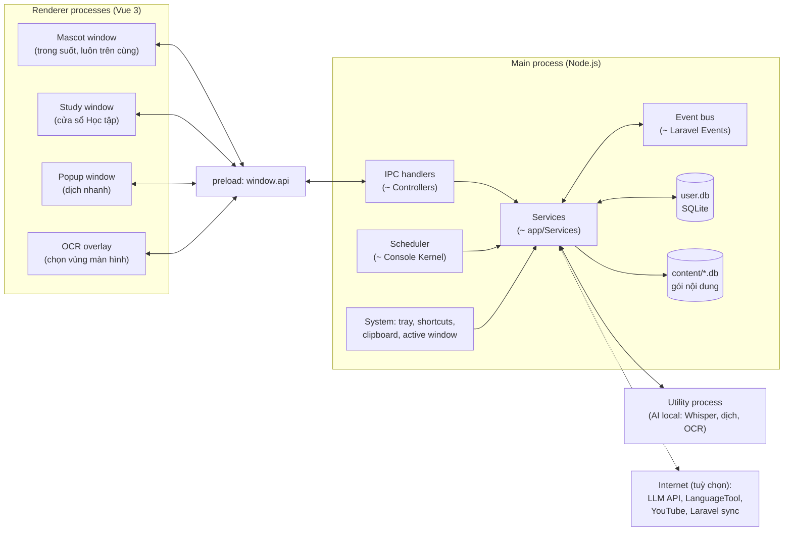
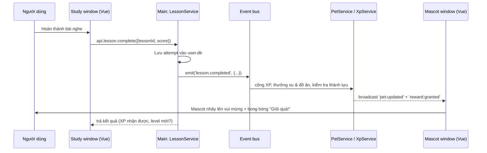
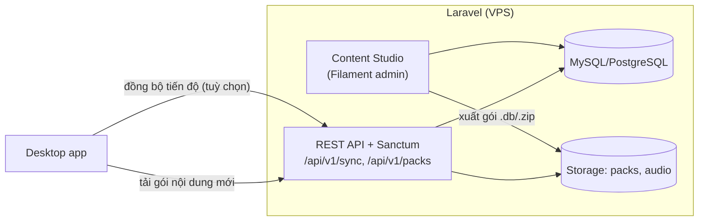

# 03 — Kiến trúc hệ thống

> Đọc [glossary.md](glossary.md) nếu gặp thuật ngữ lạ (main process, renderer, preload, IPC...).

## 1. Electron trong 1 phút — giải thích bằng ngôn ngữ Laravel/Vue

Một app Electron có **hai loại tiến trình (process)**:

| Electron                                 | Nó là gì                                                                                                                  | So với Laravel + Vue                                                         |
| ---------------------------------------- | ------------------------------------------------------------------------------------------------------------------------- | ---------------------------------------------------------------------------- |
| **Main process** (1 cái)                 | Chương trình Node.js chạy nền. Tạo cửa sổ, đọc/ghi file, database, phím tắt, tray, gọi API ngoài. **Không có giao diện.** | Giống **Laravel backend**: routes, controllers, services, models, scheduler. |
| **Renderer process** (mỗi cửa sổ 1 cái)  | Một trang web Chromium hiển thị giao diện. Ở đây chạy **Vue**. Bị sandbox, không được tự đọc file/DB.                     | Giống **frontend Vue** chạy trên trình duyệt.                                |
| **Preload script**                       | Đoạn script nhỏ chạy trước renderer, "mở một cánh cửa" an toàn để renderer gọi main.                                      | Giống **API client** (axios) đã cấu hình sẵn các endpoint được phép.         |
| **IPC** (Inter-Process Communication)    | Kênh gửi tin nhắn giữa renderer ↔ main.                                                                                   | Giống **HTTP request** từ Vue lên Laravel, nhưng nội bộ, không cần mạng.     |
| `ipcMain.handle('pet:feed', ...)`        | Đăng ký xử lý một kênh.                                                                                                   | `Route::post('/pet/feed', [PetController::class, 'feed'])`                   |
| `ipcRenderer.invoke('pet:feed', data)`   | Gọi kênh và chờ kết quả.                                                                                                  | `await axios.post('/pet/feed', data)`                                        |
| `webContents.send('pet:updated', state)` | Main **chủ động đẩy** dữ liệu xuống cửa sổ.                                                                               | Giống **broadcast** (Laravel Echo/WebSocket).                                |

**Quy tắc vàng:** Renderer (Vue) **không bao giờ** truy cập trực tiếp DB, file, hệ thống. Mọi thứ đi qua `window.api.*` (do preload cung cấp) → IPC → main.
Giống như Vue không bao giờ kết nối thẳng MySQL mà phải gọi API Laravel.

## 2. Sơ đồ tổng thể



## 3. Các cửa sổ (windows)

| Cửa sổ                 | File tạo                               | Đặc điểm                                                                                                                                                                                                                                                 | Khi nào hiện                        |
| ---------------------- | -------------------------------------- | -------------------------------------------------------------------------------------------------------------------------------------------------------------------------------------------------------------------------------------------------------- | ----------------------------------- |
| **Mascot**             | `src/main/windows/MascotWindow.ts`     | `transparent`, `frame:false`, `alwaysOnTop`, `skipTaskbar`, `resizable:false`, `focusable:false` (mặc định), kích thước ~ 360×440 (chứa nhân vật + bong bóng thoại). Vùng trong suốt **click xuyên qua** (`setIgnoreMouseEvents(true, {forward:true})`). | Luôn chạy khi app mở (trừ khi ẩn).  |
| **Study** (Học tập)    | `src/main/windows/studyWindow.ts`      | Cửa sổ thường (~1100×750), có thể dùng khung tuỳ biến kiểu pixel. Chứa router: Trang chủ, Từ vựng, Đọc, Nghe, Nói, Viết, Luyện thi, Thú cưng, Thống kê, Cài đặt.                                                                                         | Người dùng click "Học ngay" / tray. |
| **Popup** (Dịch nhanh) | `src/main/windows/popupWindow.ts`      | Nhỏ (~380×260), không khung, hiện cạnh con trỏ chuột, tự ẩn khi mất focus. Tạo sẵn 1 lần và ẩn/hiện để mở nhanh.                                                                                                                                         | Phím tắt dịch, click icon dịch.     |
| **OCR overlay**        | `src/main/windows/ocrOverlayWindow.ts` | Phủ toàn màn hình, trong suốt mờ, người dùng kéo chọn vùng.                                                                                                                                                                                              | Phím tắt OCR.                       |

> Mỗi cửa sổ là **một entry Vue riêng** (multi-page) để nhẹ: cửa sổ mascot không cần tải code của trang Luyện thi.

### Kỹ thuật cửa sổ mascot (quan trọng nhất của dự án)

1. **Trong suốt**: `transparent: true`, `backgroundColor: '#00000000'`, CSS `html, body { background: transparent }`.
2. **Click xuyên qua vùng trống**: mặc định `setIgnoreMouseEvents(true, { forward: true })` → chuột đi xuyên qua xuống app bên dưới, nhưng renderer vẫn nhận `mousemove`.
   Trong renderer, mỗi lần `mousemove` kiểm tra con trỏ có nằm trên **pixel không trong suốt** của nhân vật/bong bóng không:
   có → gọi `window.api.mascot.setClickThrough(false)`; không → `true`.
3. **Luôn trên cùng**: `win.setAlwaysOnTop(true, 'screen-saver')` (mức cao để nổi trên taskbar). Ẩn khi có app fullscreen (xem mục 6).
4. **Di chuyển**: main process giữ toạ độ, renderer gửi lệnh "đi sang trái/phải với tốc độ v"; main cập nhật `win.setPosition()` ~30 lần/giây.
   Giới hạn trong `screen.getDisplayNearestPoint(...).workArea` (vùng làm việc, không đè taskbar) — nhân vật "đứng" trên mép trên taskbar.
5. **Kéo thả**: khi `mousedown` trên nhân vật → renderer báo main bắt đầu kéo; main theo dõi `screen.getCursorScreenPoint()` và di chuyển cửa sổ; thả ra → animation rơi xuống mép dưới workArea.
6. **Không cướp focus**: `focusable: false` để người dùng đang gõ phím không bị mất focus. Khi cần nhập liệu trong bong bóng (trả lời quiz bằng bàn phím) → tạm `setFocusable(true)` rồi `focus()`.
7. **Nhiều màn hình**: dùng `screen.getAllDisplays()`; khi kéo sang màn hình khác thì dùng workArea của màn hình đó.
8. **DPI scaling**: Windows có scale 125%/150% → luôn dùng toạ độ DIP mà Electron trả về, sprite vẽ với `image-rendering: pixelated` và scale số nguyên (×2, ×3).

Phương án thay thế (chưa dùng): một cửa sổ trong suốt phủ cả màn hình, nhân vật di chuyển bên trong bằng CSS. Mượt hơn nhưng tốn tài nguyên hơn và rắc rối với nhiều màn hình. Ghi lại ở [decisions.md](decisions.md).

## 4. Cấu trúc thư mục

```text
english-assistant/
├─ AGENTS.md                    # hướng dẫn cho AI agent
├─ docs/                        # tài liệu (bạn đang đọc)
├─ package.json
├─ electron.vite.config.ts      # cấu hình build (~ vite.config.js)
├─ electron-builder.yml         # cấu hình đóng gói installer
├─ drizzle.config.ts            # cấu hình migration
├─ resources/                   # icon app, icon tray, âm thanh hệ thống (được copy vào bản build)
├─ assets-src/                  # file gốc art (.aseprite), KHÔNG đưa vào bản build
├─ content/                     # nguồn nội dung & gói nội dung đã build (xem 09)
│  ├─ raw/                      # dữ liệu thô tải về (gitignore nếu lớn)
│  ├─ curated/                  # JSON/YAML đã chuẩn hoá & duyệt
│  └─ packs/                    # file .db/.zip đã đóng gói
├─ scripts/                     # script pipeline nội dung (tsx), build sprite...
├─ src/
│  ├─ main/                     # ===== MAIN PROCESS (~ Laravel app/) =====
│  │  ├─ index.ts               # khởi động app (~ bootstrap/app.php)
│  │  ├─ container.ts           # khởi tạo & nối các service (~ Service Providers)
│  │  ├─ windows/               # tạo/quản lý từng cửa sổ
│  │  ├─ ipc/                   # IPC handlers theo domain (~ Controllers + routes)
│  │  │  ├─ index.ts            # đăng ký tất cả handler
│  │  │  ├─ pet.ipc.ts
│  │  │  ├─ dictionary.ipc.ts
│  │  │  ├─ study.ipc.ts        # study:fullscreen — toàn màn hình cửa sổ Học tập (màn game bé), chỉ nhận từ cửa sổ đó
│  │  │  └─ ...
│  │  ├─ services/              # nghiệp vụ (~ app/Services)
│  │  │  ├─ PetService.ts
│  │  │  ├─ XpService.ts
│  │  │  ├─ SrsService.ts
│  │  │  ├─ DictionaryService.ts
│  │  │  ├─ TranslateService.ts
│  │  │  ├─ LessonService.ts       # bài học/ngữ pháp/đọc/nghe dùng chung (theo `kind`)
│  │  │  ├─ CourseService.ts       # khoá học Course → Unit → Lesson
│  │  │  ├─ ProgressService.ts     # Elo theo kỹ năng, độ chính xác, thời gian học
│  │  │  ├─ PlacementService.ts    # kiểm tra đầu vào + bài kiểm tra lên cấp (checkpoint)
│  │  │  ├─ PracticeService.ts, StatsService.ts, KidsService.ts, KidsWorldService.ts (bản đồ thế giới của bé, docs/19), ParentService.ts
│  │  │  └─ ...
│  │  ├─ content/               # thư viện nội dung đóng gói sẵn: LessonLibrary, CourseLibrary, KidsLibrary,
│  │  │                         #   PhrasebookLibrary, PlacementBank, bundledLessons (glob content/curated/**)
│  │  ├─ db/
│  │  │  ├─ schema/             # Drizzle schema (~ Models + migrations định nghĩa)
│  │  │  ├─ migrations/         # file SQL sinh bởi drizzle-kit
│  │  │  ├─ repositories/       # truy vấn (~ Eloquent scopes/repositories)
│  │  │  └─ client.ts           # mở kết nối user.db & content packs
│  │  ├─ events/                # event bus có kiểu (~ app/Events + Listeners)
│  │  ├─ jobs/                  # tác vụ định kỳ (~ app/Console/Kernel schedule)
│  │  ├─ system/                # tray, globalShortcut, clipboard, activeWindow, autostart, UpdateManager (cập nhật app)
│  │  ├─ ai/                    # provider LLM, TTS, STT, dịch (interface + implementations)
│  │  └─ utility/               # code chạy trong utilityProcess (AI local nặng)
│  ├─ preload/
│  │  └─ index.ts               # contextBridge.exposeInMainWorld('api', {...})
│  ├─ renderer/                 # ===== RENDERER (~ resources/js) =====
│  │  ├─ mascot/                # index.html + main.ts + App.vue (cửa sổ mascot)
│  │  ├─ study/                 # index.html + main.ts + router + pages/
│  │  ├─ popup/                 # dịch nhanh
│  │  ├─ ocr/                   # overlay chọn vùng
│  │  └─ shared/
│  │     ├─ art/                # hình từ vector vẽ bằng canvas: kit.ts (bộ nét chung), pictures/<nhóm>.ts, index.ts (vectorPictureUrl, PixelPicture ưu tiên) — docs/19 §5.5
│  │     ├─ components/         # PixelButton, PixelPanel, AudioPlayer, ...
│  │     ├─ composables/        # useTts, useRecorder, useHotkeys...
│  │     ├─ stores/             # Pinia stores (đồng bộ với main qua sự kiện)
│  │     ├─ exercises/          # (thực tế nằm ở renderer/study/exercises/: registry lessonExercises.ts + ChoiceList, WordOrderBoard, MatchBoard, AudioPrompt)
│  │     ├─ i18n/               # vi.json, en.json
│  │     └─ styles/
│  └─ shared/                   # ===== DÙNG CHUNG main + renderer =====
│     ├─ ipc-contract.ts        # định nghĩa kiểu của mọi kênh IPC
│     ├─ schemas/               # zod schema: content, exercise, settings
│     ├─ constants.ts           # level, XP table, ...
│     ├─ progress.ts            # kỹ năng, ánh xạ dạng bài → kỹ năng, công thức Elo
│     ├─ placement.ts, kids.ts, trace.ts   # kế hoạch kiểm tra, quy tắc chế độ trẻ em, chấm nét tô chữ
│     ├─ pixelGrid.ts, badgeArt.ts, pictures.ts   # pixel art vẽ bằng code (huy hiệu, 60 hình minh hoạ)
│     ├─ i18n/                  # vi.json, en.json (+ usedKeys.test.ts kiểm tra khoá thiếu)
│     └─ types.ts
└─ tests/
   ├─ unit/
   └─ e2e/
```

## 5. Luồng dữ liệu & đồng bộ giữa các cửa sổ

- **Main là nguồn sự thật duy nhất** (single source of truth). Pinia store trong renderer chỉ là bản sao để hiển thị.
- Khi dữ liệu thay đổi, service phát event → main **broadcast** tới mọi cửa sổ đang mở → store cập nhật.



### Event bus (giống Laravel Events)

Các event chính (định nghĩa kiểu trong `src/main/events/types.ts`):

| Event                         | Ai phát           | Ai nghe                                                 |
| ----------------------------- | ----------------- | ------------------------------------------------------- |
| `lesson.completed`            | LessonService     | XpService, PetService, AchievementService, QuestService |
| `card.reviewed`               | SrsService        | XpService, QuestService                                 |
| `word.saved`                  | DictionaryService | QuestService                                            |
| `pet.fed` / `pet.played`      | PetService        | AchievementService                                      |
| `level.up` (profile hoặc pet) | XpService         | PetService (mở khoá), NotificationService               |
| `quiet-mode.changed`          | QuietModeService  | MascotController (ẩn/hiện, dừng nhắc)                   |
| `settings.changed`            | SettingsService   | nhiều nơi                                               |

## 6. Tác vụ nền (scheduler)

Chạy trong main bằng `setInterval` được quản lý tập trung ở `src/main/jobs/` (giống `$schedule->...` trong Laravel):

| Job              | Chu kỳ           | Việc làm                                                                                                                       |
| ---------------- | ---------------- | ------------------------------------------------------------------------------------------------------------------------------ |
| `QuietModeJob`   | 2 giây           | Kiểm tra cửa sổ active: fullscreen? app họp (Zoom, Teams, Meet trên trình duyệt)? → bật/tắt chế độ yên lặng.                   |
| `PetDecayJob`    | 1 phút           | Giảm nhẹ hunger/mood/energy theo thời gian thực (tính theo `last_tick_at`, nên tắt máy vẫn đúng — có giới hạn sàn).            |
| `MicroLessonJob` | 1 phút           | Đến giờ nhắc & không ở chế độ yên lặng & người dùng không gõ phím liên tục → yêu cầu mascot hiện "Từ của khoảnh khắc"/thẻ SRS. |
| `DailyResetJob`  | khi qua ngày mới | Reset nhiệm vụ ngày, tính streak.                                                                                              |
| `BackupJob`      | 1 ngày           | Sao lưu `user.db` (giữ 7 bản gần nhất).                                                                                        |

> Không dùng cron hệ thống. Khi app tắt thì job tắt; khi mở lại, các job tự "bù" dựa trên timestamp lưu trong DB.

## 7. Backend Laravel (tuỳ chọn, giai đoạn sau)

App chạy **hoàn toàn offline** không cần backend. Khi cần, thêm một backend Laravel — đúng thế mạnh của team:



- **Content Studio**: soạn/duyệt bài học, gắn level, upload audio, chạy job sinh nội dung bằng AI, xuất **content pack** (cùng định dạng ở [09](09-content-pipeline.md)).
- **Sync API**: đồng bộ bảng người dùng theo cơ chế "last-write-wins + updated_at" (mỗi bản ghi có `uuid`, `updated_at`, `deleted_at`). Thiết kế schema đã chuẩn bị sẵn cho việc này (xem [10](10-data-model.md)).
- Cho đến khi có backend, gói nội dung được đóng sẵn trong installer hoặc tải từ GitHub Releases.

## 8. Hiệu năng — ngân sách tài nguyên

| Hạng mục                   | Mục tiêu                                                                               |
| -------------------------- | -------------------------------------------------------------------------------------- |
| RAM khi chỉ có mascot chạy | < 250 MB                                                                               |
| CPU khi mascot idle        | < 1–2% (animation 12 fps cho pixel art là đủ, dừng hẳn khi ẩn)                         |
| Mở popup dịch              | < 300 ms (cửa sổ tạo sẵn, ẩn/hiện)                                                     |
| Khởi động app              | < 3 giây tới khi mascot xuất hiện                                                      |
| Model AI local             | Chỉ tải khi dùng lần đầu, chạy trong utilityProcess, giải phóng khi không dùng 10 phút |

Mẹo: cửa sổ Study chỉ tạo khi mở và có thể huỷ khi đóng (giải phóng RAM); cửa sổ Mascot và Popup luôn tồn tại.
