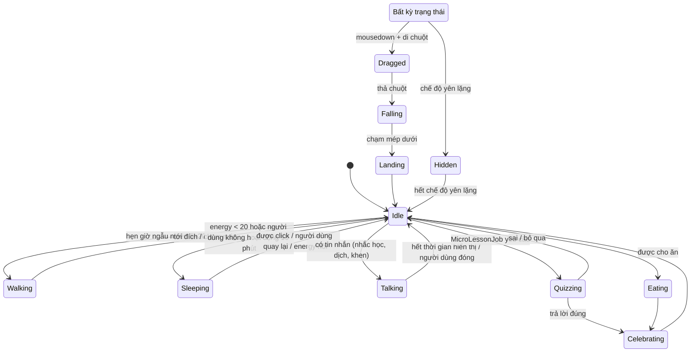

# 05 — Hệ thống Mascot

## 1. Nhân vật

- **Tên tạm**: *Bi* (đổi được). Một sinh vật chibi tròn trịa, dễ thương với cả trẻ em và người lớn.
- **Phong cách**: pixel art, khung sheet **96×96 px** (vẽ chi tiết: đổ bóng 5 tông, viền theo màu, mặt biểu cảm, tay/chân/đuôi), mặc định hiển thị **96px** (cài đặt kích thước 1/2/3 = 48/96/144px, tính theo khung gốc 48; sheet 96 được thu lại tương ứng) trên màn hình (Phase 1 cho chỉnh ×1/×2/×3 trong cài đặt — luôn số nguyên để pixel sắc nét). Kích thước trước đây (64px ×3 = 192px) bị đánh giá là quá to.
- **Tính cách**: tò mò, hay khen, hơi lười buổi trưa, thích ăn. Câu thoại ngắn, có cả tiếng Anh và tiếng Việt tuỳ level người dùng.
- **Tiến hoá** (theo level thú cưng): Trứng (lv 1) → Bé (lv 2–9) → Thiếu niên (lv 10–24) → Trưởng thành (lv 25–49) → Huyền thoại (lv 50+). Mỗi giai đoạn là một bộ sprite mới.
  - **Nhiều nhân vật (2026-10-20):** `src/shared/characters.ts` — `bi`, `webster` (nhện hero: mặt nạ đỏ, kính trắng, chân nhện, tơ trán), `draco` (rồng: sừng, bụng kem, đuôi gai, cánh từ thiếu niên, lửa ở huyền thoại), `robo` (robot: kính tối đèn xanh, ăng-ten, tấm ngực, vầng sáng), `kitsu` (cáo: tai chóp nâu, đuôi xù 1→3 đuôi). **Tất cả là thiết kế gốc, không dùng nhân vật có bản quyền** (không dùng Spider-Man/Pokémon... — nhện hero chỉ lấy ý "anh hùng mặt nạ nhện"). Sprite: `characters/<id>/<giai đoạn>/` do `make-placeholder.mjs` sinh (`CHARACTER_SPECS`; `PREVIEW=1` ghi ảnh tổng hợp `content/.build/characters-preview.png`). `pet_states.character_id` lưu id; bản cũ `placeholder` được coi là `bi`. Cửa sổ mascot chọn sheet theo `<nhân vật>/<giai đoạn>`.
  - **Màn hình tiến hoá:** trang "Thú cưng" (`PetPage.vue`) có cây tiến hoá từng nhân vật (giai đoạn chưa đạt hiện bóng đen `???`), và `EvolutionOverlay.vue` tự hiện khi thú cưng lên giai đoạn mới (`useEvolution.ts`, nhớ giai đoạn đã xem theo nhân vật trong localStorage; lần đầu thấy một nhân vật không báo).
  - **Sprite hiện tại (2026-10-20, làm lại chi tiết gấp 4):** sinh bằng code trong `scripts/sprites/` — `gfx.mjs` (lõi: hình khối SDF, đổ bóng 5 tông có dither Bayer, viền theo màu, PNG), `creature.mjs` (5 nhân vật × 5 giai đoạn: thân, tai/sừng/ăng-ten, đuôi, cánh, chân nhện, tay, chân, mặt, hoa văn, hiệu ứng nhỏ), `accessories.mjs` (12 phụ kiện, có lớp sau lưng cho áo choàng/cánh), `anim.mjs` (hoạt ảnh), `make-characters.mjs` (xuất `characters/<nhân vật>/<giai đoạn>/sheet.png|json`, `acc-<id>.png` lớp trước, `accb-<id>.png` lớp sau). `pnpm sprites:characters [nhân vật] [giai đoạn]`; `PREVIEW=1` ảnh tổng hợp, `PREVIEW=anim` mọi frame, `PREVIEW=acc` thử phụ kiện (ghi vào `content/.build/`). Sheet 768×2304 (8 cột × 24 hàng, 186 frame).
  - **20 hoạt ảnh:** idle (thở+chớp mắt), look, wag, yawn, stretch, wave, dance, spin, think (tự chơi khi rảnh), walk, drag, fall, land, happy, eat, sleep, sad (khi đói), surprised, angry, love (khi bị vuốt). `MascotBrain` chọn ngẫu nhiên hoạt ảnh tự chơi (~35% mỗi lần hết thời gian nghỉ), click → happy/love, đói → sad, lên cấp → dance, thức dậy → stretch, chào → wave.
  - **Cách thay bằng art thật sau:** giữ tên file, tên hoạt ảnh trong `sheet.json`, khung 96×96, 8 cột. Phụ kiện phải khớp bố cục frame của sheet chính.

## 2. Sprite sheet — định dạng chuẩn

Mỗi bộ nhân vật nằm trong `src/renderer/mascot/assets/characters/<characterId>/<stage>/`:

```text
characters/bi/baby/
├─ sheet.png        # tất cả frame xếp lưới, nền trong suốt
└─ sheet.json       # metadata (xuất từ Aseprite: File > Export Sprite Sheet, định dạng JSON "Array" + Tags)
```

Quy ước `sheet.json` (chuẩn hoá từ Aseprite, script `scripts/sprites/normalize.ts` chuyển đổi):

```json
{
  "frameSize": { "w": 48, "h": 48 },
  "anchor": { "x": 24, "y": 47 },
  "animations": {
    "idle":    { "frames": [0, 1, 2, 3],       "fps": 6,  "loop": true },
    "walk":    { "frames": [4, 5, 6, 7, 8, 9], "fps": 10, "loop": true },
    "sleep":   { "frames": [10, 11],           "fps": 2,  "loop": true },
    "drag":    { "frames": [12, 13],           "fps": 8,  "loop": true },
    "fall":    { "frames": [14],               "fps": 1,  "loop": true },
    "land":    { "frames": [15, 16, 17],       "fps": 12, "loop": false, "next": "idle" },
    "happy":   { "frames": [18, 19, 20, 21],   "fps": 10, "loop": false, "next": "idle" },
    "sad":     { "frames": [22, 23],           "fps": 4,  "loop": false, "next": "idle" },
    "eat":     { "frames": [24, 25, 26, 27],   "fps": 8,  "loop": false, "next": "happy" },
    "talk":    { "frames": [28, 29],           "fps": 8,  "loop": true },
    "think":   { "frames": [30, 31, 32],       "fps": 4,  "loop": true },
    "yawn":    { "frames": [33, 34, 35, 36],   "fps": 6,  "loop": false, "next": "idle" },
    "wave":    { "frames": [37, 38, 39, 40],   "fps": 8,  "loop": false, "next": "idle" },
    "hold-sign": { "frames": [41, 42],         "fps": 3,  "loop": true }
  }
}
```

- `anchor`: điểm "chân" nhân vật, dùng để đặt nhân vật đứng đúng mép taskbar.
- Nhân vật luôn vẽ **quay mặt sang phải**; đi sang trái thì lật ngang bằng canvas (`scale(-1, 1)`).
- Phụ kiện/trang phục là **layer riêng** cùng kích thước frame (`accessories/<itemId>.png` + json cùng frame index), vẽ chồng lên → không cần vẽ lại cả nhân vật.

### Danh sách animation tối thiểu cho MVP
`idle`, `walk`, `sleep`, `drag`, `fall`, `land`, `happy`, `talk`, `eat`. Các animation còn lại thêm dần.

### Quy trình art
1. Vẽ trong **LibreSprite** (công cụ chính của dự án), mỗi animation là một **Tag** (Frame → Tags).
2. File → Export Sprite Sheet: layout lưới (By Rows), xuất PNG + JSON. Lưu file gốc `.ase`/`.aseprite` vào `assets-src/`.
3. Chạy `pnpm sprites:build` → chuẩn hoá JSON, kiểm tra đủ animation bắt buộc.
   - Nếu JSON xuất ra **không có** thông tin tag (tuỳ bản LibreSprite), khai báo `animations` thủ công trong file `assets-src/<character>/<stage>.anim.json` (cùng định dạng ở trên); script sẽ ưu tiên file này. Kiểm tra điều này ngay ở Phase 0.
4. **Tạm thời chưa có hoạ sĩ?** Dùng asset CC0 (ví dụ từ Kenney, OpenGameArt — xem [08](08-content-sources.md#8-hình-ảnh-âm-thanh-font-cho-giao-diện)) để làm prototype, giữ đúng định dạng JSON trên để thay sau.

## 3. Bộ máy animation (renderer)

`src/renderer/mascot/engine/SpriteAnimator.ts` — trách nhiệm duy nhất: vẽ frame đúng thời điểm.

```ts
export class SpriteAnimator {
  private current = 'idle'
  private frameIdx = 0
  private acc = 0

  constructor(private sheet: SpriteSheet, private ctx: CanvasRenderingContext2D) {}

  play(name: string, restart = false) {
    if (name === this.current && !restart) return
    this.current = name
    this.frameIdx = 0
    this.acc = 0
  }

  /** gọi mỗi khung hình requestAnimationFrame với dt (giây) */
  update(dt: number, flip: boolean) {
    const anim = this.sheet.animations[this.current]
    this.acc += dt
    const frameTime = 1 / anim.fps
    while (this.acc >= frameTime) {
      this.acc -= frameTime
      this.frameIdx++
      if (this.frameIdx >= anim.frames.length) {
        if (anim.loop) this.frameIdx = 0
        else { this.play(anim.next ?? 'idle'); return }
      }
    }
    this.draw(anim.frames[this.frameIdx], flip)
  }

  private draw(frame: number, flip: boolean) { /* drawImage cắt ô frame từ sheet, lật nếu flip */ }
}
```

- Vòng lặp dùng `requestAnimationFrame`, nhưng **chỉ vẽ lại khi frame thay đổi** (pixel art 6–12 fps) để tiết kiệm CPU.
- Khi cửa sổ bị ẩn (chế độ yên lặng) → dừng vòng lặp hoàn toàn.
- Chế độ hiệu năng thấp: giới hạn tối đa 8 fps.

## 4. State machine hành vi (brain)

Tách **"bộ não"** (quyết định làm gì) khỏi **"cơ thể"** (animation). Bộ não chạy trong renderer mascot, nhận dữ liệu từ main (chỉ số pet, sự kiện, chế độ yên lặng).



Bảng trạng thái → animation & hành động:

| Trạng thái | Animation | Hành động |
|---|---|---|
| Idle | `idle` (đôi khi `yawn`, `wave`) | Chờ, chọn hành động tiếp theo theo trọng số (mood cao → đi dạo nhiều hơn) |
| Walking | `walk` | Gửi `mascot:move-by` mỗi tick, tốc độ ~ 40 px/s, đổi hướng ở mép |
| Sleeping | `sleep` | Hiện "Zzz", hồi energy nhanh hơn |
| Talking | `talk` | Hiện bong bóng thoại |
| Quizzing | `hold-sign` / `think` | Hiện thẻ hỏi; bật focusable nếu cần gõ |
| Celebrating | `happy` | Hiệu ứng ngôi sao, cộng điểm |
| Eating | `eat` | Món ăn bay vào |
| Dragged | `drag` | Main di chuyển cửa sổ theo chuột |
| Falling/Landing | `fall` → `land` | Main di chuyển cửa sổ xuống mép dưới với gia tốc |
| Hidden | — | Cửa sổ `hide()`, dừng render |

Hiện thực: một class `MascotBrain` với `state`, `enter(state)`, `exit(state)`, `tick(dt)`. Không cần thư viện; nếu muốn có thể dùng XState.

## 5. Bong bóng thoại & thẻ tương tác

> ✅ **Đã làm**: `say`, thẻ chỉ số (`stats`, khi rê chuột), `quiz` (hỏi ôn / từ của khoảnh khắc — `QuizCard.vue`, không tự đóng, có nút "Để sau"). Hàng đợi ưu tiên: stats 0 < ambient 1 < reaction 2 < quiz 2.5 < important 3. Job `micro-quiz` (`src/main/jobs/quizJobs.ts`) chỉ hỏi khi mascot đang hiện và popup không mở.

Nằm trong cùng cửa sổ mascot, phía trên đầu nhân vật. Các loại:

| Loại | Nội dung | Thời gian tự đóng |
|---|---|---|
| `say` | Một câu ngắn ("Chào buổi sáng! ☀️") | 4–6 giây |
| `word-card` | Từ + IPA + nghĩa + nút 🔊 💾 ✖ | 15 giây hoặc khi hover thì giữ |
| `quiz` | Câu hỏi 2–4 lựa chọn | Không tự đóng; có nút "Để sau" |
| `translate-hint` | "Dịch đoạn vừa copy?" | 5 giây |
| `reward` | "+20 XP, +1 🍙" | 3 giây |

Quy tắc: **tối đa 1 bong bóng** tại một thời điểm, có hàng đợi ưu tiên (`quiz` < `reward` < phản hồi trực tiếp của người dùng). Không hiện bong bóng chủ động khi ở chế độ yên lặng.

Câu thoại lưu ở `src/renderer/mascot/dialogue/<characterId>.json`, phân theo ngữ cảnh và level ngôn ngữ:

```json
{
  "greeting.morning": {
    "kids":  ["Good morning! ☀️ Chào buổi sáng!"],
    "basic": ["Good morning! Ready to learn?", "Chào buổi sáng! Học 5 phút nhé?"],
    "advanced": ["Morning! Fancy a quick review before work?"]
  },
  "hungry": { "kids": ["Bi đói rồi... 🍙"], "basic": ["I'm hungry! Học một bài lấy cơm cho mình nhé?"] }
}
```

### Câu thoại theo nhân vật

Câu thoại nằm trong i18n: `mascot.lines.<chủ đề>` (chung) và `mascot.chars.<nhân vật>.<chủ đề>` (riêng: Bi hay "nyaa", Webby nói kiểu siêu anh hùng, Draco "khè" + lửa, Robo "bíp bíp", Kitsu "hihi" lém lỉnh). `useLines` dùng câu riêng ~65% số lần (có thì mới dùng), còn lại câu chung; không lặp câu vừa nói. Chủ đề mới `idle`: thỉnh thoảng (4–9 phút một lần, khi mascot rảnh, đang hiện và không ngủ) mascot nói vài câu bâng quơ (nhắc học, uống nước, nghỉ mắt). Test `src/shared/i18n/mascotLines.test.ts` bắt buộc mỗi nhân vật có ≥ 3 câu cho mọi chủ đề ở cả vi/en. Thêm chủ đề → thêm vào danh sách trong test.

## 6. Chỉ số nuôi (pet stats)

Lưu trong main (`pet_state` — xem [10](10-data-model.md)), main tính toán, renderer chỉ hiển thị.

| Chỉ số | Khoảng | Giảm theo thời gian | Tăng khi |
|---|---|---|---|
| `hunger` (no) | 0–100 | −4/giờ khi app mở, −1/giờ khi app tắt | Cho ăn (đồ ăn kiếm từ học) |
| `mood` (vui) | 0–100 | −3/giờ | Chơi, được vuốt (click), học xong bài, trả lời đúng quiz |
| `energy` (năng lượng) | 0–100 | −2/giờ khi thức | Ngủ (+10/giờ), đồ uống |
| `affection` (thân thiết) | 0–∞ | Không giảm | Mỗi ngày có học, cho ăn, tương tác |

**Quy tắc mềm (không phạt):**
- Chỉ số có **sàn 10** — không bao giờ về 0, thú cưng không chết, không bỏ đi.
- Khi app tắt lâu, tính giảm tối đa **24 giờ** (tắt 1 tuần quay lại vẫn chỉ "hơi đói").
- Chỉ số thấp chỉ ảnh hưởng **biểu cảm & câu thoại** (buồn, đói), không khoá chức năng học.
- Với profile trẻ em: tốc độ giảm ×0.5 và không bao giờ hiện trạng thái "buồn" quá lâu.

**Ảnh hưởng của chỉ số lên XP:** mood ≥ 70 → +10% XP ("Bi đang vui nên học vào hơn!"). Chỉ thưởng, không trừ.

## 7. Tương tác của người dùng

| Hành động | Phản ứng |
|---|---|
| Click 1 lần | `wave` + câu chào/câu đùa; mood +1 (tối đa 10 lần/giờ để tránh spam) |
| Double-click | Mở cửa sổ Học tập |
| Chuột phải | Menu ngữ cảnh (xem [01](01-features.md) A5) |
| Kéo thả | `drag` → thả ra `fall` → `land` |
| Vuốt (di chuột qua lại nhanh trên đầu) | `happy`, mood +2 |
| Thả đồ ăn từ túi đồ lên nhân vật | `eat` |
| Hover lâu | Hiện tooltip chỉ số nhỏ |

## 8. Chế độ yên lặng (Quiet mode)

Do `QuietModeService` trong main quyết định, mascot chỉ làm theo:

> ✅ **Đã làm (Phase 0)** — `src/main/services/QuietModeService.ts` + `src/main/system/win32.ts`:
> - Mỗi 2 giây đọc cửa sổ đang active qua Win32 (koffi). Cửa sổ **phủ kín cả màn hình** (kể cả vùng taskbar) và nằm **cùng màn hình với mascot** → ẩn. Cửa sổ maximize thường (còn thấy taskbar) không tính.
> - `SHQueryUserNotificationState` báo game DirectX độc quyền hoặc chế độ trình chiếu → ẩn ở mọi màn hình.
> - Bỏ qua cửa sổ shell (desktop, taskbar, Alt+Tab, Start) và cửa sổ của chính app.
> - Ẩn ngay, nhưng chỉ hiện lại sau 2 lần kiểm tra liên tiếp (~4 giây) để không nhấp nháy khi Alt+Tab.
> - "Người dùng tự ẩn" (tray) và "tạm ẩn vì yên lặng" là hai cờ riêng; tray hiển thị dòng "Đang tạm ẩn vì có app toàn màn hình".
> - Khi bị ẩn, renderer dừng hẳn vòng lặp animation (0% CPU).
>
> ✅ **Đã làm (Phase 1)**: app họp nhận theo tên file `.exe` (Zoom, Teams, Webex, Skype...) hoặc tiêu đề tab trình duyệt (Meet, Teams, Webex...) — quy tắc thuần ở `src/shared/quiet.ts`; khung giờ không làm phiền theo đồng hồ (vắt qua nửa đêm được). Cả hai chỉnh trong menu chuột phải → "Chế độ yên lặng" hoặc trang Cài đặt. `QuietModeService` nhận `QuietEnv` (đọc Win32) qua tham số nên test được không cần Windows.

### Trạng thái ngủ (sleep)

✅ `SleepService` (main) quyết định, mascot chỉ làm theo qua sự kiện `mascot:sleep`: ngủ khi người dùng không đụng máy ≥ 10 phút (`powerMonitor.getSystemIdleTime`) hoặc năng lượng ≤ 20 (ngủ tới khi hồi ≥ 45 — có độ trễ để không chập chờn). Lúc ngủ năng lượng hồi 12/giờ, mascot nằm yên với "Zzz", không hỏi ôn, không nhắc đói; click vào chỉ nhận câu "để Bi ngủ thêm" (không tính vuốt ve). Quy tắc thuần ở `src/shared/sleep.ts`.

| Điều kiện | Hành vi |
|---|---|
| Cửa sổ active đang fullscreen (game, video, PowerPoint trình chiếu) | Ẩn mascot hoàn toàn |
| Cửa sổ active là app họp (Zoom, Teams, Webex, tab Meet) | Ẩn, không nhắc (✅ đã làm, bật/tắt: `quiet.meetings`) |
| Trong khung giờ không làm phiền (`quiet.dnd.*`, vd 22:00–07:00) | Ẩn, không nhắc (✅ đã làm) |
| Người dùng đang gõ phím liên tục (tuỳ chọn) | Không hiện bong bóng chủ động, mascot vẫn đứng |
| Người dùng bấm "Ẩn 30 phút / 1 giờ / đến mai" | Ẩn theo thời gian |
| Giờ "Không làm phiền" trong cài đặt (vd 22:00–7:00) | Mascot ngủ, không nhắc |

Danh sách app họp/game có thể chỉnh trong Cài đặt (lưu theo tên process: `Zoom.exe`, `Teams.exe`, `ms-teams.exe`...).

## 9. Kiểm thử thủ công cho mascot (checklist)

- [ ] Nền trong suốt trên Windows 10 và 11, scale 100%/125%/150%.
- [ ] Click vào vùng trống quanh nhân vật trúng app bên dưới.
- [ ] Kéo sang màn hình thứ hai, nhân vật đứng đúng trên taskbar màn hình đó.
- [ ] Taskbar đặt ở cạnh trái/trên/tự ẩn → nhân vật vẫn đứng hợp lý.
- [ ] Mở video fullscreen → mascot ẩn; thoát → hiện lại.
- [ ] Đang gõ trong Word, mascot hiện bong bóng → không mất focus của Word.
- [ ] CPU khi idle < 2% (Task Manager).

## 10. Biểu cảm & hành động riêng từng nhân vật (2026-10-21)

Trước đây cả 5 nhân vật dùng chung một bộ hoạt ảnh. Nay `scripts/sprites/anim.mjs` giữ bộ **chung** (20 hoạt ảnh) và `scripts/sprites/anim-chars.mjs` thêm:

- **TWEAKS** — chỉnh hoạt ảnh chung theo nhân vật (đổi mắt, hiệu ứng, đuôi/cánh): vd Robo "love" mắt thành trái tim, "sad" mắt chữ X, "sleep" tắt đèn; Draco "idle" vỗ cánh nhẹ + khói mũi, "angry" có lửa; Kitsu "happy" nhảy zích-zắc kèm lửa ma xanh; Webby "happy" bắn tơ, "surprised" có vạch giác quan nhện.
- **QUIRKS** — hoạt ảnh đặc trưng `quirk_*`, `MascotBrain` tự chọn ngẫu nhiên khi rảnh (mỗi quirk trọng số 3, xấp xỉ 1/3 số lần "tự chơi"); danh sách lấy từ `sheet.json` của nhân vật đang dùng nên đổi nhân vật là đổi bộ động tác:

| Nhân vật | Hoạt ảnh đặc trưng |
|---|---|
| Bi (mèo con) | `quirk_groom` ngồi liếm chân rửa mặt · `quirk_pounce` rình rồi vồ · `quirk_loaf` nằm co thành ổ bánh mì, gừ gừ |
| Webby (nhện hero) | `quirk_web` bắn tơ lên cao rồi đu · `quirk_hero` tạo dáng chống hông · `quirk_crawl` bò ngang kiểu nhện |
| Draco (rồng) | `quirk_fire` hít vào rồi phun lửa · `quirk_roar` ngửa đầu gầm, xoè cánh · `quirk_tailswish` quật đuôi, ngoái nhìn |
| Robo | `quirk_scan` quét bằng mắt + tia quét · `quirk_robodance` nhảy robot từng nhịp · `quirk_beep` bíp bíp, sóng âm từ ăng-ten · `quirk_reboot` tắt–chập chờn–bật lại |
| Kitsu (cáo) | `quirk_pounce` nhảy cao chụp mồi · `quirk_tailfan` xoè đuôi như quạt · `quirk_sneeze` hắt hơi ra lửa ma · `quirk_sit` ngồi ngay ngắn vẫy đuôi |

- Kiểu mắt mới (`creature.mjs`): `heart`, `x`, `off`, `scan`, `star` (vẽ riêng cho mắt thường, kính của Webby và visor của Robo). Hiệu ứng mới: `web`, `fire`, `sound`, `sense`, `beep`, `scan`.
- `sheet.json` nay **riêng từng nhân vật** (số frame khác nhau; mọi giai đoạn của một nhân vật cùng bố cục). `idle` luôn là 8 frame đầu. `SpriteAnimator.setSheet(image, meta)` đổi cả metadata khi đổi nhân vật.
- Xem nhanh bằng `node scripts/sprites/preview-quirks.mjs <nhân vật> [giai đoạn] [tên,...]` → `content/.build/quirks-*.png`.
- Thêm động tác mới: thêm vào `QUIRKS[nhân vật]` (tên bắt đầu `quirk_`) rồi `pnpm sprites:characters <nhân vật>`; không cần sửa Brain.

### Tương tác riêng từng nhân vật: bấm, kéo, thả, rơi, ăn

- **Bấm vào** (`click_*`, `MascotBrain.pickClickReaction`): chọn ngẫu nhiên giữa `happy`/`love` chung (trọng số 2) và các phản ứng riêng của nhân vật (trọng số 3):

| Nhân vật | Phản ứng khi bấm |
|---|---|
| Bi | `click_purr` gừ gừ nhắm mắt, tim nổi · `click_boop` bị chạm mũi giật mình rồi cười |
| Webby | `click_spidey` giác quan nhện báo động rồi tạo dáng · `click_flip` lộn nhào kèm tơ |
| Draco | `click_puff` phụt đốm lửa nhỏ · `click_flapjoy` vỗ cánh nhảy cẫng |
| Robo | `click_beepboop` mắt trái tim, ăng-ten bíp · `click_glitch` chập mạch giật cục |
| Kitsu | `click_foxfire` xoay vòng toả lửa ma · `click_tailwag` vẫy đuôi tít, tai dựng |

- **Kéo / rơi / chạm đất / ăn** (`INTERACTION_TWEAKS` trong `anim-chars.mjs`, chỉnh `drag`, `fall`, `land`, `eat` theo tính cách): Bi bị xách gáy mềm oặt, rơi vẫn tiếp đất bằng bốn chân; Webby bị kéo lên thì **treo lủng lẳng trên một sợi tơ** như anh hùng nhện, bắn tơ bám trần khi rơi, tiếp đất tư thế anh hùng; Draco dang cánh khi rơi, tiếp đất rung bụi, ăn xong ợ khói; Robo bị kéo thì chập chờn tia lửa, rơi báo động, chạm đất khởi động lại; Kitsu xù đuôi cụp tai khi bị nhấc, tiếp đất nhẹ nhàng.
- Thêm phản ứng bấm mới: thêm hoạt ảnh `click_*` vào `CLICKS[nhân vật]` rồi `pnpm sprites:characters <nhân vật>`; Brain tự nhận từ `sheet.json`.
- Ghi chú: file `characters/**/sheet.json` do script sinh nên đã nằm trong `.prettierignore` — đừng chạy prettier lên chúng.

## 11. Sprite độ phân giải cao 288px (gói tải thêm, 2026-10-23)

Bộ cài giữ sprite **96×96** (≈ 22 MB). Chủ dự án muốn nét hơn → có thêm **gói tải thêm 288px (3×)** cho cả 5 nhân vật × 5 giai đoạn + toàn bộ lớp phụ kiện, cài trong **Cài đặt → "Thú cưng nét hơn"** (như gói âm thanh bài nghe).

- **Cách vẽ:** lõi `scripts/sprites/gfx.mjs` có hệ số `SPRITE_SCALE` (1 mặc định). Toạ độ vẽ trong `creature.mjs`/`accessories.mjs` vẫn là toạ độ logic 96×96; canvas thật là `96 × SCALE`, hình khối SDF lấy mẫu ở độ phân giải thật nên đường nét mịn hơn (bóng, dither, viền dày ≈ 1 pixel logic). Thiết kế nhân vật không đổi, chỉ nét hơn. `SPRITE_OUT=<thư mục>` ghi sang chỗ khác để không đè sprite 96px của bộ cài.
- **Sinh:** `SPRITE_SCALE=3 SPRITE_OUT=content/.build/sprites-hires node scripts/sprites/make-characters.mjs` (~45 phút) → `node scripts/sprites/build-hires-pack.mjs [ver]` (cần Python + Pillow: PNG → WebP lossless) → `content/.build/pet-sprites-hires-<ver>.zip` + `.sha256`.
- **Chạy trong app:** main (`SpritePackManager`/`SpritePackService`, kênh `sprites:*`) tải gói, kiểm kích thước + sha256, giải nén vào `userData/sprite-packs/`, chỉ nhận đường dẫn đúng mẫu `<nhân vật>/<giai đoạn>/(sheet|acc-*|accb-*).webp|sheet.json`. Ảnh trả cho renderer dạng data URL (CSP đã có `img-src data:`). Renderer: `shared/pet/hires.ts` theo dõi trạng thái; `PetSprite` (cửa sổ Học tập) và `mascot/App.vue` (cửa sổ mascot) dùng gói khi đã cài và rơi về sprite 96px khi chưa cài/thiếu lớp. `SpriteAnimator` vốn đã suy ra tỉ lệ từ `meta.frameSize` nên không đổi bố cục hoạt ảnh. Không trộn hai độ phân giải: thân 288px thì chỉ dùng phụ kiện 288px.
- **Hiển thị:** mascot cỡ 1×–3× hiển thị 48–144px nên sprite 288px được thu nhỏ có làm mịn (không còn "pixel vuông"); trang Thú cưng/tiến hoá dùng `image-rendering: auto` khi có gói.
- Dung lượng, số liệu: [17-metrics.md §4](17-metrics.md). Quyết định: [decisions #29](decisions.md).