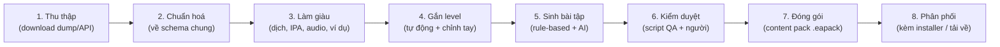

# 09 — Pipeline nội dung

Vấn đề lớn nhất của dự án: **chưa có sẵn kho bài học**. Tài liệu này mô tả cách biến dữ liệu thô từ nhiều nguồn miễn phí ([08](08-content-sources.md))
thành bài học có cấu trúc, gắn level, kiểm duyệt và đóng gói để app dùng offline.

## 1. Tổng quan



Mọi bước là **script TypeScript** trong `scripts/content/` chạy bằng `tsx` (giống Artisan command). Dữ liệu trung gian lưu ở `content/`:

```text
content/
├─ raw/          # 1. dữ liệu tải về nguyên bản (KHÔNG commit nếu lớn; có file SOURCES.md ghi nguồn + ngày tải + license)
├─ normalized/   # 2–4. JSONL theo schema chung (mỗi dòng 1 bản ghi)
├─ curated/      # 5–6. YAML/JSON đã duyệt — đây là "source code" của nội dung, CÓ commit vào git
│  ├─ curriculum/      # khung chương trình, grammar inventory
│  ├─ vocab-decks/
│  ├─ grammar/
│  ├─ readings/
│  ├─ listenings/
│  ├─ videos/
│  ├─ phrasebook/
│  ├─ courses/         # track → course → unit → lesson
│  └─ exams/
├─ media/        # audio/ảnh đã xử lý (git LFS hoặc lưu ngoài)
└─ packs/        # 7. file .eapack đã build
```

Lệnh (khai báo trong `package.json`):

| Lệnh | Việc làm | Trạng thái |
|---|---|---|
| `pnpm content:fetch [source...] [--force]` | Tải dữ liệu thô (`ngsl`, `tsl`, `cefrj`, `octanove`, `cmudict`, `wiktionary`, `tatoeba`), ghi checksum vào `content/raw/SOURCES.md` | ✅ |
| `pnpm content:normalize [stage...]` | Chuyển về schema chung: `wordlists` → `cmudict` → `tatoeba` → `wiktionary` → `merge` → `level` | ✅ |
| `pnpm content:enrich vi [--dry-run] [--limit N] [--import file]` | Sinh nghĩa tiếng Việt ngắn bằng LLM cho từ thiếu nghĩa → `curated/vocab/vi-generated.json` (§10.5) | ✅ `vi` (IPA + ví dụ làm trong `merge`; audio TTS chưa có) |
| `pnpm content:level` | Gắn lại level (sau khi sửa `content/curated/vocab/level-overrides.json` hoặc ngưỡng) + sinh decks | ✅ |
| `pnpm content:generate <kind>` | Sinh bài tập (rule-based hoặc AI) | chưa có |
| `pnpm content:validate [--pack file.eapack] [--release]` | Kiểm tra schema + QA tự động (+ kiểm tra pack đã build; `--release`: nội dung AI sinh phải `approved`) | ✅ |
| `pnpm content:build [packId]` | Đóng gói pack (mặc định `core-dictionary`) | ✅ |
| `pnpm content:lookup [từ...]` | Demo tra từ trên pack đã build | ✅ |
| `pnpm content:typecheck` | Typecheck `scripts/content` + `src/shared` | ✅ |

## 2. Nguyên tắc bắt buộc

1. **Mỗi bản ghi phải có `source`** (id nguồn, url, tác giả nếu có, license). Không có license → không được vào `curated/`.
2. Nội dung **share-alike** (CC BY-SA) đóng gói riêng pack và giữ nguyên license đó cho pack (xem [08](08-content-sources.md#1-chính-sách-giấy-phép)).
3. Nội dung do AI sinh: `source.id = "generated"`, ghi model + ngày, **bắt buộc qua kiểm duyệt** trước khi phát hành (`review.status = "approved"`).
4. Nội dung cho trẻ em phải qua checklist an toàn (mục 7).
5. Script phải **idempotent** (chạy lại không nhân đôi dữ liệu) — dùng id ổn định (hash từ nguồn + id gốc).

## 3. Schema nội dung

Schema định nghĩa bằng **zod** trong `src/shared/schemas/content/` — dùng chung cho script pipeline, validate khi import pack, và kiểu TypeScript cho app.

### 3.1 Trường dùng chung

```ts
const SourceRef = z.object({
  id: z.string(),                 // 'tatoeba' | 'ngsl' | 'voa' | 'generated' | 'original' ...
  url: z.string().url().optional(),
  author: z.string().optional(),
  license: z.string(),            // 'CC-BY-2.0-FR' | 'CC-BY-SA-4.0' | 'PD' | 'CC0' | 'proprietary-own' ...
  generatedBy: z.string().optional(), // vd 'claude-sonnet-5-5@2026-10-18'
})

const Meta = z.object({
  id: z.string(),                 // ổn định, vd 'word:en:apple', 'lesson:general-a2:u03:l02'
  level: LevelCode,               // 'PA1_1' ... 'C2'
  tracks: z.array(Track).default([]),  // rỗng = mọi track
  topics: z.array(z.string()).default([]), // 'food', 'travel', 'business'...
  source: SourceRef,
  review: z.object({ status: z.enum(['draft', 'ai_checked', 'approved', 'rejected']), by: z.string().optional() }),
})
```

### 3.2 Từ vựng (`word`)

Schema thật: [`src/shared/schemas/content/word.ts`](../src/shared/schemas/content/word.ts). Ví dụ (rút gọn) từ pack `core-dictionary`:

```json
{
  "id": "word:en:appointment",
  "lemma": "appointment",
  "pos": ["noun"],
  "ipa": { "us": "/əˈpɔɪnt.mɛnt/", "uk": "/əˈpɔɪnt.mɛnt/" },
  "senses": [
    {
      "id": "s4",
      "pos": "noun",
      "en": "An arrangement between people to meet; an engagement.",
      "vi": ["hẹn"],
      "tags": [],
      "examples": [{ "en": "They made an appointment to meet at six.", "sourceId": "wiktionary" }]
    }
  ],
  "vi": [{ "text": "hẹn", "pos": "noun", "origin": "wiktionary" }],
  "viShort": "hẹn",
  "forms": [{ "form": "appointments", "tags": ["plural"] }],
  "examples": [
    { "en": "I have an appointment at three.", "vi": "Tôi có một cuộc hẹn lúc ba giờ.", "sourceId": "tatoeba:12345" }
  ],
  "lists": ["ngsl", "cefrj"],
  "freqRank": 1839,
  "cefr": "A2",
  "level": "A2_2",
  "tracks": [],
  "topics": [],
  "source": { "id": "wiktionary", "url": "https://en.wiktionary.org/wiki/appointment", "license": "CC-BY-SA-4.0" },
  "attributions": [{ "id": "wiktionary", "license": "CC-BY-SA-4.0" }, { "id": "ngsl", "license": "CC-BY-SA-4.0" }],
  "review": { "status": "draft", "by": "pipeline" }
}
```

- `source` = nguồn chính (mục Wiktionary); `attributions` = mọi nguồn đóng góp (chi tiết ở bảng `sources`).
- `vi[].origin`: `wiktionary` (bảng dịch của mục tiếng Anh), `wiktionary-vi` (suy ngược từ mục từ tiếng Việt có định nghĩa đúng bằng từ này), `generated` (LLM — cần duyệt).
- `examples` ở cấp từ là câu Tatoeba chứa từ (không gắn nghĩa); `senses[].examples` là ví dụ Wiktionary của đúng nghĩa đó.
- Dữ liệu nhập từ nguồn mở có `review.status = "draft"` (chưa có người duyệt); quy tắc "phải approved" ở §2 áp dụng cho nội dung AI sinh.

### 3.3 Bài học & bài tập (`lesson`, `exercise`)

```json
{
  "id": "lesson:general-a2:u03:l02",
  "title": { "vi": "Hỏi giá & mặc cả", "en": "Asking prices" },
  "level": "A2_1",
  "tracks": ["general"],
  "skills": ["speaking", "vocabulary"],
  "estimatedMinutes": 8,
  "intro": { "vi": "Học cách hỏi giá và trả giá lịch sự." },
  "vocab": ["word:en:price", "word:en:discount", "word:en:expensive"],
  "grammar": ["grammar:how-much-many"],
  "items": [
    {
      "id": "ex:1",
      "type": "listen_choice",
      "audio": "media/lessons/general-a2-u03-l02/1.mp3",
      "transcript": "How much is this T-shirt?",
      "question": { "vi": "Người nói hỏi gì?" },
      "choices": ["Giá áo", "Màu áo", "Cỡ áo"],
      "answer": 0,
      "explain": { "vi": "\"How much is...?\" dùng để hỏi giá." }
    },
    {
      "id": "ex:2",
      "type": "word_order",
      "tokens": ["Can", "you", "give", "me", "a", "discount", "?"],
      "answers": [["Can", "you", "give", "me", "a", "discount", "?"]],
      "translation": { "vi": "Bạn có thể giảm giá cho tôi không?" }
    },
    {
      "id": "ex:3",
      "type": "gap_fill",
      "text": "It's too {{1}}. Do you have a cheaper one?",
      "blanks": { "1": { "accept": ["expensive"], "bank": ["expensive", "cheap", "big"] } }
    }
  ],
  "source": { "id": "original", "license": "proprietary-own" },
  "review": { "status": "approved", "by": "huy" }
}
```

Mỗi `type` có schema riêng (zod discriminated union theo `type`) — danh sách dạng bài ở [07](07-learning-modules.md#2-danh-mục-dạng-bài-tập-exercise-types).

### 3.4 Bài đọc / bài nghe / video

```json
{
  "id": "reading:storyweaver:12345",
  "kind": "reading",
  "title": "The Thirsty Crow",
  "level": "A1_1",
  "wordCount": 142,
  "paragraphs": [
    { "en": "A crow was very thirsty.", "vi": "Một con quạ rất khát nước.", "audio": { "src": "media/...mp3", "start": 0.0, "end": 2.1 } }
  ],
  "images": [{ "src": "media/...png", "afterParagraph": 0 }],
  "questions": [ { "type": "mcq", "...": "..." } ],
  "newWords": ["word:en:thirsty", "word:en:crow"],
  "source": { "id": "storyweaver", "url": "https://storyweaver.org.in/...", "author": "...", "license": "CC-BY-4.0" }
}
```

```json
{
  "id": "video:yt:abc123:intro",
  "kind": "video",
  "provider": "youtube",
  "videoId": "abc123XYZ",
  "start": 30, "end": 150,
  "level": "A2_2",
  "checkpoints": [ { "at": 75, "item": { "type": "mcq", "...": "..." } } ],
  "source": { "id": "youtube-embed", "url": "https://www.youtube.com/watch?v=abc123XYZ", "license": "embed-only" }
}
```

## 4. Gắn level tự động

Script `content:level` tính **gợi ý level**, người duyệt có thể ghi đè (`levelOverride`).

### Với từ vựng
Thứ tự ưu tiên (đã hiện thực trong [`scripts/content/level/thresholds.ts`](../scripts/content/level/thresholds.ts)):
1. Có trong bộ từ trẻ em tự soạn (sight words, từ chủ đề mầm non/tiểu học) → `PA1_*`. *(chưa có bộ từ này)*
2. Có level trong CEFR-J (A1–B2) / Octanove (C1–C2) → lấy level thấp nhất trong các dòng POS, tách nửa bậc theo `freqRank`: A1 → `A1_1` nếu rank < 500, còn lại `A1_2`; A2 → `A2_1` nếu < 1500; B1 → `B1_1` nếu < 2700; B2 → `B2_1` nếu < 4200; C1/C2 giữ nguyên.
3. Theo **thứ hạng NGSL**: ≤ 500 → A1_1, ≤ 1000 → A1_2, ≤ 1500 → A2_1, ≤ 2000 → A2_2, ≤ 2400 → B1_1, ≤ 2809 → B1_2. NGSL supplementary (thứ, tháng, số) → A1_1. TSL → B2_1 (rank TSL < 600) / B2_2. NAWL → B2 (chưa dùng — license chưa xác minh).
4. Ngoài mọi danh sách → theo `freqRank` gộp (NGSL rồi tần suất Tatoeba): ≤ 5000 → B1_2, ≤ 8000 → B2_1, ≤ 12000 → B2_2, ≤ 18000 → C1, còn lại C2. (Tách băng thay vì dồn hết vào C1/C2 vì nhiều từ hội thoại rất thông dụng — goodbye, butterfly — không có trong CEFR-J.)
5. Dạng rút gọn ngoài danh sách (`don't`, `it's`) lấy level của từ gốc.
6. Ghi đè tay: `content/curated/vocab/level-overrides.json` (`{ "levels": { "word:en:xyz": "A2_1" } }`) → `pnpm content:level`.
7. Từ học thuật/TOEIC giữ tag `lists` để lọc theo kỳ thi.

### Với câu / đoạn văn
Kết hợp 3 tín hiệu, lấy kết quả có trọng số:
- **Độ phủ từ vựng**: level thấp nhất mà ≥ 95% từ (đã lemmatize) nằm trong vốn từ tích luỹ của level đó.
- **Độ dễ đọc**: Flesch-Kincaid Grade, độ dài câu trung bình, số âm tiết/từ.
- **Ngữ pháp**: dò cấu trúc (regex/pattern) từ grammar inventory — có cấu trúc B2 thì không thể dưới B2.

Bảng ngưỡng nằm trong `scripts/content/level/thresholds.ts` và được hiệu chỉnh dần bằng dữ liệu (độ khó item tự điều chỉnh theo Elo — [06](06-levels-and-progression.md#2-rating-theo-từng-kỹ-năng)).

## 5. Xử lý audio

| Trường hợp | Cách làm |
|---|---|
| Nguồn có audio gốc (VOA, LibriVox, Tatoeba) | Chuẩn hoá: mono, 22–24 kHz, **Opus/OGG** hoặc MP3 64–96 kbps, chuẩn hoá âm lượng (ffmpeg `loudnorm`). |
| Bài dài cần tách câu | Căn chỉnh transcript với audio bằng Whisper (word timestamps) → lưu `start/end` từng câu. |
| Không có audio | Sinh bằng TTS lúc build (Piper với giọng có license thương mại — **không** dùng lessac/amy/ryan, xem [08](08-content-sources.md#9-model-ai--thư-viện-có-license-cần-chú-ý) — hoặc TTS của provider) — hoặc để app đọc bằng TTS hệ thống lúc chạy (nhẹ hơn, chất lượng thấp hơn). |
| Hội thoại nhiều người | TTS nhiều giọng (nam/nữ, US/UK/AU — IELTS cần nhiều giọng). |

Công cụ: `ffmpeg` (cài qua `winget install Gyan.FFmpeg`), gọi từ script bằng `execa`.

## 6. Sinh bài tập

### 6.1 Rule-based (miễn phí, chạy offline, nên dùng tối đa)
| Từ dữ liệu | Sinh ra |
|---|---|
| Câu song ngữ Tatoeba | `word_order`, `translate_sentence`, `dictation` (nếu có audio), `gap_fill` (đục từ mục tiêu) |
| Từ vựng + nghĩa | `mcq` nghĩa (đáp án nhiễu: từ cùng loại, cùng level, khác nghĩa), `tap_pairs`, `picture_choice` (nếu có ảnh) |
| Bài đọc | `gap_fill` tóm tắt, câu hỏi từ vựng trong ngữ cảnh |
| Cặp âm tối thiểu (CMUdict) | `pronounce_word`, `listen_choice` phân biệt âm |

### 6.2 Sinh bằng AI (cần duyệt)
Dùng cho: hội thoại theo tình huống, câu hỏi đọc hiểu, giải thích ngữ pháp, đề TOEIC/IELTS mô phỏng, truyện ngắn phân level, câu đố trẻ em.

Prompt mẫu đặt ở `scripts/content/prompts/*.md`, luôn gồm:
- Level mục tiêu + danh sách từ được phép/khuyến khích dùng (từ vốn từ tích luỹ của level).
- Danh sách điểm ngữ pháp được phép.
- Track & chủ đề, độ dài.
- **Định dạng đầu ra JSON đúng schema** (kèm schema rút gọn) → script validate bằng zod ngay.
- Yêu cầu: nội dung gốc, không trích sách/đề thi có bản quyền, phù hợp văn hoá, an toàn cho trẻ em nếu track trẻ em.

Sau khi sinh: chạy `content:level` để kiểm tra level thực tế có khớp yêu cầu không (lệch > 1 bậc → loại hoặc sinh lại).

Khi có backend Laravel, bước này chuyển thành **Job** trong Content Studio (queue + màn hình duyệt) — xem [03](03-architecture.md#7-backend-laravel-tuỳ-chọn-giai-đoạn-sau).

## 7. Kiểm duyệt (QA)

### Tự động (`content:validate`)
- [ ] Đúng schema zod.
- [ ] Có `source.license` hợp lệ trong danh sách cho phép.
- [ ] File media tồn tại, đúng định dạng, dung lượng hợp lý.
- [ ] Đáp án hợp lệ (index trong khoảng, `word_order` ghép lại khớp đáp án...).
- [ ] Level gợi ý lệch ≤ 1 bậc so với level gán.
- [ ] Lọc từ cấm / nội dung không phù hợp (danh sách từ cấm, đặc biệt cho track trẻ em).
- [ ] Không trùng lặp (hash nội dung chuẩn hoá).
- [ ] Chính tả tiếng Anh (LanguageTool) và tiếng Việt có dấu đầy đủ.

### Người duyệt (checklist)
- [ ] Đáp án đúng, giải thích dễ hiểu, không mơ hồ.
- [ ] Bản dịch tiếng Việt tự nhiên.
- [ ] Phù hợp lứa tuổi & văn hoá (không bạo lực, không chính trị, không định kiến).
- [ ] Audio rõ, khớp transcript.
- [ ] Đánh dấu `review.status = approved`.

Trong giai đoạn chưa có Content Studio: duyệt trực tiếp file YAML trong `content/curated/` qua Pull Request.

## 8. Đóng gói — Content pack

Một pack = file `.eapack` (thực chất là **zip**):

```text
general-a2-v3.eapack
├─ manifest.json
├─ content.db          # SQLite read-only chứa toàn bộ nội dung pack
├─ media/              # audio (ogg/mp3), ảnh (png/webp)
└─ LICENSES.md         # tổng hợp nguồn & giấy phép, sinh tự động
```

`manifest.json` (schema: [`src/shared/schemas/content/pack.ts`](../src/shared/schemas/content/pack.ts)):
```json
{
  "id": "general-a2",
  "version": "3.0.0",
  "schemaVersion": 1,
  "title": { "vi": "Tiếng Anh tổng quát A2", "en": "General English A2" },
  "levels": ["A2_1", "A2_2"],
  "tracks": ["general"],
  "license": "CC-BY-SA-4.0",
  "requires": ["core-dictionary@>=1.0.0"],
  "builtAt": "2026-10-18T08:00:00.000Z",
  "counts": { "words": 1200, "sentences": 3000, "decks": 4 },
  "files": [{ "path": "content.db", "sizeBytes": 48211234, "sha256": "..." }]
}
```
Zip không tự chứa hash của chính nó → `sha256` của cả file `.eapack` nằm ở file `<pack>.eapack.sha256` cạnh pack (và sau này trong danh mục pack trên server);
`files[].sha256` trong manifest để app kiểm tra `content.db` sau khi giải nén.

Các pack dự kiến:

| Pack | Nội dung | Kèm installer? |
|---|---|---|
| `core-dictionary` | Từ điển Anh–Việt, IPA, câu ví dụ | Có |
| `core-kids` | Phonics, từ mầm non/tiểu học, truyện tranh | Có |
| `core-a1-a2`, `core-b1-b2`, `core-c1-c2` | Lộ trình tổng quát theo bậc | A1–A2 có, còn lại tải về |
| `toeic`, `ielts` | Bộ từ + đề luyện | Tải về |
| `phrasebook` | Mẫu câu giao tiếp | Có |
| `share-alike-*` | Nội dung CC BY-SA tách riêng | Tuỳ |

**Cài pack trong app** (`ContentPackService`): kiểm tra sha256 → giải nén vào `userData/packs/<id>/<version>/` → validate `schemaVersion` → mở `content.db` read-only → đăng ký vào bảng `installed_packs` của `user.db`.
Nội dung giữa các pack tham chiếu bằng **id chuỗi** ổn định, không dùng id số tự tăng — để cập nhật pack không làm hỏng tiến độ người dùng (SRS, attempts lưu theo id chuỗi).

## 9. Kế hoạch nội dung tối thiểu cho MVP

| Hạng mục | Số lượng | Nguồn |
|---|---|---|
| Từ điển | ~ 30.000 mục từ (ưu tiên 10.000 từ phổ biến có nghĩa tiếng Việt tốt) | Wiktionary (kaikki) + danh sách tần suất |
| Bộ từ có level | NGSL (~2.800), CEFR-J (~7.800), TSL (~1.200), bộ từ trẻ em tự soạn (~500) | Xem 08 |
| Câu ví dụ song ngữ | 10.000+ cặp Anh–Việt (Tatoeba có ít câu tiếng Việt → bổ sung bằng dịch máy + duyệt) | Tatoeba + tự dịch |
| Bài đọc A1–B1 | 50 | StoryWeaver + tự soạn |
| Bài nghe A1–B1 | 30 | VOA Learning English |
| Điểm ngữ pháp A1–B1 | 40 | Tự soạn (AI hỗ trợ + duyệt) |
| Bài học lộ trình A1–A2 | 2 course × 8 unit × 4 lesson | Tự soạn từ các nguồn trên |

## 10. Đã làm: pipeline `core-dictionary` v1

Chạy từ đầu (máy sạch, cần mạng, ~1,5 phút + thời gian tải ~650 MB):

```bash
pnpm install
pnpm content:fetch && pnpm content:normalize && pnpm content:build
pnpm content:lookup went táo "ngan hang"
```

### 10.1 Luồng dữ liệu

| Stage | Đầu vào (`content/raw/…`) | Đầu ra (`content/normalized/…`) | Ghi chú |
|---|---|---|---|
| `fetch` | — | `raw/<source>/*`, `raw/sources.lock.json`, **`raw/SOURCES.md`** (commit) | Bỏ qua file đã tải (idempotent); `--force` để tải lại. `.bz2` của Tatoeba được giải nén sẵn. |
| `wordlists` | NGSL 1.2 (+ supplementary), TSL 1.2, CEFR-J 1.5, Octanove C1/C2 | `wordlists.json` | Rank NGSL/TSL, level CEFR thấp nhất theo POS, word family. TSL là ISO-8859-1. |
| `cmudict` | `cmudict.dict` | `cmudict.json` | ARPAbet → IPA kiểu Mỹ, có dấu nhấn theo nguyên tắc maximal onset ([`lib/arpabet.ts`](../scripts/content/lib/arpabet.ts)). |
| `wordfreq` | `wordfreq/large_en.msgpack.gz` (CC BY-SA 4.0, ghim commit) | `wordfreq.json` | Bậc tần suất ≤ 720 (~111k từ chữ cái). Chỉ dùng để **chọn và xếp hạng** từ ngoài Tatoeba (decoder: `lib/msgpack.ts`). |
| `tatoeba` | câu EN/VI + liên kết EN–VI | `tatoeba-eng.jsonl`, `tatoeba-freq.json`, `tatoeba-names.json` | Tần suất token (tách riêng viết hoa giữa câu → phát hiện tên riêng như "Tom"). |
| `wiktionary` | kaikki English `.jsonl.gz` (3,3 GB giải nén, **đọc theo luồng**), kaikki Vietnamese | `wiktionary.jsonl`, `wiktionary-vi-reverse.json` | Chỉ giữ mục từ thuộc danh sách hoặc token Tatoeba ≥ 3 lần (~65k/1,49 triệu mục). Lọc nhanh bằng regex trước `JSON.parse`. |
| `merge` | tất cả ở trên + `curated/vocab/vi-generated.json` (nếu có) | `words.base.jsonl`, `sentences.base.jsonl` | Chọn lemma, dạng từ, nghĩa, IPA, nghĩa Việt, câu ví dụ. |
| `level` | `*.base.jsonl` + `curated/vocab/level-overrides.json` | `words.jsonl`, `sentences.jsonl`, `decks.jsonl`, `missing-vi.json` | §4. |
| `enrich vi` (lệnh riêng `content:enrich vi`) | `missing-vi.json` + `words.jsonl` | **`curated/vocab/vi-generated.json`** (commit) | §10.5. Chạy xong → `content:normalize merge level`. |
| `build` | `normalized/*.jsonl` | `packs/core-dictionary-<ver>.eapack` (+ `.sha256`), `packs/samples/*.sample.json` (commit) | Validate trước, lỗi → dừng. |

### 10.2 Quy tắc chính trong `merge`
- **Chọn từ**: mọi từ trong NGSL/TSL/CEFR-J/Octanove có mục Wiktionary + từ ngoài danh sách theo tần suất Tatoeba (đã gộp dạng chia, ≥ 3 lần), tối đa 30.000 mục. 15 từ trong danh sách không có mục Wiktionary (vd `check-in counter`, `wornout`) bị bỏ qua và được in ra log.
- **`freqRank`**: rank NGSL (1–2809) cho từ NGSL; còn lại xếp theo tần suất Tatoeba từ 2810 trở đi. "Top 10k" = `freqRank ≤ 10000`.
- **Nghĩa**: bỏ nghĩa cổ/hiếm/phương ngữ khi còn nghĩa khác; tối đa 6 nghĩa/POS, 16 nghĩa/từ (nghĩa có bản dịch Việt luôn giữ). Mục chỉ là "American spelling of X" mượn nghĩa của X.
- **Nghĩa tiếng Việt**: (1) bản dịch `vi` của Wiktionary — gán vào đúng nghĩa khi wiktextract chắc chắn (`_dis1` ≥ 40); (2) nếu không có, suy ngược từ mục tiếng Việt định nghĩa đúng bằng từ đó (`origin: "wiktionary-vi"`); (3) nếu vẫn không có, lấy nghĩa LLM sinh trong `curated/vocab/vi-generated.json` (`origin: "generated"`, giữ đúng thứ tự trong file, bỏ mục `rejected`) và thêm attribution `{ id: "generated", license: "proprietary-own", generatedBy }` (§10.5). Thứ tự: hay xuất hiện trong bản dịch Tatoeba của câu chứa từ → có trong tra ngược → thứ tự gốc. `viShort` = 3 nghĩa đầu.
- **Dạng biến tố có mục riêng** (came, ran, apples, peed…): không lập mục riêng khi đó là dạng chia (plural/past/participle/third-person/comparative/superlative) của một lemma có trong từ điển và mục đó không có tính từ/trạng từ riêng hay nghĩa riêng đã có bản dịch Việt của Wiktionary (đã bỏ 1.885 mục ở bản 1.2.0). Tra "came" vẫn ra "come" nhờ `word_forms`. Dạng -ing (building, meeting) luôn giữ vì thường là danh từ riêng.
- **Loại trừ thủ công**: `curated/vocab/excluded-words.json` (`{ entries: { "word:en:looked": "lý do" } }`) — mục từ có nghĩa riêng sai/vô ích (chữ cái, tiền tố, từ lóng hiếm) bị loại dù được chọn theo tần suất/danh sách.
- **Mượn nghĩa cùng loại từ**: loại từ chỉ có dạng "cách viết khác của X" (jewelry n. = American spelling of jewellery) trong khi từ còn nghĩa riêng ở loại từ khác (jewelry v.) → mượn nghĩa cùng loại từ của X.
- **Từ nhạy cảm**: `curated/vocab/sensitive-words.json` (`{ entries: { "fuck": "profanity" } }`, nhóm profanity/sexual/slur/drugs/other) → `Word.sensitive = true` → cột `words.sensitive`; app ẩn từ này ở profile trẻ em. Chỉ liệt kê từ không nên hiện cho trẻ; từ đời thường (kill, die, beer) không đưa vào.
- **Dạng từ** (`word_forms`): `form_of` của Wiktionary (went → go), bảng biến tố (chỉ nhãn biến tố thật: plural, past, participle, comparative…), cách viết theo vùng (colour → color), word family NGSL/TSL. Bỏ quan hệ mang nhãn slang/viết tắt/phương ngữ… để không quy sai (`a` → `of`, `ho` → …).
- **IPA**: Wiktionary (GA/US cho `us`, RP/UK cho `uk`); thiếu giọng Mỹ thì lấy CMUdict.
- **Câu ví dụ**: ≤ 3 câu Tatoeba/từ, ưu tiên câu có bản dịch Việt, dài ~8 từ, không chứa từ khó hơn nhiều; mọi cặp EN–VI của Tatoeba đều được giữ. Câu gần trùng (khác hoa/thường, dấu câu) bị loại.

### 10.3 Kết quả build 2026-10-18 (`core-dictionary` 1.0.0)

| Hạng mục | Số lượng |
|---|---|
| File `.eapack` / `content.db` giải nén | 21,3 MB / 115 MB |
| Mục từ (`words`) | 26.605 (9.064 từ danh sách + 17.541 theo tần suất) — 12.587 có nghĩa Việt, 25.351 có IPA (bản 1.0.0; bản 1.2.0 xem dưới) |
| Dạng từ (`word_forms`) | 52.677 |
| Câu (`sentences`) / có bản dịch Việt | 74.167 / 19.594 |
| `sentence_words` | 364.769 |
| Decks | 12 (10 theo level A1_1…C2, NGSL, TOEIC/TSL) |
| Từ trong top 10k **chưa có nghĩa Việt** | **2.762** → danh sách ở `normalized/missing-vi.json` (đầu vào cho bước sinh nghĩa bằng LLM, §10.5) |
| **Cập nhật 1.1.0 (2026-10-19)** | 2.693/2.762 từ có nghĩa AI sinh (`draft`): nhập 2.162 mục độ tin cậy cao + 481 trung bình; **69 mục thấp giữ lại** chờ duyệt (phần lớn là dạng biến tố mang nghĩa hiếm như `came` = “thanh chì ghép kính”). Pack 21,6 MB |
| **Cập nhật 1.2.0 (2026-10-19)** | Dọn từ điển: bỏ 1.885 mục riêng của dạng biến tố, loại 68 mục vô ích (69 mục thấp đã xử lý hết), gắn cờ 104 từ nhạy cảm. **24.616 từ** (9.064 danh sách + 15.552 theo tần suất), 51.115 dạng từ, 70.480 câu, 2.139 từ dùng nghĩa AI sinh (`draft`). Pack 20,5 MB |
| **Bổ sung nghĩa (2026-10-19)** | Sau khi dọn, 304 từ mới lọt vào top 10k chưa có nghĩa → sinh bổ sung 303 từ (`claude-opus-5-5`, `draft`; `fu` loại thủ công). Top 10k đủ nghĩa: 2.442 từ dùng nghĩa AI sinh, tất cả `approved` (303 từ cuối duyệt qua `curated/vocab/vocab-303-review.csv`: 239 giữ nguyên, 63 sửa nghĩa) → `content:validate --release` đạt. **24.615 từ**, 9.714 từ ngoài top 10k chưa có nghĩa Việt. Pack 20,6 MB |

| **Cập nhật 1.3.0 (2026-10-22)** | Thêm nguồn **wordfreq** để mở rộng độ phủ. Từ ngoài danh sách phải nằm trong bảng wordfreq (loại tên riêng/lỗi gõ chỉ Tatoeba gặp; giữ dạng rút gọn don't/we'll/let's); từ chỉ có trong wordfreq xếp **sau** mọi từ cũ (rank > top 10k không đổi), `MAX_WORDS` 55.000. Nhận cả từ mà nghĩa duy nhất bị gắn nhầm nhãn `historical` (plaintiff). Dùng kaikki bản 2026-10-22. **43.628 từ** (24.615 → +19k), 78.590 dạng từ, 77.511 câu; 16.7k từ có nghĩa Việt; pack 26,3 MB. Phủ top 20k wordfreq: 16.362 → 17.3k (phần còn thiếu chủ yếu tên riêng/viết tắt: London, Mr, FBI). Nghĩa Việt của từ mới chủ yếu **chưa có** (hiện tiếng Anh) — bổ sung bằng `content:enrich vi` về sau. Tự gắn `sensitive` cho từ mới có nhãn vulgar/offensive/slur hoặc nghĩa đầu nói về tình dục (+~170 từ, hơi dư để an toàn cho trẻ). 34 từ bị đẩy vào top 10k do xếp lại thứ hạng được viết nghĩa mới (`draft`, **cần duyệt** trước `validate --release`). |

### 10.4 Hạn chế đã biết / việc tiếp theo
- Nghĩa Việt từ Wiktionary không đều và đôi khi gán sai nghĩa (wiktextract đoán, vd `appointment` → “kèo”). Từ không có nghĩa Wiktionary được bù bằng nghĩa LLM sinh (§10.5) — đã sinh 2.693 từ (`draft`), cần duyệt trước khi phát hành.
- ~~Dạng biến tố có mục riêng~~ — đã sửa ở `merge` (1.2.0, §10.2). `DictionaryService` vẫn giữ quy tắc xếp từ gốc lên trước cho các mục riêng còn lại (left, found…).
- **Độ phủ từ**: chỉ ~24,6k lemma (danh sách NGSL/TSL/CEFR-J + từ có ≥ 3 lần trong Tatoeba — kho câu đơn giản nên thiếu từ chuyên ngành/hiếm như `plaintiff`, `felony`, `byproduct`, `mollusk`). Tra gõ sai chính tả (registation) nay có gợi ý "Có phải bạn muốn tìm…" (`content/spelling.ts`, khoảng cách Damerau–Levenshtein ≤ 1–2). Mở rộng độ phủ cần nguồn tần suất giấy phép rộng rãi + tải lại kaikki (xem roadmap).
- Level câu chỉ dựa trên độ phủ từ vựng (chưa có độ dễ đọc và ngữ pháp như §4).
- Chưa có cụm động từ/thành ngữ ngoài các cụm có sẵn trong CEFR-J.
- Từ điển có cả từ tục/nhạy cảm (như mọi từ điển): 104 từ được gắn cờ `sensitive` và ẩn ở profile trẻ em; **câu ví dụ** Tatoeba chứa từ nhạy cảm chưa được lọc.
- `content.db` còn lưu `data` JSON đầy đủ (≈ 60 MB); có thể rút gọn nếu dung lượng cài đặt thành vấn đề.

### 10.5 Nghĩa tiếng Việt do LLM sinh (`content:enrich vi`)

Bù nghĩa Việt cho các từ trong top 10k **không có nghĩa Việt nào từ Wiktionary** (`normalized/missing-vi.json`) — chiến lược ở [08 §3](08-content-sources.md#3-từ-điển-nghĩa-phát-âm). Code: [`scripts/content/enrich/vi.ts`](../scripts/content/enrich/vi.ts), prompt: [`scripts/content/prompts/vi-meanings.md`](../scripts/content/prompts/vi-meanings.md), schema file curated: [`enrich/vi-generated.ts`](../scripts/content/enrich/vi-generated.ts).

```bash
pnpm content:enrich vi --dry-run --limit 50   # không cần key: in thống kê, ghi request vào content/.build/enrich-vi/requests.json
pnpm content:enrich vi --provider claude-cli  # dùng Claude Code CLI + phiên đăng nhập Claude (gói Pro/Max) — KHÔNG cần API key
ANTHROPIC_API_KEY=... pnpm content:enrich vi  # dùng Claude API (--limit N, --batch 40, --concurrency 3, --model, --effort)
pnpm content:enrich vi --import results.json  # nhập kết quả sinh ở nơi khác (Batch API, console, chat…) — cùng schema đầu ra
pnpm content:normalize merge level && pnpm content:validate
```

**Các cách sinh nghĩa — chọn một:**

| Cách | Cần gì | Ghi chú |
|---|---|---|
| `--provider claude-cli` (mặc định khi không có `ANTHROPIC_API_KEY`) | Đã cài Claude Code CLI và **đăng nhập**: chạy `claude` trong terminal rồi gõ `/login` | Mỗi lô là một lần `claude -p` không tương tác, không công cụ, không lưu phiên, chạy trong thư mục tạm (không nạp CLAUDE.md của dự án), JSON theo schema (`--json-schema`). Bỏ `ANTHROPIC_API_KEY` khỏi môi trường của CLI để tính vào gói đăng nhập thay vì phí API. Mặc định 2 luồng (giới hạn của gói); `--claude-bin <đường dẫn>` nếu `claude` không có trong PATH. Code: [`enrich/claude-cli.ts`](../scripts/content/enrich/claude-cli.ts). |
| `--provider api` (mặc định khi có `ANTHROPIC_API_KEY`) | API key trong biến môi trường | Structured outputs, server-side fallback, prompt caching (chi tiết bên dưới). |
| **Trong phiên Claude (Claude desktop / Claude Code)** — cách đã dùng cho bản 2026-10-19 | Không cần key hay CLI | `--dry-run` xuất toàn bộ lô → chia thành vài phần (`content/.build/enrich-vi/parts/`) → nhiều agent Claude trong phiên sinh song song, mỗi agent ghi file kết quả đúng định dạng `--import` (`content/.build/enrich-vi/results/part-XX.rN.json`) và tự kiểm tra id/độ dài/pos → nhập lần lượt bằng `--import` (một tiến trình, không ghi đè nhau) → `content:normalize merge level` → `content:build`. `generatedBy` ghi model đã sinh. |
| `--dry-run` → tự sinh ở nơi khác → `--import` | Không cần gì | `requests.json` có sẵn system prompt, JSON schema và từng lô — dán vào Claude/Cursor chat hoặc Batch API, gom kết quả thành `{ "model": "...", "items": [...] }` rồi `--import`. Cursor hiện không có CLI để gọi tự động nên dùng theo cách này. |

- **Đầu vào cho model**: lô ~40 từ, mỗi từ có `lemma`, `pos`, `level`, tối đa 5 định nghĩa tiếng Anh (cắt 140 ký tự) và 1 câu ví dụ — chỉ để phân biệt nghĩa; prompt yêu cầu dịch **từ**, không dịch câu định nghĩa.
- **Gọi API**: Claude (`@anthropic-ai/sdk`), mặc định `claude-opus-5-5`, effort `medium`, structured outputs (`betaZodOutputFormat`) → kết quả được zod validate rồi chuẩn hoá thêm (tách "a; b", bỏ trùng, bỏ nghĩa lặp lại chính từ tiếng Anh, tối đa 4 nghĩa × 60 ký tự, `pos` phải thuộc `pos` của từ). Bật server-side fallback (`fallbacks: "default"`): nếu model từ chối vì chính sách, server chạy lại trên model dự phòng và `generatedBy` ghi **model thực sự trả lời**. Lô bị từ chối / hết `max_tokens` / lỗi API thì bỏ qua — các từ đó vẫn nằm trong danh sách chờ.
- **Key**: (provider `api`) chỉ lấy từ biến môi trường `ANTHROPIC_API_KEY` (không đọc profile/token khác), không bao giờ in ra log; lỗi xác thực dừng toàn bộ. Provider `claude-cli` không dùng key — CLI chưa đăng nhập/hết phiên thì dừng với hướng dẫn `/login`. `--dry-run` và `--import` không cần key.
- **Idempotent**: từ đã có mục trong file curated (mọi trạng thái, kể cả `rejected`) không bao giờ bị gửi lại; muốn sinh lại một từ → xoá mục của nó. File được ghi sau mỗi lô (dừng giữa chừng không mất kết quả).
- **File curated** `content/curated/vocab/vi-generated.json` (commit, mỗi từ một dòng để diff dễ đọc):

  ```json
  "word:en:himself": {"lemma":"himself","meanings":[{"text":"chính anh ấy","pos":"pronoun"},{"text":"tự mình (anh ấy)","pos":"pronoun"}],"confidence":"high","source":{"id":"generated","license":"proprietary-own","generatedBy":"claude-opus-5-5@2026-10-18"},"review":{"status":"draft"}}
  ```

  `review.status`: `draft` (vừa sinh) → `ai_checked` (nếu có bước kiểm tra tự động bằng AI) → `approved` / `rejected` (người duyệt, ghi `review.by`, lý do vào `note`).
- **Merge**: chỉ dùng khi từ không có nghĩa Wiktionary (cả `wiktionary` lẫn `wiktionary-vi`); mục `rejected` bị bỏ qua; mục của từ nay đã có nghĩa Wiktionary cũng bị bỏ qua (giữ trong file, không xoá tự động). `missing-vi.json` vẫn liệt kê mọi từ không có nghĩa Wiktionary, kèm `generated: true` nếu đã được bù — log của stage `level` in số đã bù / còn thiếu.
- **Validate**: nghĩa `generated` không được trộn với nghĩa Wiktionary, phải có attribution `generated`/`proprietary-own`/`generatedBy` và mục curated còn dùng được; in số từ theo `review.status`. **`content:validate --release` báo lỗi nếu còn nghĩa AI sinh chưa `approved`** (§2.3) — bản build dev vẫn chứa nghĩa `draft`.
- **License**: bản ghi mang `proprietary-own` (`source.id = "generated"`, nguồn `generated` trong `scripts/content/sources.ts` → bảng `sources` + `LICENSES.md`). Định nghĩa tiếng Anh từ Wiktionary (CC BY-SA) chỉ được đưa vào prompt làm ngữ cảnh phân biệt nghĩa; trong pack `core-dictionary` mọi thứ vẫn phát hành dưới CC BY-SA của pack. ⚠️ Nếu sau này tách nghĩa sinh ra khỏi pack CC BY-SA, cần rà lại câu hỏi "phái sinh trực tiếp" ở [08 §10](08-content-sources.md#10-nội-dung-tự-tạo-nguồn-quan-trọng-nhất).

**Checklist duyệt** (sửa trực tiếp file JSON qua PR; ưu tiên `confidence: "low"/"medium"` và từ level thấp):
- [ ] Nghĩa đầu tiên là nghĩa phổ biến nhất ở level của từ; các nghĩa chính (danh/động/tính từ) đều có.
- [ ] Đúng loại từ (`pos`) và đúng nghĩa so với định nghĩa tiếng Anh; không dịch nhầm sang từ đồng âm/đồng dạng.
- [ ] Ngắn (1–4 từ), tự nhiên, đúng chính tả và **đủ dấu**; mỗi chuỗi một ý.
- [ ] Từ chức năng (mạo từ, trợ động từ, đại từ phản thân…) có cách diễn đạt người học hiểu được (vd `(mạo từ xác định)`).
- [ ] Không thô tục hơn từ gốc, không định kiến; từ nhạy cảm vẫn dịch trung tính.
- [ ] Đặt `review.status = "approved"` (hoặc `"rejected"` + `note`), `review.by` = tên người duyệt → `pnpm content:normalize merge level && pnpm content:validate`.

**Kết quả mẫu (2026-10-18)**: chưa có `ANTHROPIC_API_KEY` trong môi trường làm việc nên 50 từ đầu danh sách (the, would, could, off… provision) được sinh bằng `claude-opus-5-5` theo đúng prompt + schema rồi nhập qua `--import`. Sau `merge` + `level`: **50/2.762 từ được bù nghĩa (2.712 còn thiếu)**; số từ có nghĩa Việt trong pack 12.587 → 12.637; tất cả đang `draft` nên `content:validate` đạt, `content:validate --release` báo 50 lỗi chưa duyệt (đúng thiết kế).
