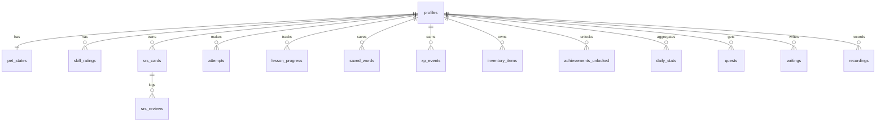

# 10 — Mô hình dữ liệu (SQLite)

## 1. Hai loại database

| DB | Vị trí | Quyền | Nội dung | Tương đương Laravel |
|---|---|---|---|---|
| `user.db` | `%APPDATA%/english-assistant/user.db` | Đọc/ghi | Profile, tiến độ, SRS, thú cưng, cài đặt | DB chính của app |
| `content.db` (mỗi pack 1 file) | `%APPDATA%/english-assistant/packs/<id>/<version>/content.db` | **Chỉ đọc** | Từ vựng, bài học, bài đọc... | Dữ liệu seed / CMS |

Tách riêng để: cập nhật/thay pack nội dung **không bao giờ** đụng tới tiến độ người dùng; backup người dùng nhẹ; sau này đồng bộ cloud chỉ cần đồng bộ `user.db`.

Liên kết giữa hai bên bằng **id chuỗi ổn định** (`content_id = 'word:en:apple'`), không dùng khoá ngoại SQL xuyên DB.

## 2. Quy ước chung (giống Laravel)

- Tên bảng **snake_case số nhiều**, cột snake_case.
- Bảng `user.db` đồng bộ được về sau → mỗi bảng có: `id` (TEXT, **UUID v7**), `profile_id` (nếu thuộc profile), `created_at`, `updated_at` (INTEGER — Unix ms), `deleted_at` (soft delete, nullable).
- Boolean lưu INTEGER 0/1; JSON lưu TEXT (Drizzle `mode: 'json'`).
- Thời gian luôn lưu UTC ms; hiển thị theo giờ máy.
- Migration bằng **drizzle-kit** (`pnpm db:generate` sinh SQL vào `src/main/db/migrations/`), app tự chạy migration khi khởi động (giống `php artisan migrate --force`).
- Bật `PRAGMA journal_mode = WAL; PRAGMA foreign_keys = ON;`.

## 3. Schema `user.db`

> ✅ **Đã có (Phase 1)** — migration `0000`: `profiles`, `pet_states`, `xp_events`, `inventory_items`, `settings`; migration `0001`: `installed_packs` (thêm cột `sha256`), `saved_words` (unique theo `profile_id + text`), `srs_cards` (thêm cột `learning_steps` theo ts-fsrs v5, unique theo `profile_id + content_id + direction`) — code ở `src/main/db/schema/index.ts`. Các bảng còn lại thêm dần theo module. Cột `profiles` hiện tối giản (`name`, `track`, `is_child`); các cột khác (mục tiêu, streak, PIN phụ huynh...) thêm khi làm tính năng tương ứng.



### profiles
| Cột | Kiểu | Ghi chú |
|---|---|---|
| id | TEXT PK | UUID v7 |
| name | TEXT | Tên hiển thị |
| avatar | TEXT | |
| birth_year | INTEGER NULL | Để gợi ý track trẻ em |
| track | TEXT | `preschool`/`primary`/`teen`/`general`/`toeic`/`ielts` |
| ui_language | TEXT | `vi`/`en` |
| explain_language | TEXT | `auto`/`vi`/`en` |
| daily_goal_minutes | INTEGER | 10/20/30/60 |
| new_words_per_day | INTEGER | |
| is_child | INTEGER | Bật hạn chế trẻ em |
| parent_pin_hash | TEXT NULL | Hash PIN phụ huynh (scrypt) |
| target_exam | TEXT NULL | `toeic:750`, `ielts:6.5` |
| placement_done_at | INTEGER NULL | |
| streak_current, streak_best, streak_freezes | INTEGER | |
| last_active_date | TEXT | `YYYY-MM-DD` giờ địa phương |
| + created_at, updated_at, deleted_at | | |

### pet_states (1–1 với profile)
| Cột | Kiểu | Ghi chú |
|---|---|---|
| id, profile_id | TEXT | |
| character_id | TEXT | `bi` |
| name | TEXT | Người dùng đặt tên |
| level, xp | INTEGER | XP trong level hiện tại |
| total_xp | INTEGER | |
| coins | INTEGER | |
| hunger, mood, energy | REAL | 0–100 |
| affection | INTEGER | |
| equipped | TEXT | Mảng JSON phụ kiện đang đeo (`["acc:bow"]`), mặc định `[]` — migration 0003 |
| stage | TEXT | `egg`/`baby`/`teen`/`adult`/`legend` |
| equipped | TEXT JSON | `{ "hat": "item:hat:straw", "glasses": null }` |
| last_tick_at | INTEGER | Để tính giảm chỉ số khi app tắt |
| position | TEXT JSON | Vị trí màn hình lần cuối `{displayId, x, y}` |

### skill_ratings
| Cột | Ghi chú |
|---|---|
| id, profile_id | |
| skill | `vocabulary`/`grammar`/`listening`/`reading`/`speaking`/`writing`/`phonics` |
| rating | REAL 0–1200 |
| confirmed_level | TEXT — level đã qua checkpoint |
| attempts_count | INTEGER — để giảm hệ số K dần |
| UNIQUE(profile_id, skill) | |

### srs_cards (thẻ ghi nhớ — trường theo FSRS)
| Cột | Ghi chú |
|---|---|
| id, profile_id | |
| content_id | `word:en:apple` hoặc `phrase:...` hoặc `custom:<uuid>` |
| direction | `en_vi`/`vi_en`/`audio_en`/`cloze`/`audio_picture` |
| custom_front, custom_back | TEXT NULL — thẻ người dùng tự tạo |
| context_sentence | TEXT NULL — câu gốc khi lưu từ lúc dịch |
| due | INTEGER | thời điểm đến hạn |
| stability, difficulty | REAL | FSRS |
| elapsed_days, scheduled_days, reps, lapses | INTEGER | FSRS |
| state | INTEGER | 0 New, 1 Learning, 2 Review, 3 Relearning |
| last_review | INTEGER NULL | |
| suspended | INTEGER | |
| INDEX(profile_id, due) | |

### lesson_progress (bài học nền tảng — migration 0004)
| Cột | Kiểu | Ghi chú |
|---|---|---|
| id | TEXT PK | UUID v7 |
| profile_id | TEXT FK | |
| lesson_id | TEXT | id bài trong `content/curated/lessons` (vd `tenses.present-simple`); UNIQUE(profile_id, lesson_id) |
| best | INTEGER | điểm cao nhất (0–100) |
| attempts | INTEGER | số lần làm bài tập |
| completed_at | INTEGER NULL | lần đầu đạt ngưỡng 70% (NULL = chưa hoàn thành) |
| created_at / updated_at / deleted_at | INTEGER | |

### srs_reviews (log — giúp tối ưu tham số FSRS về sau)
`id, profile_id, card_id, rating (1–4), state_before, due_before, elapsed_ms, reviewed_at, source ('study'|'mascot')`

### saved_words
Từ người dùng tra/lưu (kể cả chưa thành thẻ): `id, profile_id, content_id NULL, text, context, source_app (tên app đang dùng khi copy — tuỳ chọn, mặc định không lưu), lookup_count, last_lookup_at`.

### lesson_progress
`id, profile_id, lesson_id, status ('not_started'|'in_progress'|'completed'), best_score, last_score, completed_count, last_item_index, updated_at`. UNIQUE(profile_id, lesson_id).

### attempts (mỗi lần trả lời 1 câu)
| Cột | Ghi chú |
|---|---|
| id, profile_id | |
| content_id | id bài/đoạn (lesson, reading, exam...) |
| item_id | id câu trong bài |
| exercise_type | `mcq`, `dictation`... |
| skill | |
| item_difficulty | độ khó tại thời điểm làm |
| score | REAL 0–1 |
| answer | TEXT JSON — câu trả lời người dùng |
| duration_ms | |
| rating_before, rating_after | |
| session_id | |
| created_at | |

### item_calibrations
Độ khó item tự hiệu chỉnh (local): `content_item_key (content_id#item_id) PK, difficulty, n`. (Không ghi vào content.db vì read-only.)

### study_sessions
`id, profile_id, kind ('lesson'|'srs'|'micro'|'exam'|'free'), started_at, ended_at, active_ms, xp_earned`.

### xp_events (sổ cái — giống bảng transactions)
`id, profile_id, amount, coins, reason ('lesson.completed'|'card.reviewed'|...), ref_id, multiplier, created_at`.
Tổng XP/xu luôn tính lại được từ bảng này → tránh lỗi cộng sai.

### inventory_items
`id, profile_id, item_id ('food:onigiri', 'hat:straw'), quantity, acquired_at`. UNIQUE(profile_id, item_id).

### achievements_unlocked
`id, profile_id, achievement_id, unlocked_at, seen (0/1)`.

### quests
`id, profile_id, date, quest_id, progress, target, completed_at NULL, claimed_at NULL`.

### daily_stats (tổng hợp theo ngày cho biểu đồ)
`id, profile_id, date, active_minutes, cards_reviewed, new_words, lessons_completed, xp, by_skill (JSON)`. UNIQUE(profile_id, date).

### writings
`id, profile_id, prompt_id NULL, text, word_count, feedback (JSON: lỗi LanguageTool, điểm AI, bản sửa), provider, created_at`.

### recordings
`id, profile_id, item_id, file_path, duration_ms, transcript, score (JSON), expires_at`. File audio nằm ở `userData/recordings/`, tự xoá khi hết hạn.

### translations_history
`id, profile_id, input, output, direction, engine ('dict'|'opus-mt'|'llm:<provider>'), created_at`. Có cài đặt để tắt lưu lịch sử.

### installed_packs
`id (pack id) PK, version, path, schema_version, installed_at, enabled`.

### settings
Key–value: `scope ('global' hoặc id profile), key, value (JSON), updated_at`. PRIMARY KEY(scope, key).
(Không dùng `profile_id NULL` làm khoá chính vì SQLite coi các giá trị NULL là khác nhau.)
Danh sách khoá + kiểu + mặc định định nghĩa bằng zod ở `src/shared/schemas/settings.ts`; giá trị lưu sai/cũ tự rơi về mặc định.
Ví dụ key: `hotkeys.translate`, `mascot.scale`, `mascot.reminderMinutes`, `quiet.apps`, `quiet.dndHours`, `tts.voice`, `ai.provider`, `clipboard.watch`.
> **API key KHÔNG lưu ở đây** — lưu mã hoá bằng `safeStorage` của Electron vào file riêng (xem [16](16-privacy-and-security.md)).

## 4. Schema `content.db` (mỗi pack)

Content pack được build từ JSON đã duyệt; bảng tối ưu cho đọc & tìm kiếm.
Các bảng từ `meta` tới `sources` dưới đây **đã hiện thực** (schemaVersion 1) trong
[`scripts/content/build/schema.ts`](../scripts/content/build/schema.ts) — pack `core-dictionary` dùng chúng.
Các bảng còn lại là kế hoạch cho pack bài học.

| Bảng | Cột chính | Ghi chú |
|---|---|---|
| `meta` | key, value | `pack_id`, `version`, `schema_version`, `license`, `built_at`, `counts` (JSON) |
| `words` | id, lemma, pos (JSON), ipa_us, ipa_uk, level, freq_rank, lists (JSON), vi_short, sensitive (0/1), data (JSON `Word` đầy đủ) | INDEX(lemma COLLATE NOCASE), INDEX(level, freq_rank), INDEX(freq_rank). `vi_short` = nghĩa ngắn cho popup (NULL nếu chưa có). `sensitive = 1` = từ nhạy cảm, ẩn ở profile trẻ em (app vẫn đọc được gói cũ chưa có cột này) |
| `word_forms` | form (chữ thường), word_id, tags (JSON) — PK(form, word_id), WITHOUT ROWID | `went` → `word:en:go` (tags `["past"]`), `colour` → `word:en:color` (`["alternative", ...]`). Một dạng có thể trỏ nhiều lemma (`found` → find, found) |
| `words_fts` | FTS5(word_id UNINDEXED, lemma, vi_meanings), `tokenize='unicode61 remove_diacritics 2'`, `prefix='2 3'` | Tìm tiền tố tiếng Anh + tra ngược tiếng Việt; bỏ dấu được (`ngan hang` khớp `ngân hàng`) → app nên ưu tiên kết quả khớp đúng dấu |
| `sentences` | id, en, vi (bản dịch đầu tiên), level, audio, source (JSON), data (JSON `Sentence`, bỏ `wordIds`) | INDEX(level). URL Tatoeba suy ra từ id: `https://tatoeba.org/en/sentences/show/<n>` |
| `sentence_words` | word_id, sentence_id — PK(word_id, sentence_id), WITHOUT ROWID | Tìm câu ví dụ theo từ. Từ quá phổ biến (freq_rank ≤ 100: the, be...) chỉ được liên kết với câu chọn riêng cho nó |
| `decks` | id, kind (`level`/`topic`/`exam`/`list`), level, tracks (JSON), title (JSON), word_ids (JSON), data | Bộ từ |
| `grammar_points` | id, level, title (JSON), data (JSON) | (kế hoạch) |
| `courses` | id, track, level, title, data | (kế hoạch) |
| `units` | id, course_id, order, title, data | (kế hoạch) |
| `lessons` | id, unit_id, order, level, skills, data (JSON gồm items) | (kế hoạch) |
| `library_items` | id, kind (`reading`/`listening`/`video`/`phrase`), level, topics, title, data (JSON) | (kế hoạch) |
| `exams` | id, exam (`toeic`/`ielts`), part, level, data (JSON) | (kế hoạch) |
| `media` | path, mime, bytes, sha256 | (kế hoạch) |
| `sources` | id, name, url, license, attribution | Sinh màn hình "Giấy phép & ghi công" + `LICENSES.md` |

**Tra từ (gợi ý cho `DictionaryService`)** — demo chạy được: `pnpm content:lookup went táo`
([`scripts/content/lookup.ts`](../scripts/content/lookup.ts)):
1. `SELECT … FROM words WHERE lemma = ? COLLATE NOCASE` (khớp lemma).
2. `SELECT … FROM word_forms f JOIN words w ON w.id = f.word_id WHERE f.form = lower(?)` (dạng đã chia).
3. Không có kết quả → `words_fts MATCH 'vi_meanings : "<q>" OR lemma : "<q>"*'`, rồi xếp: nghĩa trùng nguyên văn > chứa đúng dấu > còn lại, sau đó theo `freq_rank`.
4. Câu ví dụ: `data.examples` của từ; thêm từ `sentence_words` (ưu tiên câu có `vi`, câu ngắn).

Nguyên tắc: cột hay lọc/sắp xếp → tách cột riêng có index; phần còn lại để trong `data` JSON (đã validate bằng zod khi build).

## 5. Ví dụ Drizzle schema (để tham khảo phong cách)

```ts
// src/main/db/schema/srsCards.ts
import { sqliteTable, text, integer, real, index } from 'drizzle-orm/sqlite-core'
import { timestamps } from './_columns'

export const srsCards = sqliteTable('srs_cards', {
  id: text('id').primaryKey(),
  profileId: text('profile_id').notNull().references(() => profiles.id),
  contentId: text('content_id').notNull(),
  direction: text('direction', { enum: ['en_vi', 'vi_en', 'audio_en', 'cloze', 'audio_picture'] }).notNull(),
  contextSentence: text('context_sentence'),
  due: integer('due').notNull(),
  stability: real('stability').notNull().default(0),
  difficulty: real('difficulty').notNull().default(0),
  elapsedDays: integer('elapsed_days').notNull().default(0),
  scheduledDays: integer('scheduled_days').notNull().default(0),
  reps: integer('reps').notNull().default(0),
  lapses: integer('lapses').notNull().default(0),
  state: integer('state').notNull().default(0),
  lastReview: integer('last_review'),
  suspended: integer('suspended', { mode: 'boolean' }).notNull().default(false),
  ...timestamps,
}, (t) => [index('srs_cards_profile_due').on(t.profileId, t.due)])
```

```ts
// src/main/db/schema/_columns.ts  (~ $table->timestamps(); $table->softDeletes();)
export const timestamps = {
  createdAt: integer('created_at').notNull().$defaultFn(() => Date.now()),
  updatedAt: integer('updated_at').notNull().$defaultFn(() => Date.now()).$onUpdateFn(() => Date.now()),
  deletedAt: integer('deleted_at'),
}
```

## 6. Backup & xuất dữ liệu

- `BackupJob` mỗi ngày: dùng `db.backup()` của better-sqlite3 → `userData/backups/user-YYYYMMDD.db`, giữ 7 bản.
- Cài đặt → "Xuất dữ liệu": file `.zip` gồm `user.db` + `recordings/` (tuỳ chọn). "Nhập dữ liệu": thay thế sau khi xác nhận.
- Xoá profile = soft delete, dọn hẳn sau 30 ngày (hoặc nút "Xoá vĩnh viễn" có xác nhận).
