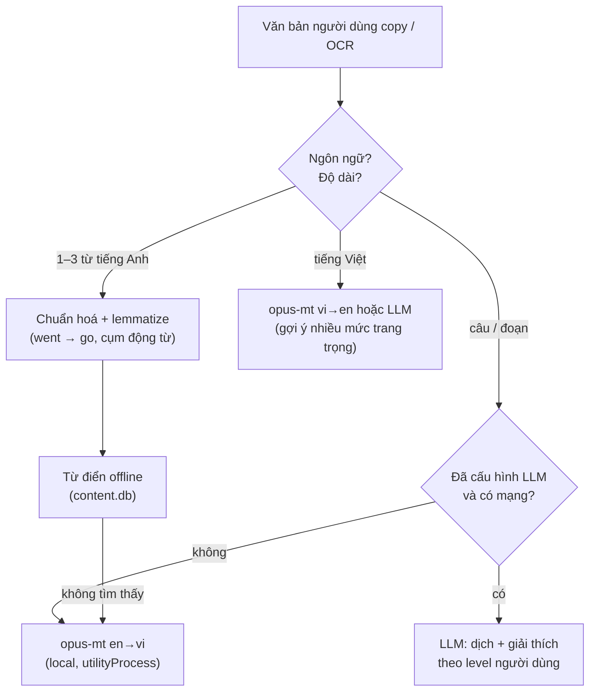

# 11 — AI, dịch, giọng nói

Nguyên tắc: **mọi chức năng đều có đường "miễn phí/offline"**, AI online chỉ để nâng chất lượng. Code luôn viết qua **interface** để đổi engine không ảnh hưởng chỗ khác
(giống Laravel `Contracts` + bind trong Service Provider).

## 1. Các interface (đặt ở `src/main/ai/contracts.ts`)

```ts
export interface TranslateEngine {
  id: string                                   // 'dict' | 'opus-mt' | 'llm'
  available(): Promise<boolean>
  translate(input: TranslateInput): Promise<TranslateResult>
}

export interface TtsEngine {
  id: string                                   // 'system' | 'piper' | 'provider'
  voices(): Promise<Voice[]>
  synthesize(text: string, opts: { voice: string; rate: number }): Promise<AudioRef>
}

export interface SttEngine {
  id: string                                   // 'whisper-local' | 'provider'
  transcribe(audio: Float32Array, opts: { language: 'en'; wordTimestamps?: boolean }): Promise<Transcript>
}

export interface LlmProvider {
  id: string                                   // 'ollama' | 'anthropic' | 'openai' | 'gemini' | 'openai-compatible'
  chat(req: LlmRequest): Promise<LlmResponse>  // hỗ trợ JSON output theo schema
  stream?(req: LlmRequest): AsyncIterable<string>
}

export interface GrammarChecker {
  id: string                                   // 'languagetool-local' | 'languagetool-public' | 'llm'
  check(text: string, level: LevelCode): Promise<GrammarIssue[]>
}
```

`AiRegistry` (trong `container.ts`) chọn engine theo cài đặt + khả năng hiện có, có **chuỗi fallback**: engine ưu tiên lỗi/offline → engine tiếp theo.

## 2. Dịch & tra từ

> ✅ **Đã làm (Phase 1)**: tra từ điển offline trong popup — `src/main/content/DictionaryService.ts` (cùng thuật toán với `pnpm content:lookup`), chuẩn hoá chuỗi copy ở `normalizeQuery` (`src/shared/schemas/dictionary.ts`), đọc clipboard **chỉ khi bấm phím tắt** và bỏ qua chuỗi giống mật khẩu/OTP (`src/main/system/clipboard.ts`), phát âm bằng `useTts`. 
>
> ✅ **Dịch câu offline (Phase 1)** — xem [decisions #12](decisions.md): copy một câu/cụm không có trong từ điển → popup dịch bằng opus-mt en→vi hoặc vi→en (tự nhận chiều) (`TranslationService` + `ModelManager` + `OpusMtEngine`/`worker.ts` trong utilityProcess). Model ~107 MB **không nằm trong bộ cài**: popup hỏi và tải khi người dùng bấm "Tải model" (có tiến trình, huỷ được, xác minh sha256). Đã kiểm tra thực tế trong Electron (cả layout đã đóng gói): ~0,15 giây/câu sau khi nạp model (~1,3 giây lần đầu). Cache LRU 200 câu trong bộ nhớ. **Chưa làm**: dịch Việt→Anh (model thứ hai), LLM qua API (phương án mở rộng), cache lưu đĩa, màn hình quản lý/xoá model trong Cài đặt. Lọc từ nhạy cảm cho profile trẻ em đã làm (từ, câu ví dụ, câu hỏi, bài tập).



- **Từ điển offline**: tra `word_forms` → `words`, hiển thị nghĩa theo level (nghĩa phổ biến trước), IPA, ví dụ, level badge, nút 💾.
- **Dịch máy local**: model **Helsinki-NLP opus-mt** (en→vi, vi→en) chạy bằng `transformers.js` trong `utilityProcess`. Tải model lần đầu (~ 100–300 MB mỗi chiều, lưu `userData/models/`), có thanh tiến trình, cho phép đổi thư mục. License Apache-2.0; bản ONNX có sẵn (Xenova). Model en→vi có thể cần token ngôn ngữ đích `>>vie<<` ở đầu câu — kiểm tra model card khi tích hợp. Chất lượng trung bình (đủ hiểu ý); LLM tốt hơn rõ rệt.
- **LLM**: prompt yêu cầu: bản dịch tự nhiên + (tuỳ chọn) giải thích ngắn từ/cấu trúc khó **theo level người dùng**, trả về JSON.
- **Cache**: kết quả dịch lưu cache (hash input + engine) để lần sau tức thì và tiết kiệm token.
- Mục tiêu tốc độ: từ đơn < 100 ms; câu với opus-mt < 1 s sau khi model đã nạp.

### Bắt văn bản người dùng muốn dịch
| Cách | Mô tả | Ưu tiên |
|---|---|---|
| Copy rồi bấm phím tắt | Người dùng Ctrl+C → `Ctrl+Alt+T` → main đọc `clipboard.readText()` | P0 (đơn giản, ổn định) |
| Theo dõi clipboard | Poll clipboard mỗi 500 ms (opt-in), nếu là tiếng Anh → mascot hiện gợi ý | P1 |
| OCR vùng màn hình | Phím tắt → overlay chọn vùng → `desktopCapturer` chụp → `tesseract.js` (eng) → dịch | P1 |
| Giả lập Ctrl+C khi bôi đen | Cần thư viện native gửi phím — **không làm** ở giai đoạn đầu (dễ xung đột, bị antivirus nghi ngờ) | ✖ |

## 3. Đọc to (TTS)

| Engine | Chất lượng | Offline | Ghi chú |
|---|---|---|---|
| **System** (`speechSynthesis` trong renderer) | Trung bình | Có | Dùng giọng Windows có sẵn (Microsoft David/Zira/Mark, giọng Natural nếu người dùng đã cài). Mặc định. Hướng dẫn người dùng cài thêm giọng tiếng Anh trong Windows Settings → Time & language → Speech. |
| **Piper** | Tốt, tự nhiên | Có | Chạy binary/ONNX local. ⚠️ Bản Piper mới là **GPL-3.0**, và nhiều giọng tiếng Anh phổ biến (lessac, amy, ryan) **cấm dùng thương mại** (xem [08](08-content-sources.md#9-model-ai--thư-viện-có-license-cần-chú-ý)). Khuyến nghị: chỉ dùng như **công cụ build nội dung** (sinh file audio sẵn) với giọng có license phù hợp, không nhúng vào app. |
| **Provider TTS** (OpenAI/Google/Azure...) | Rất tốt | Không | BYOK, cache file audio. |
| **Audio có sẵn trong pack** | Tốt nhất | Có | Luôn ưu tiên nếu nội dung có audio. |

> ✅ **Đã làm (Phase 1/2)** — **giọng tự nhiên Kokoro-82M** offline (xem [decisions #14](decisions.md)): `TtsService` + `KokoroEngine` (utilityProcess riêng) + `TtsCache` (đĩa) + `ModelInstaller`; Cài đặt → Giọng đọc: chọn "Giọng Windows" (mặc định) hoặc "Giọng tự nhiên", tải model ~92 MB (xác minh sha256), chọn giọng Mỹ/Anh (8 giọng), nghe thử. Mọi nút nghe (popup, bài học, ôn từ, luyện tập) dùng `useTts().speak` nên tự đổi giọng; lỗi/chưa tải → giọng Windows. Bộ nhớ đệm + `prefetch` cho bài học. Đo: ~0,9 s/từ, ~2 s/câu ngắn. ⚠️ Rủi ro giấy phép eSpeak-NG (GPL-3.0) trong `phonemizer` — xem decisions #14 trước khi thương mại hoá.

Tuỳ chọn người dùng: giọng US/UK, tốc độ 0.5x–1.5x.

## 4. Nhận dạng giọng nói (STT) & chấm phát âm

> Lưu ý: **Web Speech API nhận dạng giọng nói (`SpeechRecognition`) KHÔNG hoạt động trong Electron** (nó phụ thuộc dịch vụ Google của Chrome). Phải tự chạy model.

### Engine
- **Whisper local** qua `transformers.js` (model `whisper-tiny.en` / `whisper-base.en`, lượng tử hoá) trong `utilityProcess` hoặc Web Worker. Đủ nhanh cho câu ngắn trên CPU phổ thông.
- Tuỳ chọn: `whisper.cpp` (nhanh hơn, cần đóng gói binary) hoặc API STT của provider.

### Ghi âm
`navigator.mediaDevices.getUserMedia({ audio: true })` trong renderer → `AudioWorklet` lấy PCM 16 kHz mono → gửi `Float32Array` qua IPC tới engine.
Xin quyền micro: Electron cần xử lý `session.setPermissionRequestHandler` cho `media` (chỉ cho phép cửa sổ của app).

### Chấm điểm — làm theo 3 cấp độ (tăng dần độ khó)

| Cấp | Phương pháp | Đầu ra | Phase |
|---|---|---|---|
| **1. So khớp từ** | Whisper transcript ↔ câu mẫu, chuẩn hoá (lowercase, bỏ dấu câu), căn chỉnh bằng edit distance theo từ | % từ đúng, highlight từ sai/thiếu/thừa | P2 (MVP speaking) |
| **2. Độ trôi chảy** | Word timestamps của Whisper → tốc độ (WPM), khoảng ngừng dài, lặp từ | Điểm fluency | P2 |
| **3. Phát âm âm vị** | Model nhận dạng âm vị (wav2vec2 phoneme, ONNX) → so với phiên âm chuẩn từ CMUdict (ARPAbet → IPA) | Âm nào sai (vd /θ/ → /t/), gợi ý khẩu hình | P3 |

**Tránh "ảo giác" của Whisper**: Whisper có xu hướng tự sửa câu cho đúng ngữ pháp → khi chấm, dùng prompt ban đầu (initial prompt) là câu mẫu một cách thận trọng, và với cấp 1 chấp nhận sai số. Ghi chú này trên giao diện: "điểm mang tính tham khảo".

Lỗi phát âm điển hình người Việt (dùng để soạn bài & gợi ý): âm cuối (/s/, /t/, /k/, /d/), /θ/ /ð/, /ʃ/ vs /s/, /r/ vs /l/ vs /z/, nguyên âm dài/ngắn (/iː/ vs /ɪ/), trọng âm từ, nối âm.

## 5. LLM (tuỳ chọn)

### Provider hỗ trợ
| Provider | Khi nào dùng | Ghi chú |
|---|---|---|
| **Không dùng** (mặc định) | Mọi chức năng cơ bản | |
| **Ollama** (local) | Miễn phí, riêng tư, máy có GPU/RAM ≥ 16GB | Gọi HTTP `localhost:11434`. Model nhỏ tiếng Anh tốt; tiếng Việt yếu hơn. |
| **Anthropic Claude** | Chất lượng cao, giải thích tiếng Việt tốt | Gợi ý: `claude-haiku-5-5` cho dịch/giải thích nhanh, `claude-sonnet-5-5` cho chấm Writing/Speaking, sinh nội dung lúc build. |
| **OpenAI / Gemini / OpenAI-compatible** | Người dùng đã có key | Cùng interface. |

API key: người dùng tự nhập (BYOK), lưu mã hoá bằng `safeStorage`. Gọi API **từ main process** (không bao giờ đưa key xuống renderer).

### Các tác vụ dùng LLM
| Tác vụ | Đầu vào | Đầu ra (JSON) |
|---|---|---|
| `translate_explain` | văn bản, level người dùng | `{ translation, notes[] }` |
| `grammar_explain` | câu, câu hỏi | `{ explanation_vi, pattern, examples[] }` |
| `writing_feedback` | đề, bài viết, level/track, rubric | `{ scores{...}, overall, corrections[], improved_version, tips[] }` |
| `speaking_feedback` | câu hỏi, transcript, số liệu fluency | `{ scores{...}, feedback, better_answer }` |
| `roleplay_turn` | kịch bản, lịch sử, level | `{ reply, hint_vi?, correction? }` |
| `diary_correct` | đoạn nhật ký | `{ corrected, changes[] }` |

Prompt lưu thành file trong `src/main/ai/prompts/*.md` (có biến `{{level}}`, `{{track}}`...), không viết cứng trong code. Luôn validate kết quả bằng zod; sai định dạng → thử lại 1 lần → báo lỗi thân thiện.

### Kiểm soát chi phí & an toàn
- Hiển thị ước tính số lượt/token đã dùng trong tháng; cho đặt giới hạn.
- Cache kết quả theo hash input.
- Track trẻ em: **tắt** hội thoại tự do; chỉ dùng LLM cho tác vụ có cấu trúc (chấm câu, giải thích), system prompt có quy tắc an toàn, lọc đầu ra.
- Không gửi dữ liệu cá nhân không cần thiết (tên, lịch sử) lên LLM.

## 6. Kiểm tra ngữ pháp (LanguageTool)

| Chế độ | Mô tả |
|---|---|
| Public API | Gọi API công khai của LanguageTool — giới hạn ~20 request/phút, 20 KB/request (có thể đổi). Bắt buộc hiển thị link tới languagetool.org và báo người dùng văn bản được gửi đi. Mặc định khi có mạng. |
| Server local | Người dùng nâng cao tự chạy LanguageTool server (cần Java) → app trỏ `http://localhost:8081`. |
| LLM | Khi đã cấu hình LLM, dùng để giải thích lỗi bằng tiếng Việt dễ hiểu hơn. |

## 7. OCR

`tesseract.js` với dữ liệu `eng` (tải lần đầu, lưu local). Tiền xử lý ảnh (phóng to ×2, grayscale, tăng tương phản) để chữ nhỏ trên màn hình nhận tốt hơn. Chạy trong worker để không đứng UI.

## 8. Nhúng YouTube trong Electron

- Dùng **YouTube IFrame Player API** chính thức (embed) — không tải video, không cào phụ đề.
- Trang chạy từ `file://` thường bị YouTube từ chối phát (lỗi cấu hình player/referrer). Cách xử lý: đăng ký **custom protocol** (`protocol.registerSchemesAsPrivileged([{ scheme: 'app', privileges: { standard: true, secure: true } }])`) và load renderer qua `app://`, hoặc đặt header `Referer` hợp lệ qua `session.webRequest.onBeforeSendHeaders` cho domain youtube.
- CSP của cửa sổ Study phải cho phép `frame-src https://www.youtube-nocookie.com https://www.youtube.com`.
- Ưu tiên `youtube-nocookie.com` (chế độ bảo mật nâng cao).

## 9. Model local — quản lý tải về

| Model | Dùng cho | Kích thước ước tính | Khi nào tải |
|---|---|---|---|
| opus-mt en→vi, vi→en | Dịch offline | 100–300 MB/chiều | Lần đầu dịch câu (hỏi người dùng) |
| whisper tiny.en / base.en | STT | 40–150 MB | Lần đầu vào module Nói |
| tesseract eng | OCR | ~ 10–20 MB | Lần đầu OCR |
| wav2vec2 phoneme | Chấm âm vị | ~ 300 MB+ | Phase 3, tuỳ chọn |

`ModelManager` (main): danh sách model, trạng thái (chưa tải / đang tải / sẵn sàng), xác minh sha256, xoá model để giải phóng ổ đĩa (Cài đặt → Dữ liệu & model).
