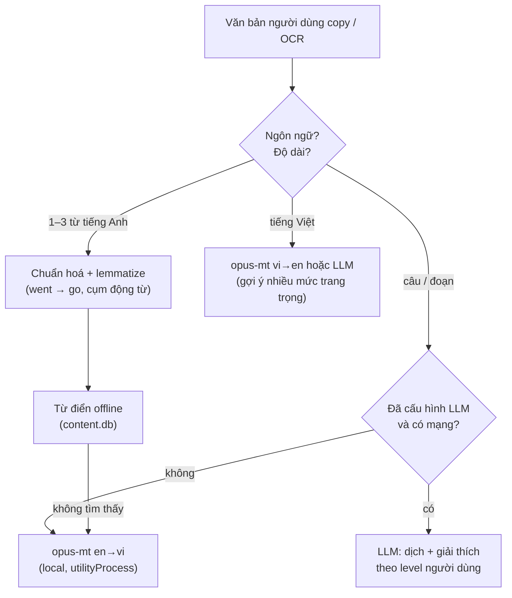

# 11 — AI, dịch, giọng nói

Nguyên tắc: **mọi chức năng đều có đường "miễn phí/offline"**, AI online chỉ để nâng chất lượng. Code luôn viết qua **interface** để đổi engine không ảnh hưởng chỗ khác
(giống Laravel `Contracts` + bind trong Service Provider).

## 1. Các interface (đặt ở `src/main/ai/contracts.ts`)

```ts
export interface TranslateEngine {
  id: string                                   // 'dict' | 'opus-mt' | 'llm'
  available(): Promise<boolean>
  translate(input: TranslateInput): Promise<TranslateResult>
}

export interface TtsEngine {
  id: string                                   // 'system' | 'piper' | 'provider'
  voices(): Promise<Voice[]>
  synthesize(text: string, opts: { voice: string; rate: number }): Promise<AudioRef>
}

export interface SttEngine {
  id: string                                   // 'whisper-local' | 'provider'
  transcribe(audio: Float32Array, opts: { language: 'en'; wordTimestamps?: boolean }): Promise<Transcript>
}

export interface LlmProvider {
  id: string                                   // 'ollama' | 'anthropic' | 'openai' | 'gemini' | 'openai-compatible'
  chat(req: LlmRequest): Promise<LlmResponse>  // hỗ trợ JSON output theo schema
  stream?(req: LlmRequest): AsyncIterable<string>
}

export interface GrammarChecker {
  id: string                                   // 'languagetool-local' | 'languagetool-public' | 'llm'
  check(text: string, level: LevelCode): Promise<GrammarIssue[]>
}
```

`AiRegistry` (trong `container.ts`) chọn engine theo cài đặt + khả năng hiện có, có **chuỗi fallback**: engine ưu tiên lỗi/offline → engine tiếp theo.

## 2. Dịch & tra từ

> ✅ **Đã làm (Phase 1)**: tra từ điển offline trong popup — `src/main/content/DictionaryService.ts` (cùng thuật toán với `pnpm content:lookup`), chuẩn hoá chuỗi copy ở `normalizeQuery` (`src/shared/schemas/dictionary.ts`), đọc clipboard **chỉ khi bấm phím tắt** và bỏ qua chuỗi giống mật khẩu/OTP (`src/main/system/clipboard.ts`), phát âm bằng `useTts`. 
>
> ✅ **Dịch câu offline (Phase 1)** — xem [decisions #12](decisions.md): copy một câu/cụm không có trong từ điển → popup dịch bằng opus-mt en→vi hoặc vi→en (tự nhận chiều) (`TranslationService` + `ModelManager` + `OpusMtEngine`/`worker.ts` trong utilityProcess). Model ~107 MB **không nằm trong bộ cài**: popup hỏi và tải khi người dùng bấm "Tải model" (có tiến trình, huỷ được, xác minh sha256). Đã kiểm tra thực tế trong Electron (cả layout đã đóng gói): ~0,15 giây/câu sau khi nạp model (~1,3 giây lần đầu). Cache LRU 200 câu trong bộ nhớ. **Chưa làm**: dịch Việt→Anh (model thứ hai), LLM qua API (phương án mở rộng), cache lưu đĩa, màn hình quản lý/xoá model trong Cài đặt. Lọc từ nhạy cảm cho profile trẻ em đã làm (từ, câu ví dụ, câu hỏi, bài tập).

> ✅ **Nâng cấp dịch offline (2026-10-22)** — thêm model tuỳ chọn **chất lượng cao**: mBART-50 many-to-many (`Xenova/mbart-large-50-many-to-many-mmt`, rev `8818d85`, ONNX q8, ~890 MB (848 MiB), **một model dịch cả Anh↔Việt**, mã en_XX/vi_VN). Lý do: opus-mt-en-vi hay dịch sai/nuốt từ (đã đo trên 8 câu mẫu: "climate change" bị bỏ "climate", "marketing strategy" → "các mới marketing", "lay off…" vô nghĩa; mBART dịch đúng "present" = món quà, "climate change", "chiến lược tiếp thị mới", đoạn văn mạch lạc). Cách dùng: Cài đặt → Dịch offline (tải/xoá, công tắc "Ưu tiên bản chất lượng cao"), hoặc nút "Tải bản chất lượng cao" ngay trong popup khi chưa có model / sau khi dịch bằng bản nhanh. `TranslationService` ưu tiên engine `mbart-50` khi đã tải và bật `translate.highQuality`, không thì dùng opus-mt của chiều đó; cache tách theo engine. Worker dịch **nhóm 2–3 câu một lần (≤ 320 ký tự)** để giữ ngữ cảnh (`groupSentences`), giới hạn nâng 600 → 1200 ký tự. Đo (CPU 4 luồng, q8): nạp ~4 s, 2–5 s/câu, ~8 s cho đoạn 3 câu (opus-mt ~0,3–0,9 s/câu). Còn sai ở thành ngữ/cụm động từ ("lay off" → "lay ra") và đôi chỗ lệch ngữ cảnh Việt→Anh. ⚠️ License: thẻ model trên HF không ghi license, kho fairseq là MIT; **không dùng NLLB** (CC-BY-NC) và VinAI en2vi (AGPL-3.0) theo chính sách docs/08.

> ✅ **Dịch trực tiếp trong popup (2026-10-29)** — từ có trong từ điển thì chỉ hiện nghĩa từ điển; từ/cụm **không có** trong từ điển nay cũng được dịch máy (trước đây để trống, chỉ hiện "không tìm thấy"). Giảm độ trễ câu: khi bấm phím tắt, main gọi `TranslationService.warmup(text)` nạp sẵn model (đúng chiều/engine) song song với tra từ điển, nên lần dịch đầu không phải chờ nạp model. Đo thực tế (2026-10-29, mBART q8, máy 12 nhân): nạp model ~3 giây (đây là lý do popup từng chậm 3–5 giây), sau đó từ ~0,4–0,9 giây, câu ngắn ~1,6 giây, câu dài ~3,3 giây; num_beams 1 vs 2 và 4 vs 8 luồng không khác biệt. ~~Vì vậy app còn nạp sẵn model 8 giây sau khi khởi động và giữ tiến trình dịch 20 phút khi không dùng.~~ Đã bỏ 2026-11-09 ([decisions #54](decisions.md)): nạp sẵn NLLB lúc khởi động giữ tới 3,7 GB RAM. Nay chỉ nạp khi mở popup; tiến trình tắt sau 10 phút rảnh (đã dùng NLLB thì 3 phút). Chất lượng câu vẫn phụ thuộc model (xem nâng cấp bản chất lượng cao ở trên).

> ✅ **NLLB-200 thay mBART-50 + dịch online tuỳ chọn (2026-10-29, đã thử tay OK (2026-11-11) trong app thật)** — xem [decisions.md #34](decisions.md). (1) Model chất lượng cao (khoá `high`) nay là NLLB-200 distilled 600M (`Xenova/nllb-200-distilled-600M`, rev `261c31d`, ~870 MB, mã `eng_Latn`/`vie_Latn`, `CC-BY-NC-4.0`): trên mẫu của người dùng đúng hơn mBART rõ rệt ("sa thải", "Chức năng trả lại null…"), Việt→Anh ổn, ~1–4 giây/câu sau khi nạp (~3 giây). Nhãn engine `mbart-50` → `nllb-200`; thư mục mBART cũ được xoá một lần khi khởi động. (2) Dịch online: Cài đặt → Dịch online (Claude), mặc định tắt (`translate.online`). `OnlineTranslator` (`src/main/translate/OnlineTranslator.ts`) gọi Messages API bằng `fetch` (model `claude-haiku-5-5`, `effort: low`, timeout 8 giây, prompt giữ nguyên thuật ngữ kỹ thuật); key do người dùng nhập, lưu mã hoá bằng `safeStorage` (`src/main/system/SecretStore.ts`, file `userData/secrets.json`), renderer chỉ biết `hasKey`; kênh `translate:online-status|set-key|clear-key`. Lỗi mạng/key/hạn mức → tự rơi về model offline (engine trả về cho popup là `claude` khi dịch online, huy hiệu "Claude"). Không log key hay văn bản.

> ✅ **Giảm RAM + dịch online Google/Azure (2026-11-09)** — xem [decisions.md #54](decisions.md). NLLB-200 chạy với arena CPU của onnxruntime tắt (~1,75 GB thay vì ~2,85 GB, chậm ~2 lần). `CloudTranslator` (`src/main/translate/CloudTranslator.ts`) gọi Google Cloud Translation v2 (header `x-goog-api-key`) rồi Azure Translator v3 (header key + region). Key do người dùng nhập trong Cài đặt → Dịch → Dịch online (Google / Microsoft), lưu mã hoá bằng `SecretStore`, đọc lại mỗi lần dịch; kênh `translate:set-cloud-key` / `translate:clear-cloud-key`, renderer chỉ biết `cloudKeys` (đã có key chưa). Thứ tự trong `TranslationService.translate`: Claude → Google → Azure → offline; cache theo engine. Key sai → tắt tới khi đổi key, lỗi tạm → nghỉ 5 phút, không báo lỗi. Cài đặt `translate.cloud` mặc định bật. Popup hiện nhãn "Google"/"Microsoft". Đã thử tay OK (2026-11-11) với key thật.



- **Từ điển offline**: tra `word_forms` → `words`, hiển thị nghĩa theo level (nghĩa phổ biến trước), IPA, ví dụ, level badge, nút 💾.
- **Dịch máy local**: model **Helsinki-NLP opus-mt** (en→vi, vi→en) chạy bằng `transformers.js` trong `utilityProcess`. Tải model lần đầu (~ 100–300 MB mỗi chiều, lưu `userData/models/`), có thanh tiến trình, cho phép đổi thư mục. License Apache-2.0; bản ONNX có sẵn (Xenova). Model en→vi có thể cần token ngôn ngữ đích `>>vie<<` ở đầu câu — kiểm tra model card khi tích hợp. Chất lượng trung bình (đủ hiểu ý); LLM tốt hơn rõ rệt.
- **LLM**: prompt yêu cầu: bản dịch tự nhiên + (tuỳ chọn) giải thích ngắn từ/cấu trúc khó **theo level người dùng**, trả về JSON.
- **Cache**: kết quả dịch lưu cache (hash input + engine) để lần sau tức thì và tiết kiệm token.
- Mục tiêu tốc độ: từ đơn < 100 ms; câu với opus-mt < 1 s sau khi model đã nạp.

### Bắt văn bản người dùng muốn dịch
| Cách | Mô tả | Ưu tiên |
|---|---|---|
| Copy rồi bấm phím tắt | Người dùng Ctrl+C → `Ctrl+Alt+T` → main đọc `clipboard.readText()` | P0 (đơn giản, ổn định) |
| Theo dõi clipboard | Poll clipboard mỗi 500 ms (opt-in), nếu là tiếng Anh → mascot hiện gợi ý | P1 |
| OCR vùng màn hình | Phím tắt → overlay chọn vùng → `desktopCapturer` chụp → `tesseract.js` (eng) → dịch | P1 |
| Bôi đen rồi bấm phím tắt (✅ đã làm 2026-10-22) | Khi bấm `Ctrl+Alt+T`, main gửi Ctrl+C giả lập (`SendInput` qua koffi, `system/selection.ts`), đợi `GetClipboardSequenceNumber` đổi, đọc chữ rồi **trả clipboard về như cũ** (sao lưu/khôi phục mọi định dạng). Không có gì được sao chép → dùng chữ đã Ctrl+C như trước. **Không gửi vào terminal** (cmd/PowerShell/Windows Terminal/PuTTY...: Ctrl+C ở đó là ngắt lệnh — danh sách ở `selectionRules.ts`). App chạy quyền admin sẽ chặn phím giả lập (UIPI) → tự rơi về clipboard. Tắt được: Cài đặt → Dịch nhanh → "Tự lấy chữ đang bôi đen" (`translate.autoCopy`). | P0 |

## 3. Đọc to (TTS)

| Engine | Chất lượng | Offline | Ghi chú |
|---|---|---|---|
| **System** (`speechSynthesis` trong renderer) | Trung bình | Có | Dùng giọng Windows có sẵn (Microsoft David/Zira/Mark, giọng Natural nếu người dùng đã cài). Mặc định. Hướng dẫn người dùng cài thêm giọng tiếng Anh trong Windows Settings → Time & language → Speech. |
| **Piper** | Tốt, tự nhiên | Có | Chạy binary/ONNX local. ⚠️ Bản Piper mới là **GPL-3.0**, và nhiều giọng tiếng Anh phổ biến (lessac, amy, ryan) **cấm dùng thương mại** (xem [08](08-content-sources.md#9-model-ai--thư-viện-có-license-cần-chú-ý)). Khuyến nghị: chỉ dùng như **công cụ build nội dung** (sinh file audio sẵn) với giọng có license phù hợp, không nhúng vào app. |
| **Provider TTS** (OpenAI/Google/Azure...) | Rất tốt | Không | BYOK, cache file audio. |
| **Audio có sẵn trong pack** | Tốt nhất | Có | Luôn ưu tiên nếu nội dung có audio. |

> ✅ **Đã làm (Phase 1/2)** — **giọng tự nhiên Kokoro-82M** offline (xem [decisions #14](decisions.md)): `TtsService` + `KokoroEngine` (utilityProcess riêng) + `TtsCache` (đĩa) + `ModelInstaller`; Cài đặt → Giọng đọc: chọn "Giọng Windows" (mặc định) hoặc "Giọng tự nhiên", tải model ~92 MB (xác minh sha256), chọn giọng Mỹ/Anh (8 giọng), nghe thử. Mọi nút nghe (popup, bài học, ôn từ, luyện tập) dùng `useTts().speak` nên tự đổi giọng; lỗi/chưa tải → giọng Windows. Bộ nhớ đệm + `prefetch` cho bài học. Đo: ~0,9 s/từ, ~2 s/câu ngắn. ⚠️ Rủi ro giấy phép eSpeak-NG (GPL-3.0) trong `phonemizer` — xem decisions #14 trước khi thương mại hoá.

Tuỳ chọn người dùng: giọng US/UK, tốc độ 0.5x–1.5x.

> ✅ **Gói âm thanh bài nghe tạo sẵn (2026-10-21, [decisions #26](decisions.md))** — tải thêm (MP3; gói 1.7.0 267,8 MB (267.760.884 byte, build 2026-11-11)) trong Cài đặt hoặc ở trang Nghe; có gói thì mọi câu có trong gói (bảng nguồn bên dưới) phát tức thì bằng giọng tự nhiên, không cần model Kokoro. Thứ tự phát: **gói tạo sẵn → giọng tự nhiên (Kokoro) → giọng Windows**. Khi chờ Kokoro tạo âm thanh, giao diện hiện vòng xoay "Đang tạo giọng đọc…" (cửa sổ Học tập, popup và cả mascot). Mã: `src/main/audio/`, `src/main/services/AudioPackService.ts`, `src/shared/audioPack.ts`, `useTts.ts` (`tryPack`).

> ✅ **Gói phủ mọi câu tĩnh app đọc to (2026-11-10; gói 1.7.0 đã build 2026-11-11)** — `scripts/audio/build-listening-audio.mjs` gom theo từng nguồn (mỗi nguồn một bộ gom, `--list` in bảng số câu/clip/dung lượng ước lượng):
>
> | Nguồn | Chỗ gọi | Giọng × tốc độ |
> |---|---|---|
> | Bài nghe `content/curated/listening` (khối audio) | `ListeningPlayer` | Mỹ + Anh × 0,6 / 0,8 / 1 |
> | Chế độ trẻ em (kids, world/places, từ của hình) | giao diện bé | Mỹ × 0,7 / 0,8 / 0,85 / 0,9 |
> | Bài học / ngữ pháp / bài đọc / bài nghe — khối `examples` | `LessonViewer` | cả hai × 0,9 |
> | — khối `sounds` (`say ?? text`) | `LessonViewer` (0,8) + `SpeakPractice` luyện âm (0,9) | cả hai × 0,8 / 0,9 |
> | — khối `passage`: từng câu (`splitSentences`) + "Nghe cả bài" (các đoạn nối bằng dấu cách, cắt theo `clipForTts`) | `ReadingPassage` | cả hai × 0,85 |
> | — bài tập `listen` (`say`), `picture` có `listen` (`word`) | `LessonExercises` + `AudioPrompt` | cả hai × 0,9 / 0,6 |
> | — lời giải đọc sau khi chấm: `gap` (`prompt` thay `___` đầu bằng `answers[0]`), `order` (`answer`) | `LessonExercises` (`speaksSolution`) | cả hai × 0,9 |
> | — bài tập `speak` (`say`) | `SpeakPractice` "Nghe mẫu" | cả hai × 0,9 |
> | TOEIC Part 1–4 | `ToeicPage.play` → `src/shared/toeicAudio.ts` (`toeicAudioLines`, dùng chung với script) | theo dòng (Mỹ/Anh) × 0,95 |
> | Bài kiểm tra trình độ — câu nghe `say` | `PlacementTest` | Mỹ × 0,9 / 0,6 |
> | Sổ tay mẫu câu `p.en` | `PhrasebookPage` | cả hai × 0,9 |
> | Câu thử giọng `tts.testText` | Cài đặt → Giọng đọc | Mỹ + Anh × 0,9 |
> | Bản thu thật VOA (`realAudioText(id)`) | `RealAudioPlayer` | MP3 nguyên bản |
>
> "Cả hai" = chỗ gọi để giọng mặc định (theo cài đặt `tts.accent`) nên tạo cả giọng Mỹ lẫn Anh. Khoá clip = `packClipKey(giọng, tốc độ, clipForTts(văn bản))`: đổi văn bản/tốc độ/giọng ở chỗ gọi thì phải sửa bộ gom tương ứng trong script, không thì câu đó rơi về Kokoro/giọng Windows. **Không** gồm từ điển (lemma + ví dụ ở ôn từ, luyện tập, danh sách từ, popup, QuizCard; lemma câu từ vựng của bài kiểm tra trình độ; từ tra trong `ReadingPassage`) — quá lớn và phụ thuộc kết quả tra từ lúc chạy. Đo `--list` ngày 2026-11-10: 11 870 clip (gồm 12 bản thu thật), ước lượng ~305 MB (24 KB/clip); gói 1.5.0 hiện phát hành có 6 074 clip (chỉ bài nghe + trẻ em).

## 4. Nhận dạng giọng nói (STT) & chấm phát âm

> Lưu ý: **Web Speech API nhận dạng giọng nói (`SpeechRecognition`) KHÔNG hoạt động trong Electron** (nó phụ thuộc dịch vụ Google của Chrome). Phải tự chạy model.

### Engine
- **Whisper local** qua `transformers.js` (model `whisper-tiny.en` / `whisper-base.en`, lượng tử hoá) trong `utilityProcess` hoặc Web Worker. Đủ nhanh cho câu ngắn trên CPU phổ thông.
- Tuỳ chọn: `whisper.cpp` (nhanh hơn, cần đóng gói binary) hoặc API STT của provider.

### Ghi âm
`navigator.mediaDevices.getUserMedia({ audio: true })` trong renderer → `AudioWorklet` lấy PCM 16 kHz mono → gửi `Float32Array` qua IPC tới engine.
Xin quyền micro: Electron cần xử lý `session.setPermissionRequestHandler` cho `media` (chỉ cho phép cửa sổ của app).

> ✅ **Đã làm (2026-10-21, đã thử tay OK (2026-11-11))** — cấp 1–2 với **Whisper base.en** (Xenova, ONNX q8, rev `95bf40a`, ~80 MB, Apache-2.0): `src/main/stt/` (`modelFiles.ts` ghim sha256, `worker.ts` trong utilityProcess, `WhisperEngine`), `SttService` (tải qua `ModelInstaller`, hàng đợi một yêu cầu/lần, cắt âm quá ngắn), kênh `stt:status|install|cancel|transcribe` + sự kiện `stt:status-changed`. Renderer: `useRecorder` (getUserMedia → ScriptProcessor, hạ mẫu 16 kHz, tự cắt lặng đầu/cuối, tự dừng 30 giây, chỉ giữ trong RAM), `useStt`, component `SpeakPractice.vue` (ghi → nhận dạng → chấm → hiện từ đúng/sai/thiếu/thừa, tốc độ nói, lời nhắc "điểm tham khảo"). Chấm điểm thuần ở `src/shared/speech.ts` (căn chỉnh theo từ bằng khoảng cách chỉnh sửa; từ ≥ 6 chữ lệch 1 ký tự vẫn đúng; số 0–20 chuẩn hoá; WPM + số quãng ngừng > 0,8 s từ mốc thời gian từng từ). Quyền micro: `applyPermissionPolicy()` chỉ cho `media` âm thanh của trang app. Đo thử trong Node: nạp model ~0,8 s, ~1,1 s cho câu ngắn; nhận dạng đúng giọng Kokoro đọc.
>
> ✅ **Tầng 3 (âm vị, wav2vec2) — đã làm (2026-10-21, đã thử tay OK (2026-11-11))**, tuỳ chọn tải thêm (Cài đặt → Nhận dạng giọng nói, hoặc ngay trong ô luyện phát âm): model `duyentq/sonari-wav2vec2-phoneme-int8` (bản ONNX int8, 355 MB, Apache-2.0, của `facebook/wav2vec2-lv-60-espeak-cv-ft`; URL ghim commit f0652c4 + sha256 `cd51f953…`, bảng âm 392 token lấy từ bản gốc rev ae45363 lưu ở `src/main/stt/wav2vec2-vocab.json`). `phonemeWorker.ts` (utilityProcess): chuẩn hoá âm thanh, `onnxruntime-node` chạy model, giải mã CTC tham lam → chuỗi âm vị nghe được; `phonemizer` (espeak-ng, cùng bộ IPA) tạo chuỗi âm vị mong đợi của văn bản. `shared/phonemes.ts` căn chỉnh hai chuỗi bằng khoảng cách chỉnh sửa có trọng số (nhóm âm tương đương theo ký hiệu: ɹ~r, ɜː~ɜ, ə~ɐ~ɚ, iː~i~iə…, bỏ qua âm đệm ʔ/j/w; cùng loại nguyên/phụ âm phạt nhẹ hơn) → mỗi âm: đúng / sai (nghe được âm gì) / thiếu / thừa, kèm mẹo sửa tiếng Việt cho 26 âm hay sai (/θ ð ʃ ʒ tʃ dʒ ɹ l ŋ ɪ iː æ ʌ ɔː ʊ uː ɜː ə v f/ và âm cuối s z t d k p). Dùng ở: khối `sounds` của bài học (bảng chữ cái, ngữ âm, âm khó: mỗi ô có nút 🎤, `phoneme-only`) và dạng bài `speak` (ưu tiên âm vị nếu đã tải, nếu chưa thì chấm theo từ bằng Whisper kèm gợi ý tải). Đo thử trong Node: nạp ~1 s, ~100 ms/từ, ~150 ms/câu; với giọng tổng hợp Kokoro `sheep`/`right` đúng hoàn toàn, `think` bị nghe thành /f/ (đúng kiểu lỗi cần phát hiện). ⚠️ Model hoạt động kém hơn với từ đơn rất ngắn; ngưỡng điểm (≥ 85 xuất sắc, ≥ 65 khá; hằng số `PHONEME_GREAT_MIN`/`PHONEME_GOOD_MIN`) mới đặt theo giọng tổng hợp. **Hiệu chỉnh cho giọng người Việt (2026-10-24, heuristic, chưa có dữ liệu ghi âm thật):** các kiểu thay âm quen thuộc (θ→t/s/f, ð→d/z, ʃ→s, ʒ→z, tʃ/dʒ, v→b, z→s, ɪ↔iː, ʊ↔uː, æ→ɛ, ɹ→l — bảng `VIETNAMESE_NEAR`) vẫn bị đánh dấu sai + nhắc mẹo nhưng được `NEAR_CREDIT` = 0,3 điểm (think→"fink" 83 = khá thay vì 75), âm lạ không được cộng. **Còn:** đo lại bằng ghi âm người Việt thật rồi chỉnh các hằng số trên. ⚠️ `phonemizer` dùng eSpeak-NG (GPL-3.0): xem rủi ro ở decisions #14. Chế độ trẻ em (2026-10-24, đã thử tay OK (2026-11-11)): khi đã tải model, hoạt động `speak` cho bé nói thật và chấm theo âm vị (kết quả chỉ là 1–3 sao + lời khen, bé luôn được đi tiếp), còn ở màn học chữ cái/âm/ghép âm có nút micro "nói thử" cho từ minh hoạ; chưa tải model thì giữ nút tự xác nhận ✓ như cũ. `SpeakPractice` có prop `kids`.

### Chấm điểm — làm theo 3 cấp độ (tăng dần độ khó)

| Cấp | Phương pháp | Đầu ra | Phase |
|---|---|---|---|
| **1. So khớp từ** | Whisper transcript ↔ câu mẫu, chuẩn hoá (lowercase, bỏ dấu câu), căn chỉnh bằng edit distance theo từ | % từ đúng, highlight từ sai/thiếu/thừa | P2 (MVP speaking) |
| **2. Độ trôi chảy** | Word timestamps của Whisper → tốc độ (WPM), khoảng ngừng dài, lặp từ | Điểm fluency | P2 |
| **3. Phát âm âm vị** | Model nhận dạng âm vị (wav2vec2 phoneme, ONNX) → so với phiên âm chuẩn từ CMUdict (ARPAbet → IPA) | Âm nào sai (vd /θ/ → /t/), gợi ý khẩu hình | P3 |

**Tránh "ảo giác" của Whisper**: Whisper có xu hướng tự sửa câu cho đúng ngữ pháp → khi chấm, dùng prompt ban đầu (initial prompt) là câu mẫu một cách thận trọng, và với cấp 1 chấp nhận sai số. Ghi chú này trên giao diện: "điểm mang tính tham khảo".

Lỗi phát âm điển hình người Việt (dùng để soạn bài & gợi ý): âm cuối (/s/, /t/, /k/, /d/), /θ/ /ð/, /ʃ/ vs /s/, /r/ vs /l/ vs /z/, nguyên âm dài/ngắn (/iː/ vs /ɪ/), trọng âm từ, nối âm.

## 5. LLM (tuỳ chọn)

> ✅ Đã làm (2026-11-10) — v1: **chỉ Anthropic Claude**, dùng **chung key** người dùng đã nhập cho "Dịch online (Claude)" (secret `'anthropic'` trong `SafeStorageSecretStore`, không có ô nhập key thứ hai) — docs/decisions.md #56.
> - `src/main/ai/AiClient.ts`: interface `AiClient { complete({ system, user, maxTokens, effort? }) }` (để thêm provider sau) + `AnthropicClient` gọi Messages API bằng `fetch` (header `anthropic-version: 2023-06-01`, timeout 15 s, HTTP lỗi / `refusal` / `stop_reason: max_tokens` (cắt cụt) / rỗng → throw; HTTP 401/403 → `AiKeyRejectedError`), model theo cài đặt `ai.model` (`claude-haiku-5-5` mặc định | `claude-sonnet-5-5`).
> - `src/main/ai/prompts.ts`: prompt là **hằng TS** (có biến `{{level}}`) thay cho file `.md` — đóng gói cùng main, không phải đọc file lúc chạy. Văn bản người dùng nằm trong thẻ `<sentence>` / `<diary>` ở phần `user`, system prompt dặn coi đó là dữ liệu, không phải lệnh. `fillPrompt` chỉ vô hiệu hoá thẻ đóng phân cách (`</sentence>`, `</question>`, `</diary>`, không phân biệt hoa thường/khoảng trắng: đổi `<` thành `‹`); chữ khác như `I <3 pizza` giữ nguyên.
> - `src/main/ai/AiService.ts`: `status()`, `explain()` (`grammar_explain`, trình độ = `learning.level`), `correctDiary()` (`diary_correct` → `{ corrected, changes[{ from, to, note_vi }], praise_vi }`, dùng bởi `DiaryService.correct()` qua kênh `diary:correct`, docs/07 §14). `max_tokens` 4096 cho cả hai tác vụ. Tách JSON từ `{` đầu tới `}` cuối → zod; câu trả lời đầy đủ mà sai → thử lại 1 lần → `AI_FAILED` (`errors.aiFailed`); lỗi mạng/HTTP và câu bị cắt cụt vì hết `max_tokens` không thử lại (`errors.aiFailed`); key bị từ chối (HTTP 401/403) → `AI_FAILED` với `errors.aiKeyRejected` ("Key Claude bị từ chối…"). Schema `examples` không giới hạn số phần tử (service chỉ giữ 3) để model trả dư không gây một lần gọi lại tốn tiền. Cache LRU 100 theo `tác_vụ:FNV-1a(input + level + ai.model)` (đổi model thì không dùng lại kết quả của model kia), không cache lỗi. Bộ đếm lượt gọi tháng (cache hit không tính, lần thử lại có tính) ở cài đặt `ai.usage` = `'YYYY-MM:n'` theo tháng cục bộ.
> - Tắt hẳn với **hồ sơ trẻ em** (`status().enabled = false`, gọi → `FORBIDDEN` / `errors.aiOff`); chưa bật `ai.enabled` hoặc chưa có key cũng `errors.aiOff`.
> - Kênh `ai:status`, `ai:explain`. Popup: nút "Giải thích ngữ pháp" dưới khối dịch (câu, cụm không có trong từ điển; câu tiếng Anh ≤ 600 ký tự) chỉ hiện khi `enabled && hasKey` (từ 2026-11-11: `enabled && ready`). Có kết quả thì popup nới từ 400×360 lên 520×600 (kênh send `popup:expand`, vẫn nằm trong vùng làm việc của màn hình), tra câu khác hoặc mở lại thì về cỡ gốc; chữ dài tự xuống dòng, không cuộn ngang. Cài đặt → Dịch: mục "AI (Claude)" (bật/tắt, chọn model, số lượt tháng này).
> - Chưa làm: Ollama/OpenAI/Gemini, giới hạn lượt/tháng cho key API, các tác vụ còn lại trong bảng dưới.
>
> ✅ Đã làm (2026-11-11) — **nhà cung cấp thứ hai: Claude Code CLI** (`claude -p`, dùng đăng nhập claude.ai gói Pro/Max của người dùng, không cần API key) — docs/decisions.md #57.
> - Cài đặt `ai.provider` = `auto` (mặc định: có key API → API; không key mà CLI đã cài + đăng nhập → CLI; không có gì → chưa sẵn sàng) | `api` | `cli`. `AiService` nhận `clients: { api, cli }` + `CliProbe`; khoá cache có thêm nhà cung cấp. `AiStatus`: `enabled`, `ready` (thay `hasKey`: có nhà cung cấp dùng được), `provider` (`api`/`cli`/null), `cliAvailable`, `cliState` (`unknown`/`ready`/`missing`/`loggedOut`/`error`), `cliCallsToday`, `cliDailyLimit`, `callsThisMonth`. Popup/Nhật ký hiện nút khi `enabled && ready`; trang Nhật ký đọc lại `aiReady` khi cửa sổ được focus hoặc có `settings:changed`.
> - `src/main/ai/resolveClaudeCli.ts`: tìm exe bằng `%SystemRoot%\System32\where.exe claude` (nơi khác `/usr/bin/which -a claude`), chỉ nhận đường dẫn tuyệt đối tên `claude.exe` (Windows) / `claude`, **bỏ `.cmd`/`.bat`/`.ps1`**; where.exe không cho kết quả hợp lệ → thử `~/.local/bin/claude.exe` (cùng kiểm tra); `claude auth status` (JSON) có `loggedIn: true` mới là sẵn sàng (timeout 10 s, cache 10 phút; exe phân giải một lần, nút "Kiểm tra lại" = kênh `ai:recheck-cli` phân giải lại; AI tắt / hồ sơ trẻ em → không chạy gì, tối đa 1 lần mỗi 5 s). Chỉ dò khi CLI có thể được dùng (AI bật, không phải hồ sơ trẻ em, hạn mức > 0, provider `cli` hoặc `auto` mà không có key); chưa dò lần nào thì `ai:status` chờ dò (`diary:today` không chờ: dò phía sau, trang Nhật ký đọc lại khi focus / `settings:changed`), quá 10 phút thì trả trạng thái cũ và dò lại phía sau (chỉ `auth status`, không gọi model). CLI báo chưa đăng nhập → bỏ cache để dò lại.
> - `src/main/ai/cliRunner.ts`: `spawn(exe, args, { shell: false, windowsHide: true })`, cwd = thư mục `mkdtemp(<temp>/english-assistant-ai-XXXXXX)` tạo một lần mỗi tiến trình (tên ngẫu nhiên, mới tạo nên rỗng, không xoá đệ quy), env = `process.env` bỏ `ANTHROPIC_API_KEY`, `ANTHROPIC_AUTH_TOKEN`, `ANTHROPIC_BASE_URL`, `ANTHROPIC_CUSTOM_HEADERS`, `ANTHROPIC_MODEL`, `ANTHROPIC_DEFAULT_*_MODEL`, `ANTHROPIC_BEDROCK_BASE_URL`, `ANTHROPIC_VERTEX_*`, `CLAUDE_CODE_USE_BEDROCK`, `CLAUDE_CODE_USE_VERTEX`, `CLAUDE_CODE_USE_FOUNDRY`, `CLAUDECODE`, `NODE_OPTIONS`, `ELECTRON_RUN_AS_NODE` (giữ biến proxy và `CLAUDE_CONFIG_DIR`); timeout 45 s → `taskkill /pid <pid> /T /F` **trước** (lúc tiến trình gốc còn sống, đường dẫn System32, không shell), chỉ khi taskkill lỗi / thoát ≠ 0 mới `kill()` tiến trình gốc (nơi khác SIGKILL); stdout tối đa 512 KB (đếm byte, vượt → kill + lỗi); stderr giữ 4 KB, không log.
> - **CLI chạy trong utilityProcess `aiCliWorker`** (2026-11-11): `src/main/ai/cliWorker.ts` (entry build `aiCliWorker` trong `electron.vite.config.ts`, serviceName "English Assistant AI CLI") nhận `{ id, exe, args, stdin, opts }` và gọi đúng `runCli` ở trên (vẫn là cài đặt duy nhất: không shell, env `cliEnv`, cwd `aiTempDir()` của worker, timeout 45 s + taskkill cây, giới hạn 512 KB / 4 KB, dữ liệu người dùng chỉ qua stdin); trả `{ id, ok: true, result }` hoặc `{ id, ok: false, message }` với message chỉ là lý do cố định `ai-cli: ...` (main lọc lại bằng `safeCliReason`). Phía main: `createWorkerCliRunner` (`cliWorkerClient.ts`) là `CliRunner` dùng cho **cả** `ClaudeCliClient` lẫn `ClaudeCliLocator`/`findClaudeCandidates` (`claude auth status`, where.exe) — main không spawn CLI nào. Worker khởi động ở lần gọi đầu, tắt sau 5 phút rảnh; watchdog `opts.timeoutMs + 5 s` → reject `ai-cli: worker timeout` + kill worker (lần sau tạo mới). `container.ts` vẫn nhận runner qua `options.ai.cli.run` (index.ts tiêm, test không có CLI). **Lý do**: đo 2026-11-11, `spawn(claude.exe, ['-p', ...])` ngay trong tiến trình main của Electron chặn luồng main 0,7–1,4 giây (cùng lệnh từ Node thường chỉ 10–16 ms — chi phí tạo tiến trình của Windows/AV khi tiến trình cha là electron.exe); main giữ global mouse hook của mascot (`setIgnoreMouseEvents(true, { forward: true })`) nên chuột cả hệ thống bị đơ khi bấm "Giải thích ngữ pháp" / "Sửa bằng AI".
> - `src/main/ai/ClaudeCliClient.ts`: `claude -p --model haiku|sonnet --effort low --setting-sources "" --strict-mcp-config --tools "" --disable-slash-commands --safe-mode --no-session-persistence --output-format json --system-prompt <prompt cố định>`; **dữ liệu người dùng chỉ qua stdin**, không có tham số vị trí. Không bao giờ dùng `--bare` (tắt OAuth), `--dangerously-skip-permissions`, `--permission-mode`, `--add-dir`, `--mcp-config`, `--settings`, `--plugin-dir`, `--resume`, `--continue`. Model: `claude-haiku-5-5` → `haiku`, `claude-sonnet-5-5` → `sonnet`. CLI không có cờ `max_tokens` nên `maxTokens` bị bỏ qua. Đầu ra: `JSON.parse(stdout)`; `is_error`/`subtype ≠ success` → lỗi; chữ lỗi trong `result` có "usage limit"/"limit reached"/"rate limit"/"limit exceeded"/"hit your limit" (không khớp "usage" đứng một mình) → `AI_LIMIT` `errors.aiPlanLimit`; "not logged in"/"login"/"authenticat…"/"unauthorized" (theo ranh giới từ) (trong `result`, hoặc stderr khi thoát ≠ 0 không có JSON) → `errors.aiCliLogin`; `stop_reason: max_tokens` → lỗi; trả `result`.
> - **Hạn chế dùng CLI**: mỗi lúc 1 tiến trình (hàng đợi trong `AiService`, tối đa 2 yêu cầu chờ, quá → `AI_BUSY` `errors.aiBusy`; tới lượt thì xét lại cache nên bấm 2 lần cùng câu chỉ chạy 1 lần); hạn mức ngày `ai.cliDailyLimit` (0–200, mặc định 30, 0 = tắt CLI) đếm ở `ai.cliUsage` = `'YYYY-MM-DD:n'` theo ngày cục bộ, kiểm tra trước mỗi lần chạy (lượt thử lại do sai định dạng cũng tính; cache hit không tính), hết → `AI_LIMIT` `errors.aiDailyLimit`. Renderer không ghi được `ai.usage`/`ai.cliUsage` qua `settings:set` (`MAIN_ONLY_SETTING_KEYS`). Chỉ gọi khi người dùng bấm.
> - Cài đặt → Dịch → "AI (Claude)": chọn nhà cung cấp, dòng trạng thái Claude Code + nút "Kiểm tra lại", hạn mức/ngày (10/30/60/Tắt), "Hôm nay đã dùng n/N", ghi chú dùng chung hạn mức gói Claude.
> - Đo thử (2026-11-11, Claude Code 2.1.317, haiku, prompt 1 dòng): ~2,8–3,1 s mỗi lần; 651 token đầu vào, như nhau có/không `--safe-mode` (không tool, không MCP/CLAUDE.md nào bị nạp). Vẫn thêm `--safe-mode` (tắt CLAUDE.md, skill, plugin, hook, MCP) làm lớp chặn thứ hai; đăng nhập OAuth vẫn chạy với cờ này.

### Provider hỗ trợ
| Provider | Khi nào dùng | Ghi chú |
|---|---|---|
| **Không dùng** (mặc định) | Mọi chức năng cơ bản | |
| **Ollama** (local) | Miễn phí, riêng tư, máy có GPU/RAM ≥ 16GB | Gọi HTTP `localhost:11434`. Model nhỏ tiếng Anh tốt; tiếng Việt yếu hơn. |
| **Claude Code CLI** (✅ 2026-11-11) | Người dùng có gói Claude Pro/Max, không có API key | Chạy `claude -p` headless, không tool, hạn mức lượt/ngày; xem khối ✅ ở trên và #57. |
| **Anthropic Claude** | Chất lượng cao, giải thích tiếng Việt tốt | Gợi ý: `claude-haiku-5-5` cho dịch/giải thích nhanh, `claude-sonnet-5-5` cho chấm Writing/Speaking, sinh nội dung lúc build. |
| **OpenAI / Gemini / OpenAI-compatible** | Người dùng đã có key | Cùng interface. |

API key: người dùng tự nhập (BYOK), lưu mã hoá bằng `safeStorage`. Gọi API **từ main process** (không bao giờ đưa key xuống renderer).

### Các tác vụ dùng LLM
| Tác vụ | Đầu vào | Đầu ra (JSON) |
|---|---|---|
| `translate_explain` | văn bản, level người dùng | `{ translation, notes[] }` |
| `grammar_explain` | câu, câu hỏi | `{ explanation_vi, pattern, examples[] }` |
| `writing_feedback` | đề, bài viết, level/track, rubric | `{ scores{...}, overall, corrections[], improved_version, tips[] }` |
| `speaking_feedback` | câu hỏi, transcript, số liệu fluency | `{ scores{...}, feedback, better_answer }` |
| `roleplay_turn` | kịch bản, lịch sử, level | `{ reply, hint_vi?, correction? }` |
| `diary_correct` | đoạn nhật ký, level | `{ corrected, changes[{ from, to, note_vi }], praise_vi }` |

Prompt là hằng string trong module TS `src/main/ai/prompts.ts` (có biến `{{level}}`...; trước đây định để file `.md` — đổi để đóng gói cùng main, xem #56). Luôn validate kết quả bằng zod; sai định dạng → thử lại 1 lần → báo lỗi thân thiện.

### Kiểm soát chi phí & an toàn
- Hiển thị ước tính số lượt/token đã dùng trong tháng; cho đặt giới hạn.
- Cache kết quả theo hash input.
- Track trẻ em: **tắt** hội thoại tự do; chỉ dùng LLM cho tác vụ có cấu trúc (chấm câu, giải thích), system prompt có quy tắc an toàn, lọc đầu ra.
- Không gửi dữ liệu cá nhân không cần thiết (tên, lịch sử) lên LLM.

## 6. Kiểm tra ngữ pháp (LanguageTool)

| Chế độ | Mô tả |
|---|---|
| Public API | Gọi API công khai của LanguageTool — giới hạn ~20 request/phút, 20 KB/request (có thể đổi). Bắt buộc hiển thị link tới languagetool.org và báo người dùng văn bản được gửi đi. Mặc định khi có mạng. |
| Server local | Người dùng nâng cao tự chạy LanguageTool server (cần Java) → app trỏ `http://localhost:8081`. |
| LLM | Khi đã cấu hình LLM, dùng để giải thích lỗi bằng tiếng Việt dễ hiểu hơn. |

## 7. OCR

`tesseract.js` với dữ liệu `eng` (tải lần đầu, lưu local). Tiền xử lý ảnh (phóng to ×2, grayscale, tăng tương phản) để chữ nhỏ trên màn hình nhận tốt hơn. Chạy trong worker để không đứng UI.

## 8. Nhúng YouTube trong Electron

- Dùng **YouTube IFrame Player API** chính thức (embed) — không tải video, không cào phụ đề.
- Trang chạy từ `file://` thường bị YouTube từ chối phát (lỗi cấu hình player/referrer). Cách xử lý: đăng ký **custom protocol** (`protocol.registerSchemesAsPrivileged([{ scheme: 'app', privileges: { standard: true, secure: true } }])`) và load renderer qua `app://`, hoặc đặt header `Referer` hợp lệ qua `session.webRequest.onBeforeSendHeaders` cho domain youtube.
- CSP của cửa sổ Study phải cho phép `frame-src https://www.youtube-nocookie.com https://www.youtube.com`.
- Ưu tiên `youtube-nocookie.com` (chế độ bảo mật nâng cao).

## 9. Model local — quản lý tải về

| Model | Dùng cho | Kích thước ước tính | Khi nào tải |
|---|---|---|---|
| opus-mt en→vi, vi→en | Dịch offline | 100–300 MB/chiều | Lần đầu dịch câu (hỏi người dùng) |
| whisper tiny.en / base.en | STT | 40–150 MB | Lần đầu vào module Nói |
| tesseract eng | OCR | ~ 10–20 MB | Lần đầu OCR |
| wav2vec2 phoneme | Chấm âm vị | ~ 300 MB+ | Phase 3, tuỳ chọn |

`ModelManager` (main): danh sách model, trạng thái (chưa tải / đang tải / sẵn sàng), xác minh sha256, xoá model để giải phóng ổ đĩa (Cài đặt → Dữ liệu & model).
