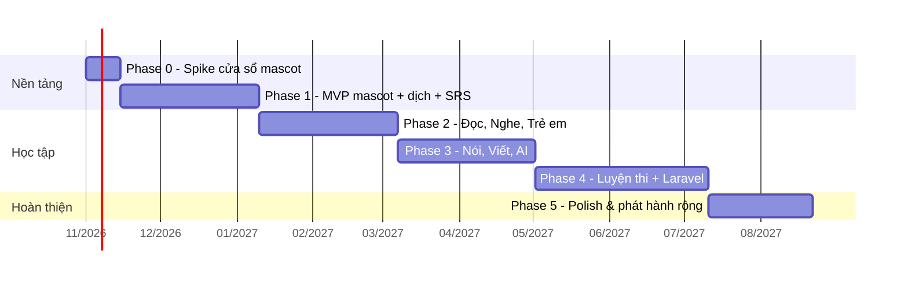

# 14 — Lộ trình phát triển

Thời gian ước tính cho **1 dev part-time (~15–20 giờ/tuần)**, mới làm desktop lần đầu. Có AI hỗ trợ code thì nhanh hơn. Mỗi phase kết thúc bằng một bản chạy được.

> Song song với code, **pipeline nội dung** ([09](09-content-pipeline.md)) phải chạy từ Phase 1 — nội dung là phần tốn thời gian nhất.

---

## Phase 0 — Spike: cửa sổ mascot (≈ 2 tuần)

Mục tiêu: chứng minh các kỹ thuật khó nhất chạy được trên Windows.

- [x] Tạo project electron-vite + Vue + TS ([04](04-getting-started.md)), ghim Node/pnpm bằng Volta
- [x] Cửa sổ trong suốt, không khung, luôn trên cùng, không hiện taskbar, không cướp focus
- [x] Click xuyên qua vùng trong suốt, bắt được click trên nhân vật — đã thử tay OK (2026-10-18)
- [x] Kéo thả nhân vật; thả ra rơi xuống mép taskbar (có trọng lực); click → nhảy vui — đã thử tay OK (2026-10-18)
- [x] Animation sprite sheet (idle + walk + drag/fall/land/happy) bằng canvas, nhân vật tự đi qua lại — sprite tạm (`pnpm sprites:placeholder`)
- [x] Tray icon: Hiện/Ẩn, Đưa về góc, Thoát
- [x] Phím tắt toàn cục `Ctrl+Alt+T` bật/tắt popup trống cạnh con trỏ (Esc / click ra ngoài để đóng) — *đã code, cần thử tay*
- [x] Phát hiện app fullscreen → ẩn mascot (cùng màn hình với mascot; game DirectX độc quyền & chế độ trình chiếu ẩn ở mọi màn hình) — đã xác nhận thực tế với một game toàn màn hình
- [x] Build được installer `.exe` (`pnpm build:win`, ~112 MB) — [ ] cài thử trên máy khác
- [ ] Kiểm tra LibreSprite có xuất tag trong JSON không ([05](05-mascot-system.md#quy-trình-art))

**Đo CPU (bản dev, 2026-10-18):** đứng yên ~1–2% tổng các tiến trình Electron; đang đi bộ ~3–12%. Cần đo lại trên bản production và tối ưu thêm nếu vượt ngân sách ([03](03-architecture.md#8-hiệu-năng--ngân-sách-tài-nguyên)).

**DoD:** Cài trên một máy Windows sạch, mascot đi dạo trên taskbar, kéo thả được, không cản trở dùng máy, CPU idle < 2%.

## Phase 1 — MVP (≈ 8 tuần)

Mục tiêu: dùng được hằng ngày: thú cưng + dịch nhanh + từ vựng.

**Nền tảng**
- [ ] Cấu trúc thư mục theo [03](03-architecture.md), `ipc-contract`, container, event bus, Clock
- [ ] SQLite `user.db` + Drizzle + migration tự chạy
- [ ] Profile (tạo, chọn, nhiều profile), onboarding: chọn track, tự đánh giá level
- [ ] Cài đặt cơ bản (phím tắt, tần suất nhắc, kích thước mascot, khởi động cùng Windows)
- [ ] i18n vi/en, design tokens, bộ component `Px*`
- [ ] Cài content pack (`core-dictionary`, bộ từ NGSL/CEFR-J) — `ContentPackService`

**Mascot**
- [ ] State machine: idle, walk, sleep, drag, fall, land, happy, talk, eat
- [ ] Bong bóng thoại + hàng đợi
- [ ] Menu chuột phải
- [ ] Chỉ số nuôi + `PetDecayJob` + cho ăn + túi đồ
- [ ] XP, xu, level thú cưng, `xp_events`
- [ ] Chế độ yên lặng đầy đủ (fullscreen, app họp, hẹn giờ ẩn, giờ không làm phiền)

**Dịch & từ điển**
- [ ] Popup dịch: copy + phím tắt → tra từ điển offline
- [ ] TTS hệ thống (US/UK)
- [ ] Dịch câu: opus-mt local (tải model khi cần) — hoặc tạm thời LLM BYOK nếu opus-mt chưa xong
- [ ] Lưu từ → sổ từ + tạo thẻ SRS kèm câu ngữ cảnh

**Học**
- [ ] SRS với ts-fsrs: phiên ôn trong cửa sổ Study
- [ ] Micro-learning: "Từ của khoảnh khắc" + quiz thẻ đến hạn qua mascot
- [ ] Trang chủ Study: lộ trình hôm nay, streak, nhiệm vụ ngày
- [ ] Placement rút gọn (từ vựng + ngữ pháp) & rating theo kỹ năng

**Nội dung (song song)**
- [ ] Pipeline: fetch + normalize Tatoeba, NGSL, CEFR-J, kaikki (Wiktionary), CMUdict
- [ ] Build `core-dictionary` + `decks` theo level

**DoD:** Dùng liên tục 1 tuần không lỗi nghiêm trọng; dịch từ < 1s; học & ôn từ vựng hằng ngày được; thú cưng phản ứng với việc học.

## Phase 2 — Đọc, Nghe, Trẻ em (≈ 8 tuần)

- [ ] Hệ thống dạng bài tập (registry) + các dạng: `mcq`, `gap_fill`, `word_order`, `tap_pairs`, `picture_choice`, `listen_choice`, `dictation`, `true_false_ng`
- [ ] Course → Unit → Lesson player, lưu tiến độ, chấm điểm, rating Elo
- [ ] Trình đọc tương tác (bấm từ tra, highlight từ trên level, TTS theo câu, song ngữ)
- [ ] Trình nghe (tốc độ, A–B loop, theo câu, transcript)
- [ ] Ngữ pháp: trang điểm ngữ pháp + bài tập
- [ ] Phrasebook
- [ ] Track trẻ em: phonics, chữ cái, picture book, chế độ phụ huynh (PIN, giới hạn thời gian)
- [ ] Checkpoint lên cấp, thành tựu, cửa hàng phụ kiện, tiến hoá thú cưng
- [ ] Thống kê cơ bản
- [ ] Nội dung: 50 bài đọc + 30 bài nghe A1–B1, 40 điểm ngữ pháp, 2 course A1–A2
- [ ] Auto-update

**DoD:** Một người A1–B1 và một bé 6–8 tuổi đều có lộ trình học ≥ 4 tuần không hết bài.

## Phase 3 — Nói, Viết, AI (≈ 8 tuần)

- [ ] Ghi âm + Whisper local (utilityProcess) + `ModelManager`
- [ ] `speak_repeat`, `pronounce_word` (chấm cấp 1–2), shadowing
- [ ] Cấu hình AI (provider, key mã hoá, giới hạn chi phí)
- [ ] LLM: giải thích ngữ pháp/câu, dịch nâng cao, `writing_feedback`, `speaking_feedback`, roleplay (người lớn)
- [ ] LanguageTool cho Writing
- [ ] Dạng bài `write_free`, `translate_sentence`, `transform`, `speak_answer`, `roleplay`
- [ ] Nhật ký tiếng Anh (💡) nếu kịp
- [ ] OCR vùng màn hình
- [ ] Theo dõi clipboard (opt-in)

**DoD:** Luyện nói/viết được hoàn toàn offline ở mức cơ bản; có AI thì nhận feedback chi tiết theo rubric.

## Phase 4 — Luyện thi + Backend Laravel (≈ 10 tuần)

- [ ] TOEIC: 7 Part, mini test, full test, ước lượng điểm
- [ ] IELTS: Reading/Listening dạng bài đầy đủ, Writing Task 1/2, Speaking Part 1–3 chấm AI
- [ ] Video library (YouTube embed + checkpoint)
- [ ] Track B2–C2 nội dung
- [ ] **Laravel**: API Sanctum, Content Studio (Filament) soạn/duyệt/sinh nội dung bằng AI, xuất pack, kho pack tải về
- [ ] Đồng bộ tiến độ (tuỳ chọn đăng nhập)

**DoD:** Người luyện TOEIC/IELTS có ≥ 5 đề mini + ngân hàng câu theo Part; pack mới phát hành qua backend mà không cần cập nhật app.

## Phase 5 — Polish & phát hành rộng (≈ 6 tuần)

- [ ] Nhiều nhân vật, mini-game
- [ ] Chấm phát âm cấp 3 (âm vị)
- [ ] Tối ưu hiệu năng, chế độ pin yếu
- [ ] Ký số code signing, trang giới thiệu, hướng dẫn sử dụng
- [ ] Thu thập phản hồi (form/issue, không tracking ẩn)
- [ ] Bản macOS (tuỳ nhu cầu)

---

## Rủi ro chính & cách giảm

| Rủi ro | Mức | Giảm thiểu |
|---|---|---|
| Thiếu nội dung chất lượng | Cao | Bắt đầu pipeline sớm; dùng AI sinh + duyệt; ưu tiên rule-based từ dữ liệu mở |
| Vấn đề license nội dung | Cao | Chính sách ở [08](08-content-sources.md); mọi bản ghi có `source.license`; tách pack share-alike |
| Cửa sổ trong suốt lỗi trên một số máy/GPU | Trung bình | Spike Phase 0 trên nhiều máy; tuỳ chọn tắt hardware acceleration |
| Model AI local nặng, chậm trên máy yếu | Trung bình | Model nhỏ lượng tử hoá; tải theo nhu cầu; fallback online |
| Mascot gây phiền → người dùng tắt | Cao | Chế độ yên lặng thông minh, tần suất mặc định thấp, dễ chỉnh |
| Phạm vi quá lớn cho 1 người | Cao | Bám MVP, cắt tính năng 💡, mỗi phase phải ra bản dùng được |
| Antivirus cảnh báo app chưa ký | Trung bình | Code signing (Phase 5); không dùng kỹ thuật hook bàn phím |
