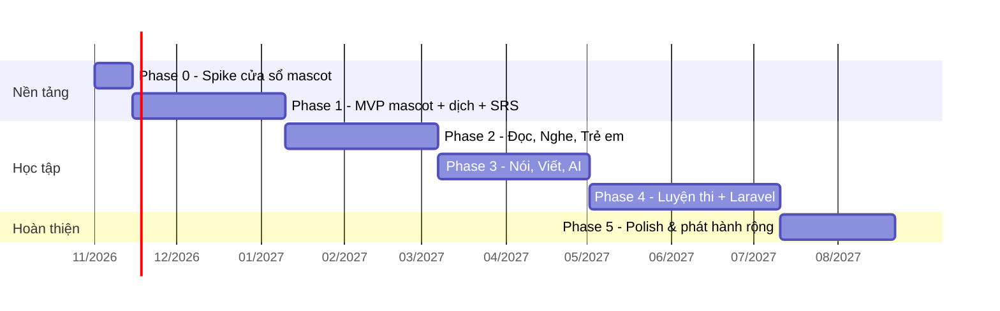

# 14 — Lộ trình phát triển

Thời gian ước tính cho **1 dev part-time (~15–20 giờ/tuần)**, mới làm desktop lần đầu. Có AI hỗ trợ code thì nhanh hơn. Mỗi phase kết thúc bằng một bản chạy được.

> Song song với code, **pipeline nội dung** ([09](09-content-pipeline.md)) phải chạy từ Phase 1 — nội dung là phần tốn thời gian nhất.

---

## Nhật ký tiến độ (cập nhật liên tục)

- [x] (2026-11-12) **Dọn tài liệu và file tạm** (không đổi code). Tài liệu: đóng các dòng lỗi thời ở trang này (mascot nhắc lộ trình, vùng bấm Huyền thoại, cảnh 12 nơi còn ghi "Đang làm", `SpritePackManager`, LibreSprite) và ở [30](30-product-review-2026-11.md) (§1, §5 mục 4, §6). File tạm bị gitignore đã xoá (≈ 6 GB, chủ dự án duyệt): `dist/`, 3 thư mục `.claude/worktrees/` cũ, `.ui-shot/` trừ `profile`, `hh/` và các file nháp nhỏ ở gốc thư mục, trong `content/.build` các gói `listening-audio` 1.0.0–1.6.0 + sprite 288px + `old-packs` + `edge` + ảnh xem thử, `content/packs` 1.3.0–1.6.0, ảnh nháp trong `scripts/design-data/review` (Hà Nội v1–v5 và ảnh test, bản `*-WRONG`/`*-OLD`, nền cũ, `kids-games/out/`, `cards-ink/`), `__pycache__`. **Giữ:** `content/raw`, `content/normalized`, `content/.build/{core-dictionary,lookup,enrich-vi}`, `listening-audio-1.7.0.zip` (làm `--base` cho lần build sau), `core-dictionary-1.7.0.eapack`, mọi ảnh gốc mà `scene_cfg/`, `embed-scene.py`, `embed-kids-games.py` đọc ([26](26-scene-art-prompts.md)). Kiểm tra: `pnpm test` 777 qua.

- [x] (2026-11-11, nhánh `feat/writing-skill`, chưa thử tay) **Kỹ năng Viết trong Elo + thống kê Viết** ([decisions #62](decisions.md)): kỹ năng thứ năm `writing` (`SKILLS`), `translate`/`write` trong bài học tính vào Viết (dòng cũ vẫn ở ngữ pháp, không chuyển dữ liệu), rating khởi đầu = `learning.level`; Viết tự do: nhận xét AI mới đầu tiên mỗi bài = 1 câu Elo (đạt ≥ 60, độ khó theo bậc đề `bandDifficultyLevel` A1→A1_1 … B2→B2_1), một lần mỗi bài nhờ cột `free_writing_entries.rated_at` (migration `0011`, cùng transaction); lộ trình hằng ngày và gợi ý lên cấp không xét Viết (`WEAK_SKILLS` tường minh, `LEVEL_UP_SKILLS`, `ahead = 0`); trang Thống kê → Trình độ có dòng Viết + khối "Viết tự do" (số bài, số từ, 30 ngày, có nhận xét AI, điểm trung bình) qua `study:stats`; ẩn với hồ sơ trẻ em. Docs [06 §2](06-levels-and-progression.md), [07](07-learning-modules.md), [10](10-data-model.md), [03](03-architecture.md), [17](17-metrics.md). Kiểm tra: `pnpm lint && pnpm typecheck && pnpm test && pnpm content:validate && pnpm ui:audit && pnpm ui:contrast` (767 test qua).

- [x] (2026-11-11, nhánh `feat/speak-answer`, chưa thử tay) **Trả lời câu hỏi bằng giọng nói** (`speak_answer` = dạng bài `respond`) + tác vụ AI `speaking_feedback`: ghi âm ≤ 30 s → Whisper tại máy → "Máy nghe được" + số liệu trôi chảy (`answerFluency` trong `src/shared/speech.ts`: từ/phút, ngừng > 0,8 s, lặp từ, từ đệm um/uh/er/erm/hmm) + Ghi lại; chỉ khi bấm "Nhận xét bằng AI" (kèm dòng báo chỉ gửi chữ, không gửi âm thanh) mới gửi chữ nhận dạng cho Claude; `SpeakingService` + kênh `speaking:feedback` (cờ `useAi`, main tự lấy câu hỏi và tính lại số liệu, giới hạn 1.500 ký tự / 200 từ), prompt coi lời nhận dạng là bản ghi máy có thể sai, không sửa chính tả/dấu câu, không chấm phát âm; điểm task/grammar/vocabulary/fluency 0–5 + overall, đạt ≥ 60 (`RESPOND_PASS`), không AI → đủ `minWords`; AI lỗi → thử lại hoặc chấm không cần AI; không micro/model → như `speak` (bỏ qua = chưa đạt); không Elo. Giao diện `RespondBoard.vue`, `WritingFeedback.vue` dùng chung cho câu trả lời nói, `SttModelSetup.vue` tách từ `SpeakPractice`. Nội dung `11-speaking-answers.json` (6 bài A1_1 → B1_2, 26 câu `respond`). Docs [07](07-learning-modules.md#trả-lời-câu-hỏi-bằng-giọng-nói-respond--2026-11-11), [11 §5](11-ai-and-speech.md), [16](16-privacy-and-security.md#micro--bài-nói), [03](03-architecture.md), [08](08-content-sources.md), [17](17-metrics.md), [decisions #61](decisions.md). Kiểm tra: `pnpm lint && pnpm typecheck && pnpm test && pnpm content:validate && pnpm ui:audit && pnpm ui:contrast` (755 test qua).

- [x] (2026-11-11, nhánh `feat/free-writing`, chưa thử tay) (A) Hạn mức AI: cài đặt `ai.cliUnlimited` (hạn mức 0 = tắt CLI vẫn thắng), mặc định `ai.cliDailyLimit` 30 → 60, ô chọn 10/30/60/100/150/200/Không giới hạn/Tắt (`src/shared/aiLimit.ts`), "Hôm nay đã dùng n lượt (không giới hạn)" + ghi chú hạn mức gói Claude ([11 §5](11-ai-and-speech.md)). (B) **Viết tự do theo đề**: tab "Viết tự do" ở Hội trường, 30 đề tự soạn A1–B2 (`content/curated/free-writing/`) + đề tự đặt, 3 mức độ dài theo bậc, bảng `free_writing_entries` (migration `0010`), `FreeWritingRepository`/`FreeWritingService`, 7 kênh `free-writing:*`, store `useFreeWritingStore`, `FreeWritingPage.vue` (dùng lại `WriteBoard` + `WritingFeedback` với `graded=false`), lưu trước rồi nhận xét AI (`writing_feedback`), nút nhận xét lại khi AI lỗi/tắt, danh sách bài + sửa/xoá, thưởng ngày ≥ 20 từ +15 XP +5 xu (`free-writing.written`), không Elo ([07](07-learning-modules.md#viết-tự-do-theo-đề--2026-11-11), [10](10-data-model.md), [decisions #60](decisions.md)). Kiểm tra: `pnpm lint && pnpm typecheck && pnpm test && pnpm ui:audit`.

- [x] (2026-11-11) Chủ dự án xác nhận **đã thử tay hết** các mục còn ghi "chưa thử tay": đổi thành "đã thử tay OK (2026-11-11)" ở trang này và ở [07](07-learning-modules.md), [11](11-ai-and-speech.md), [19](19-kids-world.md), [23](23-design-v2-spec.md); [30 §4](30-product-review-2026-11.md) đánh `[x]` mục nợ thử tay, [30 §5.6](30-product-review-2026-11.md) đánh `[x]` (TOEIC thi thử tính giờ + ước lượng điểm đã có từ 2026-11-05). Phát video YouTube thật trong app: chủ dự án xác nhận chạy được (2026-11-11, Phase 4, [decisions #51](decisions.md)). Giữ nguyên, chưa xác nhận riêng: `prefers-reduced-motion`, fps máy yếu, các việc "Còn" không phải thử tay. Chỉ sửa docs, không đổi code.

- [x] (2026-11-11) Sửa đơ chuột khi gọi AI qua Claude Code CLI: `spawn(claude.exe -p …)` từ main của Electron chặn luồng main 0,7–1,4 giây (đo 3 lần; từ Node thường 10–16 ms) → global mouse hook của mascot đơ chuột toàn hệ thống. Mọi lần chạy CLI (model, `claude auth status`, where.exe) chuyển sang utilityProcess `aiCliWorker` (`src/main/ai/cliWorker.ts`, entry build trong `electron.vite.config.ts`), vẫn gọi chung `runCli`; phía main `createWorkerCliRunner` (`cliWorkerClient.ts`: gọi–trả lời theo id, lỗi chỉ giữ lý do cố định `ai-cli: ...`, watchdog `timeoutMs + 5 s` → kill + tạo lại worker, tắt khi rảnh 5 phút), tiêm từ `index.ts` qua `options.ai.cli.run` (container không import electron). Docs [11 §5](11-ai-and-speech.md), [03](03-architecture.md), [decisions #57](decisions.md), [17](17-metrics.md). `pnpm lint` 0 lỗi, `pnpm typecheck` sạch, `pnpm test` 664 qua, `pnpm ui:audit` 0 lỗi, `pnpm build` có `out/main/aiCliWorker.js`. Chủ dự án đã thử tay OK (2026-11-11).

- [x] (2026-11-11) Task 6 của plan daily-plan-ai: AI qua Claude Code CLI (`claude -p`, đăng nhập claude.ai gói Pro/Max, không cần API key). `src/main/ai/` thêm `ClaudeCliClient.ts` (cờ `--tools "" --setting-sources "" --strict-mcp-config --disable-slash-commands --no-session-persistence --output-format json`, dữ liệu người dùng chỉ qua stdin, map `haiku`/`sonnet`, lỗi hết gói → `errors.aiPlanLimit`, chưa đăng nhập → `errors.aiCliLogin`), `cliRunner.ts` (spawn không shell, env bỏ biến key/Node, cwd tạm rỗng, timeout 45 s + taskkill cây, stdout ≤ 512 KB), `resolveClaudeCli.ts` (where.exe → `claude.exe`, bỏ `.cmd`; `claude auth status`, cache 10 phút). `AiService`: chọn `ai.provider` auto/api/cli, 1 tiến trình CLI + tối đa 2 chờ (`AI_BUSY`), hạn mức ngày `ai.cliDailyLimit` (mặc định 30) đếm `ai.cliUsage` (`AI_LIMIT`), cache theo provider. `AiStatus.hasKey` → `ready` + `provider/cliAvailable/cliState/cliCallsToday/cliDailyLimit`; kênh mới `ai:recheck-cli`; renderer không ghi được `ai.usage`/`ai.cliUsage`. Cài đặt → AI: chọn nhà cung cấp, trạng thái Claude Code + "Kiểm tra lại", hạn mức/ngày, "Hôm nay đã dùng n/N". Trang Nhật ký đọc lại `aiReady` khi focus / `settings:changed`, câu gợi ý nhắc Claude Code. Smoke thật 2 lần (haiku): ~2,8–3,1 s, `result` parse được. Docs [11 §5](11-ai-and-speech.md), [16](16-privacy-and-security.md), [03](03-architecture.md), [17](17-metrics.md), [decisions #57](decisions.md). `pnpm lint` 0 lỗi, `pnpm typecheck` sạch, `pnpm test` 649 qua, `pnpm ui:audit` 0 lỗi. Sửa sau review (2026-11-11): taskkill cả cây trước rồi mới kill gốc (test tiến trình cháu), `--safe-mode`, cwd `mkdtemp` riêng mỗi tiến trình (bỏ xoá đệ quy), env bỏ thêm biến header/model/Vertex/Foundry/`CLAUDECODE`, "Kiểm tra lại" không chạy khi AI tắt/hồ sơ trẻ em + tối đa 1 lần/5 s, `settings:set` qua `SettingsService.setFromRenderer` (test FORBIDDEN), regex hết gói/đăng nhập theo cụm từ, dự phòng `~/.local/bin/claude.exe`, `diary:today` không chờ lần dò CLI đầu; 656 test qua. Chủ dự án đã thử tay OK (2026-11-11).

- [x] (2026-11-11) Sửa sau review toàn nhánh daily-plan-ai: AI `max_tokens` 4096 (explain + correctDiary), `stop_reason: max_tokens` → lỗi, không thử lại; HTTP 401/403 → `errors.aiKeyRejected`; schema `examples` bỏ `.max(5)`. Bong bóng có action (nhắc nhật ký) giữ 60 s, không đè quiz đang mở (xếp hàng, không bị bỏ khi hàng đầy) — làm ở `useBubble` (main không biết quiz đã đóng bằng "Để sau"). `StudyWindow` gửi `study:open-page` qua `sendTo`, cửa sổ đang nạp thì chờ `did-finish-load`. `TodayDrawer`: mục ôn thẻ xong và 0 thẻ không hiện "Làm lại". en: số nhiều `study.lessons.autoSaved`, sửa nhãn nút trong `study.diary.staleCorrection`. Docs [11 §5](11-ai-and-speech.md), [05 §5](05-mascot-system.md), [17](17-metrics.md). Chủ dự án đã thử tay OK (2026-11-11).
- [x] (2026-11-10) Task 5 của plan daily-plan-ai: nhật ký tiếng Anh buổi tối (01 G3). Bảng `diary_entries` (migration `0009`), `DiaryRepository`, `DiaryService` (`today/todayView/save/correct/list/prompt`; ≥ 10 từ lần đầu trong ngày +10 XP +3 xu `diary.written`; AI sửa qua `AiService.correctDiary`, không XP; chỉ người lớn), kênh `diary:today|save|correct|list`, cài đặt `diary.hour` (mặc định 21, null = tắt; ô chọn trong Cài đặt), job `diaryJob.ts` (5 phút, tối đa 1 lần/ngày, chỉ khi mascot đang hiện) → `mascot:react` kind `diary`, bấm bong bóng → `mascot:open-diary` → `StudyWindow.open('diary')` + sự kiện `study:open-page`; tab Nhật ký ở Thư viện (`DiaryPage.vue`), 12 câu gợi ý i18n. Kèm 2 sửa từ review Task 4: `fillPrompt` vô hiệu hoá thẻ đóng phân cách, khoá cache AI có `ai.model`; `SettingsRepository.set` ghi được giá trị `null`. Docs [07 §14](07-learning-modules.md), [10](10-data-model.md), [03](03-architecture.md), [01 G3](01-features.md), [11 §5](11-ai-and-speech.md), [17](17-metrics.md), [30 §5](30-product-review-2026-11.md). `pnpm lint` 0 lỗi, `pnpm typecheck` sạch, `pnpm test` 603 qua, `pnpm ui:audit` 0 lỗi. Chủ dự án đã thử tay OK (2026-11-11).

- [x] (2026-11-10) Task 4 của plan daily-plan-ai: AI BYOK dùng chung (Anthropic) + giải thích ngữ pháp trong popup (B8, F4 v1). `src/main/ai/` (`AiClient` interface + `AnthropicClient` fetch, `prompts.ts` hằng TS, `AiService`: tách JSON + zod, thử lại 1 lần → `AI_FAILED`, cache LRU 100, đếm lượt tháng `ai.usage`, tắt với hồ sơ trẻ em), `correctDiary()` sẵn cho Task 5; dùng chung secret `anthropic` của Dịch online (không có ô key thứ hai); cài đặt `ai.enabled`/`ai.model`; kênh `ai:status`, `ai:explain`; nút "Giải thích ngữ pháp" trong popup (`ExplainBlock.vue`), mục "AI (Claude)" trong Cài đặt → Dịch. Docs [11 §5](11-ai-and-speech.md), [01 B8/F4](01-features.md), [03](03-architecture.md), [17](17-metrics.md), [decisions #56](decisions.md), [30 §5](30-product-review-2026-11.md). `pnpm lint` 0 lỗi, `pnpm typecheck` sạch, `pnpm test` 581 qua, `pnpm ui:audit` 0 lỗi. Chủ dự án đã thử tay OK (2026-11-11).

- [x] (2026-11-10) Task 3 của plan daily-plan-ai: từ khó của bài đọc tự vào sổ từ (SRS) khi lần đầu đạt bài. Module `src/main/content/hardWords.ts` (`pickHardWords` thuần + `wordLevel`/`wordLevels` dùng chung với kênh `dictionary:levels`), callback `onFirstPass` của `LessonService` bài đọc nối trong `container.ts` (tối đa 8 từ, theo thứ tự xuất hiện, bỏ tên riêng/từ đã lưu, ngữ cảnh = câu đầu tiên chứa từ, bỏ qua hồ sơ trẻ em), `LessonCompleteResult.savedWords`, cài đặt `review.autoSaveReading` (mặc định bật) + toggle trong Cài đặt → Ôn thẻ, chip "Đã lưu N từ mới" ở thẻ kết quả `LessonsPage`. Docs [07 §5](07-learning-modules.md), [30 §5](30-product-review-2026-11.md), [17](17-metrics.md). `pnpm lint` 0 lỗi, `pnpm typecheck` sạch, `pnpm test` 569 qua, `pnpm ui:audit` 0 lỗi. Chủ dự án đã thử tay OK (2026-11-11).

- [x] (2026-11-10) Task 2 của plan daily-plan-ai: lộ trình hằng ngày (C13). `DailyPlanService` (suy ra, không ghi DB, tối đa 5 mục: ôn thẻ → bài kế tiếp của khoá đang theo → bài của kỹ năng yếu nhất theo Elo, hoặc luyện tập nhanh; thêm bước của khoá khi chưa đủ phút), cài đặt `learning.dailyMinutes` (10/20/30/60, mặc định 20), kênh `study:plan`, khối "Hôm nay" trên cùng `TodayDrawer` (bỏ CTA ôn thẻ cũ), `App.vue` mở thẳng bài qua `startId`. Docs [07 §13](07-learning-modules.md), [01 C13](01-features.md), [03](03-architecture.md), [17](17-metrics.md), [30 §5](30-product-review-2026-11.md). `pnpm lint` 0 lỗi, `pnpm typecheck` sạch, `pnpm test` 561 qua, `pnpm ui:audit` 0 lỗi. Sửa sau review: bước thêm/bước cuối của khoá xong hôm nay vẫn hiện ✓; mục ôn thẻ xong khi hết thẻ đến hạn ("Thẻ đến hạn đã ôn xong"); lộ trình lỗi không làm trống thống kê. Chủ dự án đã thử tay OK (2026-11-11). Mascot nhắc lộ trình: xong 2026-11-11 (`src/main/jobs/planJob.ts`, cài đặt `plan.reminderHour`, xem dòng "Bắt đầu từ đâu" bên dưới).

- [x] (2026-11-10) Task 1 của plan daily-plan-ai: thêm 2 quy tắc kiểm tra nội dung vào `src/main/content/lessons.test.ts` (level bài nằm trong dải CEFR của tên chương hoặc một bậc bắc cầu; các câu `tf` trong một bài cùng có hoặc cùng không có `ng`). Sửa nội dung: thêm `ng: true` cho các câu `tf` thiếu ở 49 bài đọc/nghe; không có vi phạm level. Docs [30 §4](30-product-review-2026-11.md). Kiểm tra: `pnpm lint && pnpm typecheck && pnpm test && pnpm content:validate`.

- [x] (2026-11-10) Rà soát sản phẩm toàn app → [30](30-product-review-2026-11.md): danh sách giữ / bỏ / phát triển thêm có checklist; ưu tiên tiếp theo là Lộ trình hằng ngày (C13) và nhờ giáo viên duyệt mẫu 10 % nội dung.

- [x] (2026-11-10) Gói `listening-audio` 1.6.0 phủ mọi phần nghe tĩnh (Fable QA/techlead, Opus sửa script): `scripts/audio/build-listening-audio.mjs` tách thành collector theo nguồn (bài nghe, trẻ em, bài học, ngữ pháp, bài đọc, TOEIC Part 1–4, kiểm tra nghe, cụm từ, câu thử giọng), `--list` in bảng số clip/ước lượng dung lượng; khoá clip áp `clipForTts` như renderer. `src/shared/toeicAudio.ts` (`toeicAudioLines` + `TOEIC_TTS_RATE`) dùng chung ToeicPage + script; sửa lỗi bài nói Part 4 > 400 ký tự bị `clipForTts` cắt (tách theo câu thành đoạn ≤ 400). Đã build: 11 888 đoạn, 264 350 234 byte, sha256 `8e8fae78…c8c0f5`, `packSpec.ts` 1.6.0; kiểm tra 431 dòng TOEIC đều có clip. Ngoài phạm vi: âm thanh từ điển (ôn tập/luyện/WordList/popup/QuizCard). `pnpm lint` 0 lỗi, `pnpm test` 554 qua, `pnpm typecheck` sạch. Docs [11 §3](11-ai-and-speech.md), [15 §6b](15-packaging-and-release.md), [17](17-metrics.md). Đã đăng release `listening-audio-1.6.0` (pre-release, 2026-11-10). Chủ dự án đã thử tay OK (2026-11-11).

- [x] (2026-11-10) QA trang Luyện thi TOEIC (Fable QA/techlead, Opus sửa code): ngân hàng 267 câu đã soạn đủ, test qua; vấn đề là UX Part 1–2 (4 ô A/B/C/D trống, không tự phát, không chỉ dẫn) trông như chưa soạn. `ToeicPage.vue`: tự phát sau 400 ms khi vào mục nghe (Part 1–4, huỷ khi chuyển mục/nộp/huỷ), dòng chỉ dẫn mỗi Part (`study.toeic.hint.1–4`), ô Part 1–2 có icon loa + canh giữa, nhãn "Đang phát…", cảnh báo thiếu giọng tiếng Anh (`study.toeic.noVoice`, ân hạn 1,5 s chờ `voiceschanged`), Part 3–4 đọc thêm câu hỏi sau script. Nội dung: `t1-g006` sửa `scene`/lựa chọn theo ảnh thật (không thấy vali) — [08 §7b](08-content-sources.md). `pnpm lint` 0 lỗi, `pnpm test` 549 qua, `pnpm typecheck` sạch, `pnpm ui:audit` 0 lỗi. Chủ dự án đã thử tay OK (2026-11-11). 🚧 Còn: ảnh `t1-g012` vẫn lệch nhẹ; Part 1–2 renderer vẫn nhận chữ lựa chọn trước khi nộp (chỉ ẩn, không phải bí mật); 2 nút primary khi đang phát (Nghe + Tiếp).

- [x] (2026-11-10) **Làm giàu bài học** (chỉ nội dung, không đổi code/schema): mỗi bài thêm khối *hướng dẫn nói* (`sounds` bấm nghe + micro, bảng tập khẩu hình), khối *trường hợp đặc biệt* và 1–2 bài tập `speak`/`listen`. Đã xong: chương 01 chữ cái (8 bài cũ + 3 bài mới `alphabet.r-vowels`, `alphabet.silent-letters`, `alphabet.linking`, đã thêm vào khoá `foundation-a1`), chương 02–05 (25 bài), mạo từ (`sentences.articles`, `gramnoun.articles`: bảng "chọn a/an theo âm" — an hour, a university, an MP3…, cách đọc `the`), 32 điểm ngữ pháp A1–B1 (file 01–08, 10: khối "khi nói + mở rộng", +2–3 ví dụ, +2 bài tập; sửa cách viết kiểu Anh). IPA chương 02–07 chuẩn hoá theo chương chữ cái (bỏ `ː`, /ɜr/ /ər/). Quy tắc soạn mới ở `content/curated/lessons/AUTHORING.md`. Số liệu: 58 bài / 645 bài tập ([17](17-metrics.md)). `pnpm lint` 0 lỗi, `pnpm test` 549 qua, `pnpm content:validate` ✔. 🚧 Còn: chưa duyệt chương 06 (hình), 07 (luyện nói), 08–09 (B2, C1–C2) và ngữ pháp B2–C2 (file 09, 11–13: 23 điểm); đã thử tay OK (2026-11-11) trong `pnpm dev` (độ dài bài, lưới `sounds` với ô cặp từ, TTS đọc cặp "ship. sheep.", chấm `speak` từ đơn); nội dung mới chưa có giáo viên rà.

- [x] (2026-11-10) Vùng bấm mascot theo bóng dáng + hoạt ảnh tương tác ([05 §7](05-mascot-system.md)): `engine/hitRegion.ts` (elip theo từng con/giai đoạn, tính viewBox Huyền thoại và hướng lật), `engine/gestures.ts` (`ClickBurst`, `StrokeDetector`), `PoseAnimator` thêm bảng `MOTION`, `PetFigure`/`PetSprite` prop `motion` (9 chuyển động CSS `m-*`), `MascotBrain` thêm 7 trạng thái (`notice giggle nuzzle trick dizzy purr groove`) + `hover()`/`lookAt()`; sau góp ý: bỏ lộn vòng/xoay (thay `bounce`, `shimmy`), quay mặt có độ trễ + nghỉ + transition, pha đuôi liên tục qua các lần đổi dáng (`--f`); câu thoại `trick`/`dizzy`/`stroke` (vi + en). `pnpm typecheck` sạch, `pnpm lint` 0 lỗi, `pnpm test` 549 qua, `ui:audit` 0 lỗi. Chủ dự án đã thử tay OK (2026-11-11).

- [x] (2026-11-10) Mascot v4 ([decisions #55](decisions.md), [05](05-mascot-system.md)): đuôi/lá/bờm/cánh/ăng-ten nối khớp lắc lư cho cả 5 con mọi giai đoạn, đuôi 7 khúc có túm lông, mắt mới, ria, ánh sáng Huyền thoại nhỏ (đốm, sao, kitsunebi, vòng chấm), Thiên Hồ đai vàng nạm ngọc, Nguyệt Lang trăng khuyết + chòm sao. `export.py` dùng `chars4.CHARS4` + `build4.backdrop` + `fx4.CSS4`; đã chạy `pnpm mascot` (5 `pet.json` + 25 icon), `preview_pets.py` kitsu legend / lupo adult đủ 19 dáng + phụ kiện, `pnpm lint` 0 lỗi, `pnpm test` 539 qua. Canvas: https://claude.ai/artifact/WQjkL5Rc57N5oKQeBLgu2b. Chủ dự án đã thử tay OK (2026-11-11). 🚧 Còn: đo CPU cửa sổ mascot với Thiên Hồ, chưa tăng phiên bản.

- [x] (2026-11-09) Giảm RAM worker dịch + dịch online Google/Azure ([decisions #54](decisions.md), [11](11-ai-and-speech.md)): bỏ nạp sẵn NLLB lúc khởi động (lúc rảnh 3,7 GB → ~335 MB), idle 10 phút / 3 phút khi đã nạp NLLB, tắt arena ORT cho NLLB, `CloudTranslator` dùng key Google/Azure người dùng tự nhập (mã hoá bằng `SecretStore`, kênh `translate:set-cloud-key` / `translate:clear-cloud-key`). Phát hành v2.2.0. `pnpm test` 539 qua, typecheck sạch, lint 0 lỗi, ui:audit 0 lỗi. Chủ dự án đã thử tay OK (2026-11-11). 🚧 Còn: đo lại NLLB (arena tắt) trong Electron sau khi tải lại model.

- [x] (2026-11-09) Mascot v3 + phụ kiện v2 + huy hiệu vector ([decisions #53](decisions.md), [05](05-mascot-system.md), [06](06-levels-and-progression.md)): 5 con vẽ lại chibi mềm, tay cố định độ dài, 4 giai đoạn vẽ riêng × 19 dáng, Huyền thoại thần thoại; 25 phụ kiện vẽ theo từng con (vị trí mới `hand`, bỏ ba lô/bờm tai mèo + hoàn xu), cửa hàng có lọc vị trí và thử đồ; 32 huy hiệu SVG. Phát hành v2.1.0. Chủ dự án đã thử tay OK (2026-11-11). Vùng bấm theo bóng dáng Huyền thoại: xong 2026-11-10 (`engine/hitRegion.ts`, xem dòng "Vùng bấm mascot theo bóng dáng" phía trên).

- [x] (2026-11-06) Bài nghe VOA bản thu thật (12 bài: 7 Words and Their Stories + 5 Let’s Learn English A1–A2): `audio.recording` + license `public-domain` + `RealAudioPlayer`, MP3 trong gói `listening-audio` ([decisions #52](decisions.md), [08 §6](08-content-sources.md)). Chuẩn hoá âm lượng xong (2026-11-11, `scripts/audio/normalize-recordings.mjs`, -22 LUFS, [decisions #58](decisions.md)); gói `listening-audio-1.7.0` đã build (267 760 884 byte, `packSpec.ts` đã điền) và đã đăng (2026-11-11). 🚧 Còn: nghe đối chiếu tai lời thoại với MP3 của 5 bài Let’s Learn English; đã thử tay OK (2026-11-11) trong app.
- [x] (2026-11-06) TOEIC Part 1: thêm 12 ảnh thật (Pexels, `src/renderer/study/art/toeic/*.webp`) hiện trong `ToeicPage`; nguồn + ID ở [08 §7b](08-content-sources.md). 🚧 Còn: thay t1-g006/g012 bằng ảnh sát `scene` hơn; mở rộng nguồn nghe/video (chưa xác nhận license Tatoeba/LibriVox/Wikimedia); đã thử tay OK (2026-11-11) trong app.
- [x] (2026-11-06) Rà ngôn ngữ 148 từ/câu mẫu trẻ em `town`/`basics`: làm câu Việt tự nhiên, sửa ví dụ đếm sai, đơn giản hoá một số nghĩa theo bảng từ hiện tại và giữ ngữ cảnh cô/chú của câu nghề theo yêu cầu chủ dự án. Ghi nhận ở [28](28-kids-expansion.md). Chủ dự án đã duyệt trọn nội dung và hình ảnh theo [19](19-kids-world.md#4-schema-nội-dung); cờ `reviewed: true` đã được đặt cho cả 10 nơi. `pnpm content:validate` được thử nhưng chưa đạt do 201 lỗi có sẵn trong `content/curated/vocab/vi-generated.json`.

- [x] (2026-11-05) Mở rộng thẻ từ + chương trình trẻ em ([28](28-kids-expansion.md)): 148 thẻ mới (batch 14–23) vào bài học qua tầng `town` + `basics` (10 nơi, 148 từ; dữ liệu `tw-*`/`bs-*`). 🚧 Còn: cảnh/bản đồ riêng cho 10 nơi (UI, tạm dừng theo chủ dự án), âm thanh Kokoro (`node scripts/audio/build-listening-audio.mjs`). (Docs 19/07 đã cập nhật số 37 nơi / 337 từ, 2026-11-05.)

- [x] (2026-11-04) 11 cảnh tầng 1 (hcmc, halong, hoian, ninhbinh, sapa, danang, hue, nhatrang, dalat, cantho, phuquoc) làm lại bằng ChatGPT Image: nền trống + sprite 6 khung, engine mới (`lane`, `loop`, sương riêng, đồng hồ, vầng sáng đèn lồng, lửa rồng ban đêm), dựng bằng `scripts/design-data/scene_build.py`, đã nhúng vào app và đặt biển chạm ở `placeArtPhoto.ts`; chi tiết [26](26-scene-art-prompts.md). `pnpm test` 480 qua, ui:audit 0 lỗi, typecheck sạch, lint chỉ còn lỗi cũ. Chủ dự án đã thử tay OK (2026-11-11).

- [x] (2026-11-04) Vẽ lại 5 game của bé (Memory, Balloon, Pet, Fishing, Spell) bằng ChatGPT Image cùng style cảnh Hà Nội: nền + sprite 6 khung, `GameStage`/`SpriteLoop`/`gameArt`, [27](27-kids-game-art-prompts.md), [decisions #49](decisions.md). Đã chụp thử cả 5 bằng `pnpm ui:shot`; `pnpm lint` (chỉ còn lỗi cũ ở file khác), typecheck, test 466, ui:audit 0 lỗi. Đã thử tay OK (2026-11-11): tiếng nói, chạm sai/đúng từng game, giảm chuyển động.

- [x] (2026-11-03) Chốt phong cách vẽ lại thẻ từ: chibi giống mascot, mặt "b" (mắt chấm, lông mày, không má hồng), nhìn thẳng. Đã có 6 con mẫu ở `scripts/design-data/review/cards-chibi/`. Chưa đụng `art/cards/`. Chi tiết và việc còn lại ở mục **Vẽ lại bộ thẻ từ** (Giai đoạn A, thế giới của bé). **(Đã thay cùng ngày bằng ảnh ChatGPT Image: [24](24-card-art-prompts.md), [decisions #47](decisions.md).)**

- [x] (2026-11-02) Cảnh 6 nước tầng 2 đổi sang tranh vẽ sẵn (nhờ ChatGPT Image, WebP nhúng trong `kids-p<nước>.art.html`), toạ độ biển ở `game/placeArtPhoto.ts`. Nhãn biển Trung Quốc đổi (Núi, Gấu trúc, Múa lân, Thuyền rồng, Đèn lồng). 🚧 Còn: tranh động (nền trống + sprite 4 khung, đã thử Trung Quốc), từ học Trung Quốc (tiger, deer, fox, wolf, bear) chưa khớp tranh, đã thử tay OK (2026-11-11), đo dung lượng.

- [x] (2026-11-02) Hỏi xác nhận khi thoát giữa chừng một phiên học, cả giao diện người lớn lẫn bé: `study/leaveGuard.ts` (phiên đang làm dở đăng ký `useLeaveGuard`, nơi thoát gọi `confirmLeave()`) + hộp `LeaveConfirm.vue` (mặc định chọn Ở lại, Esc = ở lại). Chủ dự án đã thử tay, ổn (2026-11-02). Có guard: Luyện tập (đang làm bài), bài tập trong bài học, bài kiểm tra đầu vào/lên cấp, hoạt động chữ cái của bé, lượt học tại một nơi của bé. Chặn ở: chuyển trang/về làng (`App.go`), nút quay lại trong Luyện tập, bài tập → bài đọc, về nhà và về cảnh của bé. Không guard Ôn tập (thẻ lưu từng lá ngay). Phiên Luyện tập có thêm nút quay lại danh sách dạng bài + Esc lùi một bậc. Đã thử tay OK (2026-11-11).

- [x] (2026-11-02) Sửa treo app khi vào Luyện tập ở hồ sơ trẻ em: lọc câu nhạy cảm dùng `NOT EXISTS` tương quan theo `sentence_id`, mà `sentence_words` chỉ có khoá `(word_id, sentence_id)` nên mỗi câu quét cả bảng (>300 s trên pack 1.6.0, 77k câu). Đổi thành truy vấn con không tương quan `UNSAFE_SENTENCES` trong `DictionaryService.ts` (0,25 s), áp cho `randomSentences` và `safeSentences`. Chủ dự án đã thử tay, ổn (2026-11-02).

- [x] (2026-11-01) Gói việc thiết kế còn thiếu [23 §7](23-design-v2-spec.md) theo thứ tự T1→T7 (T1 thời tiết cảnh, T2 cảnh 6 nước, T3 độ thưa HCMC/Phú Quốc/Cần Thơ, T4 bản đồ 900×640, T5 mô hình 3D Hội An + Đà Nẵng, T6 phụ kiện/đồ ăn đối chiếu spec, T7 thẻ xoài). Kiểm tra tương phản xong. T1 xong (lớp thời tiết CSS, `SceneWeather.vue`). T2 xong (6 cảnh nước: `gen_places_{japan,china,australia,kenya,france,usa}.py`, xuất qua `export-art.py --kids`, nhãn 5 biển trong i18n `kids.game.spots`; đã thử tay OK (2026-11-11)). T3 xong (PHcmc, PPhuquoc, PCantho vẽ dày hơn trong `gen_places_south.py`, vị trí 5 biển + thú cưng giữ nguyên; đã thử tay OK (2026-11-11)). T4 xong (cửa sổ nhỏ: HUD, biển tên, biển chạm và nút dock phóng thêm bằng `--hz` tới 1.5× khi sân khấu co dưới 0.8; đã thử tay OK (2026-11-11) ở 900×640). T5 xong (`hoianChuaCau` và `dragonBridge` dựng lại trên đĩa tròn bán kính ~4.9, lòng sông chạy dọc z, `PLATES` đổi theo; chủ dự án đã thử trên bản đồ thật, ổn (2026-11-02)). T7 xong (thẻ xoài vẽ lại dài, nghiêng, vai xanh + má đỏ, `gen_cards.py` `s_mango`; 188 thẻ còn lại giữ nguyên). T6 xong: 38 icon vật phẩm vẽ riêng (18 đồ ăn + 20 phụ kiện) ở `src/renderer/shared/art/items/<id có ':' → '-'>.svg`, sinh bởi `scripts/design-data/review/gen_items_{food_a,food_b,acc_a,acc_b}.py`; `ItemEmoji` nhận `id` và ưu tiên hình vẽ, thiếu thì dùng Twemoji. Đã thử tay OK (2026-11-11) trong app. Xong cả T1–T7.

- [x] (2026-11-01) Giếng làng: các từ lưu từ cùng một câu không bị hỏi liên tiếp (`StudyService.next` đẩy thẻ cùng câu ra sau; thẻ nhận diện đã gặp xen kiểu điền từ khi thẻ trước cũng là nhận diện, thẻ mới vẫn hỏi nghĩa trước). Thanh tranh bên trái `PlaceShell` phủ kín chiều cao giữ nguyên nét cong (`ArtScene fill`: dải trời trên và dải đất dưới được giãn dọc, phần giữa giữ cỡ gốc), nút Về làng + huy hiệu nơi viền tách màu khỏi tranh.

- [x] (2026-11-01) Sửa lỗi chủ dự án báo sau khi thử tay: cây nằm trên sông ở nền `kids-visitbg`; hạn mức từ mới đếm theo từ đã học xong + cài đặt `kids.newPerDay` (0 = không giới hạn, mặc định); màn giới thiệu nơi trước khi vào + biển "Giới thiệu" trong cảnh (`place.about` cho 27 nơi, chờ người duyệt nội dung); đang học chỉ còn nút quay lại nơi; lời chào thú cưng ở màn bé không bị ô che. Chủ dự án đã thử tay OK (2026-11-01). Đã soát cây-trên-nước ở 12 cảnh nơi khác (2026-11-01): không có lỗi.

- [x] (2026-11-01) Thiết kế v2, phần H, thế giới của bé: bản đồ Việt Nam 2D/3D, 12 cảnh địa điểm, tầng 2 Các nước, tầng 3 quả địa cầu với 9 kỳ quan ([19](19-kids-world.md)). Cảnh chi tiết 6 nước đã có (2026-11-01). Còn: đo fps trên máy yếu.
- [x] 2026-11-01: **áp dụng thiết kế v2 vào app** xong, chủ dự án đã thử tay OK. Còn: trạng thái phụ S1, S2 chưa đối chiếu ảnh, KidsReview chưa có ảnh, fps máy yếu. Mascot kéo bấm: đã thử tay OK (2026-11-11).

- [x] 2026-10-30: **thiết kế lại UI v2 trên Claude Design** (chưa đụng code) — nhật ký đầy đủ ở [21](21-redesign-v2.md): prompt [20](20-claude-design-prompt.md), bỏ pixel ([decisions #39](decisions.md)), Kitsu + Robo đã duyệt, Bi/Draco/Webby v4 chờ duyệt, bản đồ VN 34 tỉnh + châu Á + Trái Đất + cảnh Hội An + thời tiết + di chuyển + hoạt ảnh bài học + khu phụ huynh (script `scripts/design-data/`). 🚧 Tiếp theo: duyệt nhân vật, hoạt ảnh 6 trạng thái cho cả 5 con, cảnh địa danh còn lại, các màn Study còn lại — xem checklist 21 §6.
- [x] 2026-10-31: **thiết kế v2 "Làng chữ"** đã duyệt trên canvas, tổng hợp ở [23](23-design-v2-spec.md). Bước tiếp theo: mục "Áp dụng thiết kế v2" bên dưới. Chưa đổi code app.
- [x] 2026-10-31: **áp "Làng chữ" cho toàn bộ S1–S5** trên canvas, chờ chủ dự án duyệt ([22 §10](22-redesign-plan.md)). Chưa đổi code app.

- [x] 2026-10-28: sửa hoạt ảnh level cao bị cắt — khung sprite thêm lề (docs/05 §10b); sheet bộ cài đã sinh lại, lint/test pass.
- [x] 2026-10-28: gói hires 1.1.0 đã build (69.090.373 B, 65,9 MB; packSpec đã cập nhật). Đã tải lên Release `pet-sprites-hires-1.1.0` (pre-release, 69.090.373 B khớp). Gói sprite pixel đã bỏ từ 2026-11-01 (decisions #45), không cần đo lại.
- [x] 2026-10-29: dịch popup — NLLB-200 thay mBART-50 (từ không có trong từ điển cũng dịch máy; nạp sẵn model khi mở popup/khởi động) + dịch online tuỳ chọn (Claude, key người dùng, safeStorage). `pnpm lint && pnpm test` (385) pass; Đã thử tay (2026-11-01): tạm ổn nhưng **dịch hơi lâu** — Đã đo (2026-11-01, Node, q8, 12 luồng): nạp model ~3,5 giây (nằm trong warmup), câu ngắn ~1,1–1,2 giây, đoạn 2 câu ~4 giây; đổi luồng 4↔8 và `num_beams` 2↔1 **không đổi gì** → nghẽn ở bộ giải mã, q8 + warmup + cache LRU đã có sẵn. Muốn nhanh hơn phải đổi model nhỏ hơn (vd. opus-mt cho câu ngắn, NLLB chỉ cho đoạn dài) — để sau.

- [x] 2026-10-29: lên kế hoạch **mở rộng mạnh từ vựng trẻ em** — đã ghi roadmap [Phase 2b](#phase-2b--mở-rộng-từ-vựng-trẻ-em-đề-xuất-2026-10-29) + [decisions #35](decisions.md). Chưa code; chủ dự án đã đồng ý làm A + B.
- [x] 2026-10-29: thiết kế chi tiết giai đoạn A → `docs/19-kids-world.md` (12 nơi có công trình, bản đồ 3D three.js voxel + 2D dự phòng, gói tải thêm `kids-world`, decisions #36).
- [x] 2026-10-30: bước 1 docs/19 §8 — schema `src/shared/schemas/kidsWorld.ts` + logic thuần `src/shared/kidsWorld.ts` + 22 test (commit `e1a1527`).
- [x] 2026-10-30: bước 2 docs/19 §8 — nội dung tầng 1 (`content/curated/kids/world/`: 12 nơi × 10 từ), 24 hình pixel mới (`src/shared/picturesMore.ts`), lõi voxel + 12 công trình voxel (`src/shared/voxels/`), test nội dung + voxel.
- [x] 2026-10-30: bước 3 docs/19 §8 — `KidsWorldLibrary`, `KidsWorldService`, kênh `kids:world`/`kids:visit`/`kids:visit-done`, `kids:home` có tiến độ bản đồ, test service (7). `pnpm stats` đếm thêm nơi/từ/công trình/hình. lint 0 lỗi, typecheck sạch, 428 test pass.
- [x] 2026-10-30: bước 4 docs/19 §8 — `src/renderer/study/kids/KidsWorld.vue` (bản đồ 2D), `KidsVisit.vue` (lượt 5 bước), `LandmarkPicture.vue`, ô Chơi mở bản đồ, `kids:next` thôi tự giới thiệu hình mới; lint 0 lỗi, typecheck, `ui:audit` 0 lỗi, 429 test, `pnpm build` qua. Chủ dự án đã mở thử bản đồ: chạy được nhưng **chưa ra chất game** → làm bước 4b. **Đã thử tay OK (2026-11-11)**: lượt 5 bước, rương, bình tưới, hồ sơ cũ đã có thẻ hình.
- [x] (2026-10-30, đã thử tay OK) **Tầng 2–3 + 3D khởi đầu**: 9 file nơi mới (tầng 2: Nhật, Trung Quốc, Úc, Kê-ni-a, Pháp, Hoa Kỳ; tầng 3: Hành tinh hoang dã, Băng giá & bầu trời, Đồ vật thông minh; 7 từ/nơi — decisions #38), 9 công trình voxel mới, tab tầng khoá hiện ổ khoá; cài `three` + `game/Landmark3D.vue` (công trình xoay được trên thẻ nơi). lint 0 lỗi, typecheck, 441 test, `ui:audit` 0 lỗi, `pnpm build` qua. Còn: bản đồ 3D đầy đủ + gói `kids-world`.
- [x] (2026-10-30, đã thử tay OK (2026-11-11)) **Bản đồ 3D tầng Việt Nam (spike)**: `src/shared/voxels/vnTerrain.ts` (địa hình voxel từ vnMap: đất liền, Phú Quốc, đảo, Hoàng Sa/Trường Sa, sông, núi tuyết, cây) + `game/map3d.ts` (three.js: công trình voxel tại bệ bố cục, nhãn tên, kéo trượt, Shift/chuột phải xoay, lăn zoom, chạm công trình → bay tới) + `game/WorldMap3D.vue` (thẻ nơi + nút Chơi) + nút 3D/2D trên HUD (nhớ lựa chọn, tự về 2D nếu không có WebGL). 4 test địa hình. Còn: thú cưng/xe đi trên bản đồ 3D, ngày–đêm, nước động, mây, đo fps/RAM máy yếu, gói `kids-world`.
- [x] (2026-10-30, đã thử tay OK (2026-11-11)) **3D làm lại theo góp ý** (chủ dự án: 3D xấu hơn 2D, tham khảo độ chi tiết grandvalley.pages.dev, to hơn, có thú cưng): địa hình đổi từ voxel khối vuông sang **lưới độ cao mịn** (`src/shared/vnHeightfield.ts`: bờ biển mượt, nước nông→sâu, núi, sông khoét lòng, nền phẳng cho công trình, màu theo độ cao/dốc/rừng, ~10 nghìn cây + làng nhà rải theo luật), `map3d.ts` viết lại (bóng đổ mềm, che sáng AO cho công trình `meshAO.ts`, nước có ánh, mây trôi, sương xa, viền mực theo độ sâu, nhãn vẽ sau hậu kỳ), công trình to hơn + tự dãn ra cho khỏi đè; **thú cưng ở 3D** (`WorldMap3D.vue`: sprite đứng trên đất theo phép chiếu, to nhỏ theo xa gần, có bóng, đi ô tô/thuyền/máy bay dọc đường rồi mới hiện thẻ, camera bám theo); Chùa Cầu vẽ lại ở độ phân giải ×2 (88×56×48). Còn: vẽ lại 11 công trình ×2 (chờ duyệt Chùa Cầu), thêm chi tiết địa hình (ruộng bậc thang, đường, cầu), cây thông/đồi dày hơn, đo fps/RAM.
- [x] (2026-10-30, đã thử tay OK (2026-11-11)) **3D vòng 3** (góp ý: bản đồ to hơn, có đường xe chạy, xe có hoạt ảnh bánh lăn, công trình không ăn nhập bản đồ): công trình thu nhỏ còn 10 đơn vị so với cả nước (bản đồ "to" hơn tương đối) và **bỏ bệ nền** (`stripPlate`/`landmarkBuilding`, công trình trên đất đặt thẳng lên địa hình có nền phẳng nhỏ; công trình ngoài biển Hạ Long/Phú Quốc giữ bệ nước); **đường bộ** uốn theo địa hình có vạch trắng + **đường phà** chấm trắng (`buildRoads`); **phương tiện 3D** (`map3dVehicles.ts`): ô tô bánh nan hoa lăn theo quãng đường + thân rung + khói, thuyền buồm chòng chành + sóng đuôi, máy bay quay cánh quạt + nghiêng khi vòng; thú cưng ngồi trên xe (sprite đặt theo phép chiếu). Còn: vẽ lại 11 công trình ở độ phân giải ×2, chi tiết địa hình (ruộng, cầu, nhà ven đường), ngày–đêm, đo fps/RAM.
- [x] (2026-10-30, đã thử tay OK (2026-11-11)) **3D vòng 4** (góp ý: công trình còn pixel, xe/thuyền xấu, bản đồ to gấp 3, đảo xa nhau hơn): **12 công trình 3D mới vẽ mịn cùng phong cách địa hình** (`game/landmarks3d/`: `kit.ts` bộ dựng — mái đình đầu đao, vòm, bậc, cột, đèn lồng, cây/cọ/thông, đá, người; `north.ts`, `central.ts`, `south.ts`) — mô hình voxel giờ chỉ dùng ở bản đồ 2D/sticker; bản đồ 3D to gấp 3 so với công trình/thú cưng/xe (công trình 3,4 đơn vị, camera đứng sát hơn, bóng đổ bám theo camera, lưới địa hình 0,35, cây không mọc đè đường); **phương tiện vẽ lại** (`map3dVehicles.ts`: xe jeep mui trần bánh có nan hoa lăn + nhún, thuyền buồm phồng gió + cờ phất + sóng đuôi, máy bay cánh quạt tiện tròn có đĩa mờ khi quay + nghiêng + vệt mây). Còn: tầng 2–3 chưa có bản đồ 3D, chi tiết thêm cho công trình (người, xe cộ chạy quanh), ngày–đêm.
- [x] (2026-10-30, đã thử tay OK (2026-11-11)) **3D vòng 5** (góp ý: công trình xấu, camera chui vào núi ở Sa Pa, đảo xấu, chợ nổi nằm trên bờ, đường xấu, xe đi nhanh, muốn vào cận cảnh từng nơi + hoạt ảnh riêng): địa hình nén độ cao còn 0,4 (hết vách đá dựng đứng), đồi thấp hơn, nền quanh công trình rộng và thoải; camera luôn cao hơn mặt đất; các nơi đặt **đúng vị trí thật**, đường đi bám điểm `via` uốn mượt, dừng ở cổng công trình (không cắt ngang); chợ nổi nằm trên mặt nước (nền nước); **chất liệu hoạt hình toon 4 bậc** (`game/toon.ts`) cho địa hình, công trình, xe; tới nơi thì **cận cảnh gần + camera lượn chậm quanh công trình**; **hoạt ảnh riêng từng nơi** (`userData.tick`): rùa + thuyền thiên nga ở Hồ Gươm, thuyền buồm lượn + hải âu ở Hạ Long, mây trôi + người đi bờ ruộng ở Sa Pa, đò chèo qua hang Tràng An, cờ + thuyền rồng ở Huế, rồng phun lửa + xe chạy trên Cầu Rồng, hoa đăng + thuyền nan ở Hội An, sóng + ca nô ở Nha Trang, tàu chạy + hơi nước ở Đà Lạt, xe vòng quanh Bến Thành, ghe dập dềnh ở Cái Răng, thuyền thúng xoay ở Phú Quốc; xe đi chậm lại (ô tô 150, thuyền 95, máy bay 300 đơn vị/giây, chuyến tối đa 24 giây). Còn: vẽ chi tiết hơn từng công trình theo góp ý tiếp, đo fps máy yếu.
- [x] (2026-10-30, đã thử tay OK (2026-11-11)) **3D vòng 6 — công trình bám thực tế, đợt 1/3** + **quy tắc UI 3D** ([18 §10](18-ui-rules.md)): vẽ lại chi tiết theo ảnh thật `landmarks3d/detailed.ts`: Hồ Gươm (Tháp Rùa 3 tầng cửa vòm + lầu đỉnh, gò Rùa, cầu Thê Húc đỏ cong có lan can, đền Ngọc Sơn, Tháp Bút, Đài Nghiên, đèn + ghế bờ hồ), Ngọ Môn (đài chữ U, 5 cửa, lầu Ngũ Phụng mái vàng giữa + mái xanh hai bên, lỗ châu mai, cầu Trung Đạo, hồ sen), Chùa Cầu (cầu gỗ mái ngói âm dương cong, chùa nhô phía bắc, biển Lai Viễn Kiều, tượng khỉ/chó, phố cổ tường vàng, dây đèn lồng), Bến Thành (mặt tiền vàng trụ trắng, tháp đồng hồ 3 mặt, cửa vòm, chữ BẾN THÀNH, nhà lồng mái xám, vòng xoay tượng Trần Nguyên Hãn, xe máy chạy vòng). Bộ dựng thêm biển chữ, lan can, đèn đường, xe máy, ghế; `pnpm landmarks3d:sheet` soi ảnh. Còn đợt 2–3: Hạ Long, Sa Pa, Tràng An, Cầu Rồng, Nha Trang, Đà Lạt, Cái Răng, Phú Quốc.
- [x] (2026-10-30, đã thử tay OK (2026-11-11)) **3D vòng 7 — đợt 2/3 + sửa lỗi**: vẽ lại chi tiết `landmarks3d/detailed2.ts`: Vịnh Hạ Long (đảo đá vôi dạng tháp có eo khoét chân, Trống Mái, làng chài nổi, thuyền buồm, kayak, hải âu), Sa Pa (ruộng bậc thang uốn theo đồng mức, Fansipan + cáp treo chạy, bản nhà gỗ, suối + cầu gỗ, trâu + người áo chàm, mây vờn), Tràng An (núi đá phủ xanh, hang thấp sát mặt nước, đò chèo nón lá, đền bên bờ, ruộng + sen), Cầu Rồng (thân rồng vàng nhiều vòm trên mặt cầu, vảy, đầu rồng có sừng/râu/bờm phun lửa, đèn, nhà cao tầng, xe chạy). Bộ dựng: người kiểu búp bê (chân, tay, tóc/nón lá), thiên nga cổ cong, ô tô nhỏ có vành. Sửa: cỡ thú cưng đúng khi camera xoay (đo theo phương ngang màn hình), thú cưng **ngồi trong** xe/thuyền/máy bay (hạ thấp + che nửa dưới), xe nghiêng theo dốc, máy bay ngóc/chúc khi cất/hạ cánh, bánh xe có nan đỏ để thấy lăn, xe/thuyền chậm hơn (95/70), đường làm mượt (Chaikin) nối liền tới cổng, **tới chợ nổi Cái Răng bằng thuyền** (đoạn gần công trình trên nước là đường thuỷ). Còn đợt 3: Nha Trang, Đà Lạt, Cái Răng, Phú Quốc.
- [x] (2026-10-30, đã thử tay OK (2026-11-11)) **3D vòng 8 — đợt 3/3**: vẽ lại chi tiết `landmarks3d/detailed3.ts`: Tháp Bà Ponagar (cụm 4 tháp Chăm gạch đỏ nhiều tầng có tháp góc + hốc vòm, cửa vòm nhọn, tiền đình hai hàng cột bát giác, bậc dốc, đồi + bãi cát, thuyền vẽ mắt, thúng), ga Đà Lạt (3 mái nhọn cao, kính màu, đồng hồ quay, chữ ĐÀ LẠT, đầu máy hơi nước bánh đỏ + toa gỗ chạy ra vào ga + hơi nước, đồi thông, cẩm tú cầu, hồ có thuyền thiên nga), chợ nổi Cái Răng (ghe mũi đỏ vẽ mắt, mui cong, cây bẹo treo hàng, xuồng cà phê, nhà sàn + dừa nước, cầu Cần Thơ dây văng), làng chài Hàm Ninh (cầu cảng gỗ dài, nhà sàn trên nước mái tôn, thuyền đèn câu mực, thúng chai, lồng ghẹ, giàn phơi mực, nhà thùng nước mắm, dừa). Đã xoá `central.ts`, `south.ts` cũ. **Cả 12 công trình tầng 1 đã vẽ chi tiết theo docs/18 §10.**
- [x] (2026-10-30): **bước 4b docs/19 §8 — chế độ game toàn màn hình** (§5.4). ✅ Đã code: kênh `study:fullscreen`, `game/KidsGame.vue` + `WorldMap.vue` + `scene.ts` + `TripVehicle.vue` + `sfx.ts`, bản đồ Việt Nam thật giản lược có Hoàng Sa/Trường Sa (`src/shared/vnMap.ts`, decisions #37), đường đi bám đất liền (`via` trong nội dung, test), ô tô/thuyền/máy bay đi đều tốc độ, camera toàn cảnh → phóng to khi tới; lint 0 lỗi, typecheck, 441 test, `ui:audit` 0 lỗi. Chủ dự án đã thử tay, 3D spike và các vòng chỉnh ở các dòng trên.
- [x] (2026-10-30) **Hình từ vector** (docs/19 §5.5): bộ nét `src/renderer/shared/art/kit.ts`, 120 hình cho đủ 120 từ của bản đồ (`art/pictures/*.ts`), `PixelPicture` ưu tiên hình vector (mọi màn hình dùng thẻ hình đổi theo), `pnpm pictures:sheet` xuất bảng tổng hợp, `pnpm stats` đếm hình vector, test `art/art.test.ts`. lint/typecheck/`ui:audit`/433 test/`pnpm build` qua.
- [x] (2026-10-30) Vẽ lại bread, honey, milk, wave, shell, đũa của rice/noodles (không cắm đũa dựng đứng vào cơm) theo góp ý chủ dự án + **vẽ nốt 63 hình từ ngoài bản đồ** (`art/pictures/critters.ts`, `wild.ts`, `food.ts`, `things.ts`, `nature.ts`) → **183/183 hình từ đều là vector**. Sửa test chập chờn `KidsWorldService.test.ts` (thẻ cùng đến hạn → thẻ nào ra trước cũng được). lint/typecheck/`ui:audit`/433 test qua.

> Quy tắc: ghi `🚧 Đang làm` trước khi bắt đầu việc dài, xoá/đổi thành `[x]` ngay khi xong. Xem AGENTS.md.

- [x] (2026-11-11) **"Bắt đầu từ đâu" cho người lớn** (nhánh `feat/start-here`): (1) thẻ "Hôm nay" luôn hiện ở trang chủ với một nút chính, Enter mở mục kế tiếp; (2) kết quả kiểm tra trình độ có nút "Bắt đầu bài đầu tiên"; (3) ghim địa điểm kèm dòng chức năng + đánh dấu nơi có việc kế tiếp; (4) Trường làng gom 3 nhóm tab (Lộ trình / Kho bài / Luyện thi), Kiểm tra trình độ chuyển sang Tháp Bút; (5) `track = toeic` thêm mục "Luyện TOEIC" (10 phút) vào lộ trình; (6) mascot: mục "Hôm nay" trong menu chuột phải + nhắc lộ trình theo giờ `plan.reminderHour` (mặc định 10, chỉnh cả ở Cài đặt) + kênh `mascot:open-study` ([07 §13](07-learning-modules.md), [decisions #63](decisions.md)). Bỏ qua: bấm đúp mascot để mở Học tập (lần bấm thứ hai đã là cử chỉ `trick`). 🚧 Còn: chưa thử tay trong `pnpm dev`: luồng kết quả placement → bài đầu tiên, trạng thái thẻ khi xong hết/chưa có lộ trình, mục TOEIC trên hồ sơ track toeic, bong bóng nhắc đúng giờ. Kiểm tra: `pnpm lint && pnpm typecheck && pnpm test && pnpm ui:audit` (lint 0 lỗi, typecheck sạch, 777 test (sau khi gộp master, đo 2026-11-12) qua, ui:audit 0 lỗi).

- [x] (2026-11-11) **Luyện viết trong bài học** (nhánh `feat/writing-exercises`, đã gộp vào `master` 2026-11-11): dạng bài `translate` (dịch Việt → Anh: so khớp đáp án mẫu đã chuẩn hoá viết tắt/dấu câu ở `src/shared/translationMatch.ts`, không khớp thì AI `translation_check`) và `write` (viết theo đề: AI `writing_feedback`, đạt ≥ 60/100; không AI → đạt khi đủ số từ + bài mẫu), `WritingService` + kênh `writing:check-translation` / `writing:feedback`, store `useWritingStore`, `WriteBoard.vue` / `WritingFeedback.vue`, chương "Luyện viết" 6 bài A1_1–B1_2 (25 câu dịch, 6 đề viết) ([07 Luyện viết](07-learning-modules.md), [11 §5](11-ai-and-speech.md), [decisions #59](decisions.md)). `pnpm lint` 0 lỗi, `pnpm typecheck` sạch, `pnpm test` 702 qua, `pnpm content:validate` ✔, `pnpm ui:audit` 0 lỗi. 🚧 Còn: chưa thử tay trong `pnpm dev` (giao diện, chờ AI thật); 78 đoạn âm thanh mới chưa có trong gói `listening-audio` (đọc bằng TTS khi thiếu); nội dung chưa có giáo viên rà.
- [x] (2026-11-04/05, đóng dòng 2026-11-12) Làm lại cảnh 12 nơi tầng 1 (Việt Nam) bằng ChatGPT Image + vật động ngẫu nhiên ([26](26-scene-art-prompts.md), [decisions #48](decisions.md)). **Đã xong:** cả 12 cảnh đã vào app và đã commit (Hà Nội `a5ff367`, 11 cảnh còn lại `d0edbb5`), chủ dự án đã thử tay OK (2026-11-11), xem dòng 2026-11-04 "11 cảnh tầng 1" phía trên. Phần sau là ghi chép lúc đang làm, giữ để tra cứu: ✅ **Hà Nội đã vào app** (chủ dự án đã thử tay OK (2026-11-11)): nền `kids-phanoi.art.html` (WebP 270 KB), 6 vật + lá rơi ở `game/sceneAnim/hanoi*` (659 KB), `SceneAnim.vue` + `sceneAnim.ts` (hẹn giờ ngẫu nhiên, test), biển chạm mới ở `placeArtPhoto.ts`, `PlaceScene` đổi toạ độ theo `xMidYMid slice`. Bầu trời theo thời tiết (mây trôi, hạc bay, mặt trời/mặt trăng/mây mưa, sprite chung `sceneAnim/sky/` 130 KB); thời tiết chọn ngẫu nhiên mỗi lần vào nơi từ bản đồ. typecheck qua, 466 test, `ui:audit` 0 lỗi; lint còn 1 lỗi cũ ở `scripts/audio/build-listening-audio.mjs`. Hà Nội đã duyệt và commit (a5ff367). Bước tiếp theo: **kế hoạch 11 nơi còn lại đã ghi ở [26 §Kế hoạch](26-scene-art-prompts.md#kế-hoạch-11-cảnh-còn-lại-viết-2026-11-04-chưa-làm)** (mỗi cảnh một hoạt ảnh liên tục làm nét riêng, cần thêm động cơ `lane`/`emitter`/`wave`), **cập nhật 2026-11-05: cả 11 cảnh đã dựng bằng `scene_build.py --embed` (decisions #50), lint(1 lỗi cũ)/480 test/ui:audit 0 lỗi qua; CHƯA duyệt bằng mắt bản chạy thật (lửa/nước rồng chỉ ban đêm), chưa kiểm chấm biển chạm/thú cưng ở `placeArtPhoto.ts`, chưa commit**; làm theo docs/26 (mỗi nơi: chat ChatGPT Hà Nội (phong cách chuẩn là cảnh Hà Nội), nền → sprite → `anim6.py`/`preview.html` duyệt → `embed-scene.py`).

- ✅ Xong (2026-10-25): **Sửa lỗi báo cáo**: `PicText` giữ nguyên chữ ASCII (pig/hat) trừ bài chọn hình (`ids`) → ghép cặp & "cặp vô thanh – hữu thanh" không còn thay chữ bằng ảnh; bài đọc không tra/lưu tên riêng (Hue, Da Nang); trạng thái "đã lưu" tính theo thẻ ôn còn dùng của profile. Tên riêng dùng `shared/properNouns.ts` (có test); pack từ điển 1.6.0 đã lọc từ không phải tiếng Anh chuẩn (đã build, chưa phát hành — xem docs/09). lint 0 lỗi, 371 test, ui:audit 0 lỗi.
- ✅ Xong (2026-10-20): **Làm lại sprite chi tiết gấp 4** (khung 96×96, 20 hoạt ảnh, phụ kiện lớp sau lưng, MascotBrain tự chơi) — lint/typecheck/310 test/build qua; **đã thử tay OK (2026-10-20) trong app** (xem mascot mới đi/nhảy/ngủ, đổi kích thước 1/2/3, đeo cánh/áo choàng, trang Thú cưng). Sheet ~16 MB cho cả bộ: cân nhắc nén/lược bớt khi đóng gói.
- ✅ Xong (2026-10-20): **Nhiều thú cưng (5 nhân vật) + trang Thú cưng/cây tiến hoá + màn hình tiến hoá + vật phẩm cửa hàng mới** — lint/typecheck/310 test/build qua; đã thử tay OK (2026-10-20) trong app (cần: mua & chọn nhân vật, xem mascot đổi hình, đeo cánh/áo choàng, màn tiến hoá khi lên level 2/10/25/50).
- ✅ Xong (2026-10-20): workflow phát hành `.github/workflows/release.yml` — chỉ chạy khi push nhánh `release`, chỉ phát hành khi version trong package.json chưa có tag (`scripts/release/check-version.mjs`), tự tạo release + tag (không push tag); **chưa chạy thử trên GitHub**. Cần làm một lần: tải content pack lên release `content-pack-1.2.0` (docs/15 §6) và tạo nhánh `release`.
- ✅ Xong (2026-10-21): phát hành `v1.0.0`, `v1.0.1` bằng workflow (release tự tạo tag); **đã thử cập nhật tự động v1.0.0 → v1.0.1 OK** và icon khay hệ thống đã hiện ở bản cài. Ký số: bỏ qua theo yêu cầu (bàn lại khi cần).
- ✅ Xong code (2026-10-21, **đã thử tay OK (2026-11-11)**): **Chấm phát âm theo âm vị (wav2vec2, tải tuỳ chọn 355 MB)** — `duyentq/sonari-wav2vec2-phoneme-int8` rev f0652c4 (sha256 cd51f953…), worker `phonemeWorker` (onnxruntime-node + phonemizer/espeak), `PronunciationService.evaluate` + kênh `pron:evaluate`, so khớp âm vị `shared/phonemes.ts` (+ mẹo sửa tiếng Việt cho 26 âm), `SpeakPractice` chế độ âm vị; bảng chữ cái/âm (khối `sounds`) có nút 🎤 luyện từng ô, bài nói `speak` ưu tiên chấm âm vị khi đã tải model. Đã thử worker đã build với giọng Kokoro: sheep/right đúng, think → θ bị nghe thành /f/. Chưa: hoạt động chữ cái/âm của bé (kids) chưa dùng; ngưỡng điểm chưa hiệu chỉnh với giọng người Việt thật.
- ✅ Xong code (2026-10-21, **đã thử tay OK (2026-11-11)**): **Phase 3 — bài nói**: ghi âm micro (`useRecorder`, quyền micro chỉ cho trang của app) → Whisper base.en offline (`SttService`/`WhisperEngine`, model ~80 MB tải khi đồng ý) → chấm theo từ + độ trôi chảy (`shared/speech.ts`) → dạng bài `speak` (speak_repeat/pronounce_word) + unit "Luyện nói" (5 bài); panel Cài đặt → Nhận dạng giọng nói. wav2vec2 chỉ là khung tải tuỳ chọn (`PronunciationService`, chưa có ONNX để tải, không có paywall). Đã thử tay OK (2026-11-11): cấp quyền micro, tải model, nói thử, thấy điểm từng từ.
- ✅ Xong (2026-10-21): **việc nhỏ treo** — chỉ báo "đang tạo giọng đọc" ở mascot; câu thoại riêng 5 nhân vật + câu chung + nói bâng quơ (`mascot.chars.*`); gói âm thanh bài nghe tạo sẵn tải thêm (MP3 14,3 MB, release `listening-audio-1.0.0`, tải trong Cài đặt/trang Nghe, đã thử tải thật từ GitHub). Đã thử tay OK (2026-11-11) trong app (nghe bài nghe với gói, mascot nói câu riêng).
- Trước đó: workflow phát hành xong, v1.0.1 đã phát hành & thử auto-update OK.

- ✅ Xong code (2026-10-21, **đã thử tay OK (2026-11-11)**): **Sửa màn Ôn từ** — thứ tự ngẫu nhiên (mặc định mới `review.order = random`, xáo trong bể 150 thẻ đến hạn) + **ẩn từ vừa ôn** `review.hideMinutes` (mặc định 30 phút; ẩn theo từ, gồm mọi dạng thẻ và cả thẻ chấm "Quên"; chế độ trẻ em không ẩn) để thoát ra vào lại không phải làm lại từ đầu; thẻ điền từ có ô chữ (chữ đầu + số chữ), nghĩa của từ, nút "Gợi ý thêm 1 chữ" và "Nghe câu"; hình pixel minh hoạ khi từ có hình; bố cục căn giữa, chữ lớn hơn, nút "Không nhớ" rõ ràng. Cài đặt → Ôn từ có "Ngẫu nhiên" và "Ẩn từ vừa ôn".
- ✅ Xong code (2026-10-21, **đã thử tay OK (2026-11-11)**): **Thẻ nhận diện tương tác** — trắc nghiệm nghĩa 4 lựa chọn (`review.choices`), nút 🎤 nói to, câu ngữ cảnh có từ tô đậm ở mặt trước (từ nhiều nghĩa), nghĩa mascot/màn ôn thống nhất (`formatMeanings`), dòng gợi ý phím tắt đổi theo trạng thái; thẻ điền từ chỉ hiện nghĩa khi từ có 1 nghĩa.

- ✅ Xong code (2026-10-21, **đã thử tay OK (2026-11-11)**): **Biểu cảm/hành động riêng từng nhân vật** — 17 hoạt ảnh `quirk_*` (Bi 3, Webby 3, Draco 3, Robo 4, Kitsu 4) + chỉnh hoạt ảnh chung theo nhân vật (TWEAKS) + 5 kiểu mắt & 6 hiệu ứng mới; `sheet.json` riêng từng nhân vật; `MascotBrain` tự chọn quirk. **Vật phẩm cửa hàng**: +8 đồ ăn, +9 phụ kiện (tổng 20; xem docs/06). Chi tiết docs/05 §10.
- ✅ Xong code (2026-10-21, **đã thử tay OK (2026-11-11)**): **Phản ứng tương tác riêng từng nhân vật** — 2 phản ứng bấm `click_*` mỗi nhân vật (10 hoạt ảnh) chọn ngẫu nhiên cùng happy/love; kéo/rơi/chạm đất/ăn chỉnh theo tính cách (`INTERACTION_TWEAKS`). Chi tiết docs/05 §10.

- ✅ Phát hành `v1.1.0` (2026-10-22): bài nói (Whisper + wav2vec2 tuỳ chọn), màn Ôn từ mới, 5 thú cưng có hành động/phản ứng riêng, thêm vật phẩm cửa hàng. Đã chạy lint/typecheck/test/build local trước khi đẩy; workflow GitHub tạo release + tag.

- ✅ Xong (2026-10-22): **mở rộng từ điển 24,6k → 43,6k từ** (nguồn wordfreq, docs/09 §10.3): đã duyệt hết nghĩa AI sinh (`validate --release` đạt), tải pack lên release `content-pack-1.3.0`, đổi `CONTENT_PACK_TAG`, phát hành app `v1.2.0`. **Còn dở:** sinh nghĩa Việt cho **26.862 từ** chưa có (`content:enrich vi`, theo đợt rồi duyệt).
- ✅ Xong code (2026-10-22, **đã thử tay OK (2026-11-11) trong app**): **Tra từ gõ sai chính tả** — gợi ý "Có phải bạn muốn tìm…" (registation → registration) trong popup. (Mở rộng độ phủ từ điển đã làm ở pack 1.3.0 — dòng ngay trên.)
- ✅ Xong code (2026-10-22, **đã thử tay OK (2026-11-11) trong app**): **Dịch câu/đoạn chuẩn hơn (offline)** — model tuỳ chọn mBART-50 chất lượng cao (~890 MB (848 MiB), Anh↔Việt một model), ưu tiên khi đã tải; nút tải trong popup + Cài đặt; dịch nhóm 2–3 câu, giới hạn 1200 ký tự; test dịch vụ (chọn engine, cache theo engine). Đã chạy worker đã build với model thật OK (2–8 s). Chi tiết docs/11 §2, decisions #27.
- ✅ Xong code (2026-10-23, **đã thử tay OK (2026-11-11)**): **Mascot đôi lúc hiện sprite 96px dù đã tải gói 288px** — nguyên nhân: lúc khởi động mascot gọi `loadLook` trước khi biết trạng thái gói (`startHires` không chờ) → nạp 96px; khi trạng thái về, `watch(hiresVersion)` bỏ qua vì animator chưa dựng → kẹt đến khi đổi thú cưng. Sửa: `startHires()` trả Promise và mascot `await` trước khi chọn sprite; nhớ cờ `hiresChangedEarly` để làm lại sau khi dựng; không nhớ kết quả lỗi `null` của sheet trong cache. Test `hires.test.ts`.
- ✅ Xong code (2026-10-23, đã thử tay OK (2026-11-11) trong app thật, chưa commit): **Sửa thông tin cá nhân & thú cưng tuỳ ý** — kênh `profile:update` (tên hồ sơ ≤ 40 ký tự, mục tiêu học/track — đổi sang track trẻ em thì bật chế độ trẻ em, giữ nguyên level/XP — và tên thú cưng ≤ 20 ký tự; sửa được cả hồ sơ không đang dùng), `ProfileService.update`, nút ✎ "Sửa" từng hồ sơ trong Cài đặt, nút đổi tên ngay trên thẻ chính trang Thú cưng; mascot cập nhật tên qua `pet.updated`. Test `sửa hồ sơ`.
- ✅ Xong (2026-10-28, chưa commit): **Công cụ dev tăng level** — kênh `dev:level-up` (chỉ đăng ký khi chạy dev, cùng cờ `devTools`) + nút "Tăng 10 level" cạnh nút cộng xu ở Cài đặt; cộng đủ XP (`totalXpForLevel` trong `src/shared/pet.ts`) qua `xp.grant` (`reason = dev.grant`) nên sổ XP vẫn khớp và có sự kiện level-up.
- ✅ Xong (2026-10-23, chưa commit): **Công cụ dev cộng xu** — kênh `dev:grant-coins` (chỉ đăng ký khi chạy dev: `registerAppIpc(..., devTools = !app.isPackaged)`) + nút "Cộng 1.000.000 xu" ở Cài đặt chỉ hiện khi `import.meta.env.DEV`; ghi sổ XP (`reason = dev.grant`) nên tổng xu vẫn tính lại được. Bản đóng gói không có handler. (Đã thử sửa thẳng `user.db` bằng công cụ ngoài nhưng SQLite ngoài báo "database disk image is malformed" nên bỏ, không đụng dữ liệu.)
- 🚧 Đang làm (2026-10-23): **Duyệt lại nghĩa Việt HIỆN CÓ bằng opus** (her → "chỉ/bả", them → "bầy quân", you → "various", a → "ờ"… do Wiktionary/suy ngược sai/thô/thiếu lịch sự). Công cụ mới `pnpm content:enrich vi-recheck [--from-rank N --to-rank M --limit N --model claude-opus-5-5]` (xét theo tần suất, trả `keep`/`replace`; `replace` ghi `vi-generated.json` với `replace: true` → stage merge THAY hẳn nghĩa Wiktionary; sổ đã xét `curated/vocab/vi-recheck.json`, chạy lại không xét lại). Thử 100 từ đầu: 23 giữ, 77 sửa (she → cô ấy/chị ấy/bà ấy; you → bạn/các bạn…; a → một/(mạo từ…); they → họ/chúng…); chi phí ≈ 4% hạn mức 5 giờ/100 từ (opus-5-5, effort medium) → 3.000 từ ≈ 120%, chia ~3 đợt. **Còn:** chạy tiếp rank ≤ 3.000 (rồi mở rộng top 10k), xong thì `content:normalize merge level` → `content:validate --release` → `content:build` (pack mới) → release. **Tiến độ (2026-10-23):** đã xét 1.000 từ đầu (giữ 270 / sửa 730), đang chạy tiếp nốt top 3.000; **đã lên lịch 1 lần** tác vụ Windows `EnglishAssistant-ViRecheck-Once` lúc **01:40 ngày 24/10 (giờ máy, sau khi hạn mức 5 giờ reset 01:30)** chạy `content/.build/enrich-vi/scheduled-recheck.ps1` (vi-recheck rank ≤ 10.000, tối đa 2.000 từ → `content:normalize merge level` → `content:validate --release`; không commit/release; log `content/.build/enrich-vi/scheduled-recheck.log`; tự xoá sau 1 ngày; xem/xoá: `Get-ScheduledTask`/`Unregister-ScheduledTask`). **Cập nhật 2026-10-24:** tác vụ hẹn giờ đã chạy xong (5.000 từ đã xét, validate đạt); đã phát hành pack 1.5.0 (`content-pack-1.5.0`) + app v1.3.2. **Đo lại 2026-11-03:** `vi-recheck.json` có 5.000 từ (giữ 1.760 / sửa 3.240 → 3.240 mục `replace` trong `vi-generated.json`); tác vụ hẹn giờ đã tự xoá; pack mới nhất trên GitHub là `content-pack-1.6.0` (2026-10-25). Còn: xét rank 5.001–10.000 và `hers` (chưa có trong `vi-recheck.json`).
- ✅ Phát hành `v1.3.1` (2026-10-23): rà lại toàn bộ UI — 25 nút còn lớp cũ (`primary`, `small`, `link`, `tool`, `ghost`: màn kết quả bài học "Bài tiếp theo", Cài đặt, Báo cáo phụ huynh, Bài đọc, Ôn từ, Onboarding) chuyển sang `.btn`; sao ở màn kết quả tô vàng; mọi `h1` cùng cỡ, `h2` cùng `--fs-lg`; thanh `<progress>`/checkbox theo token; `ui:audit` bắt thêm nút kiểu cũ/không lớp (nguyên nhân sót: trình thay thế trước dừng ở `>` nằm trong thuộc tính `v-if`).
- ✅ Phát hành `v1.3.0` (2026-10-23): dọn UI đồng bộ toàn app (token + `.modern`, `UiIcon` lucide, bo góc, popup/bong bóng mascot hiện đại, `pnpm ui:audit`), sửa nhiệm vụ/lưới ô âm/lag trang Thú cưng, mascot luôn dùng sprite 288px khi đã tải gói, sửa hồ sơ + tên thú cưng (`profile:update`), gói sprite 288px, huy hiệu 256px, hình trẻ em 256px + Twemoji, gói tải thêm cập nhật có hỏi. Đã chạy lint/typecheck/370 test/build local trước khi đẩy; **đã thử tay OK (2026-11-11) trong app thật**. Các mục chi tiết bên dưới (ghi lúc làm) vẫn giữ để tra cứu. Dòng gốc: **đã xong code các bước 1–4, đã thử tay OK (2026-11-11) trong app thật; chưa commit**): **Dọn UI + lỗi vặt (tạm dừng thêm chức năng)** — thứ tự: (1) ✅ sửa thanh nhiệm vụ tụt sau khi đã xong (`MissionService.state`, có test); (2) căn thẻ Cửa hàng/Thú cưng (nút, mô tả, trạng thái "đã có"); (3) hệ design token hiện đại + `.btn/.card/.chip` dùng chung, thử trên Trang chủ/nav/Thú cưng/Cửa hàng rồi mới quét toàn app (docs/12 + decisions); (4) giao diện trẻ em; (5) ảnh thật thay pixel — **đã huỷ** (giữ hình pixel tự vẽ, decisions #30). Đã xong: bước 1 (nhiệm vụ), 2–3 (token + `ui.css` + Trang chủ/nav/Nhiệm vụ/Cửa hàng/Thú cưng/Thống kê, quét tự động các trang còn lại), 4 (kids: nút 3D mềm). Chi tiết docs/12 §1b, decisions #28. Đợt 3 (2026-10-23): lưới ô âm trong bài học (nút micro nằm trong thẻ, các ô cùng chiều cao), bảng bài học bo góc, bong bóng mascot hiện đại (`shared/styles/ui.css` dùng chung `.modern`), `ui:audit` quét thêm `mascot/components`. Sửa lag trang Thú cưng (2026-10-23, **chưa kiểm trên app thật**): nguyên nhân thật là mỗi sheet gói 288px là **2304×8928 ≈ 82 MB khi giải mã**, trang có ~12 sprite dùng làm `background-image` ≈ 1 GB ảnh → giật. Nay `PetSprite` (gói 288px) chỉ lấy **hàng idle** (2304×288 ≈ 2,6 MB, `hiresIdleBitmap` trong `shared/pet/hires.ts`, giải mã tuần tự, nhớ lại) và **vẽ lên canvas**; trong lúc nạp vẫn hiện sprite 96px của bộ cài. Đã sửa thêm: vị trí khung bằng biến CSS `--f` thay vì gán lại style mỗi 170 ms. **Còn:** cửa sổ mascot vẫn nạp nguyên sheet (cần mọi hoạt ảnh) — xem nếu mascot cũng nặng. Đợt 4: popup Dịch nhanh hiện đại (cửa sổ `transparent`, `PopupWindow.ts`), thay bóng đổ focus kiểu pixel bằng vòng focus, nền study `#f5f6fa`; `ui:audit` quét thêm `popup`. Đợt 2 (2026-10-23): bo góc đồng nhất toàn app, thay emoji bằng `UiIcon` (lucide), nút nghe/lưu thành `.btn--icon`, viết [docs/18-ui-rules.md](18-ui-rules.md) + `pnpm ui:audit` (0 lỗi). Kiểm tra: `pnpm lint && pnpm test` + chụp ảnh app trước/sau.
- ↩️ Huỷ (2026-10-23): **ảnh thật cho hình từ vựng trẻ em** — chủ dự án quyết định giữ hình pixel tự vẽ; đã hoàn tác toàn bộ code/ảnh/script/docs liên quan (decisions #30). Giao diện (token, `UiIcon`, bo góc, `ui:audit`) giữ nguyên.
- ↩️ Đã gỡ (2026-11-01, commit `ad5d4d2`, thiết kế v2 dùng thú cưng vector): gói sprite 288px, `SpritePackManager/Service`, kênh `sprites:*` không còn trong code; release `pet-sprites-hires-1.1.0` (2026-10-28, kèm app v1.4.3) là bản cuối. Huy hiệu đã 256px (dòng dưới), hình `pictures.ts` đã 256px (dòng 2026-10-24). Dòng gốc giữ để tra cứu: (2026-10-23) **Sprite thú cưng 288px làm gói tải thêm** (chủ dự án chọn 288px, bộ cài giữ 96px). **Xong code:** `SPRITE_SCALE`/`SPRITE_OUT` trong `scripts/sprites`, `SpritePackManager/Service` + kênh `sprites:*` + test, `PetSprite`/mascot dùng gói khi đã cài, panel Cài đặt "Thú cưng nét hơn", script `build-hires-pack.mjs`. **Đã sinh + đóng gói** (25 bộ, zip 57,2 MB, sha256 071e362d…; `packSpec.ts` đã điền; cài thử gói thật bằng `SpritePackManager` OK). **Release `pet-sprites-hires-1.0.0` đã đăng (kiểm bằng `gh release list`, 2026-10-23).** **Còn:** thử tay trong app (tải gói, thấy mascot/trang Thú cưng nét hơn, gỡ gói quay lại 96px) → phát hành app. **Chưa làm:** huy hiệu (`badgeArt.ts`) và hình/vật phẩm pixel (`pictures.ts`) vẫn 32×32; chủ dự án cũng muốn nâng độ phân giải — làm sau khi duyệt mẫu. Chi tiết docs/05 §11, decisions #29.
- ✅ Xong code (2026-10-23, đã thử tay OK (2026-11-11) trong app): **Huy hiệu Thành tựu 256×256** (chủ dự án duyệt mẫu ngọn lửa rồi cả bộ): 9 biểu tượng vẽ chi tiết × 4 hạng + khoá, 37 PNG ≈ 1,5 MB (`pnpm badges`), `PixelBadge` dùng ảnh. (Vật phẩm cửa hàng: xem dòng 2026-10-24.)
- ✅ Xong code (2026-10-23, đã thử tay OK (2026-11-11)): **Cập nhật gói tải thêm có hỏi** — đổi version gói âm thanh/sprite 288px thì bản cũ vẫn dùng, panel Cài đặt hiện "Có bản mới" + nút Cập nhật (không tự tải ngầm); từ điển vẫn tự cập nhật. docs/15 §6d. Chưa commit.
- ✅ Phát hành `v1.4.0` (2026-10-24): biểu tượng vật phẩm cửa hàng Twemoji, chấm phát âm âm vị cho bé, hiệu chỉnh ngưỡng giọng Việt (heuristic), sửa chế độ phụ huynh sau đổi hồ sơ, thẻ hỏi ôn mascot không bị cắt. Đã chạy lint/typecheck/test local trước khi đẩy.
- ✅ Xong code (2026-10-24, đã thử tay OK (2026-11-11)): **Thẻ hỏi ôn ở mascot bị cắt khi nghĩa dài** — cửa sổ mascot 320×320 → 360×440, thẻ rộng 216 → 300 px (bong bóng tối đa 336 px).
- ✅ Xong code (2026-10-24, đã thử tay OK (2026-11-11)): **Sửa lỗi chế độ phụ huynh còn sót sau khi đổi hồ sơ** — `parentMode` trong `study/App.vue` nay tự tắt khi đổi hồ sơ hoặc sang hồ sơ không phải trẻ em (trước đó banner "Quay lại màn hình bé" còn hiện ở hồ sơ người lớn).
- ✅ Xong code (2026-10-24, đã thử tay OK (2026-11-11), chưa commit): **(1) Biểu tượng vật phẩm cửa hàng nét hơn** — emoji hệ thống của đồ ăn/phụ kiện/nhân vật trong Cửa hàng thay bằng SVG Twemoji (CC-BY 4.0, ghi công sẵn) đóng gói ở `assets/items/` (42 file, 171 KB, `node scripts/images/twemoji-items.mjs`), component `ItemEmoji`; menu chuột phải của mascot vẫn dùng emoji chữ (menu hệ thống). (Hình minh hoạ `pictures.ts` đã 256 px từ trước.) **(2) Chấm phát âm cho bé** — `SpeakPractice kids` + `KidsActivity` (xem docs/11 §4). **(3) Hiệu chỉnh ngưỡng giọng Việt** theo heuristic `VIETNAMESE_NEAR` (docs/11 §4); **còn:** đo bằng ghi âm người Việt thật. Lint/typecheck/371 test qua.
- ✅ Xong code (2026-10-23, đã thử tay OK (2026-11-11), chưa commit): **Sticker/hình minh hoạ độ phân giải cao + thêm 99 từ mới** — 60 hình vẽ lại 256×256 (`pnpm pictures` → `assets/pictures/*.png`, đổ sáng mượt), 99 hình Twemoji (CC-BY 4.0, `scripts/images/twemoji.mjs` → `assets/pictures/twemoji/*.svg`, danh sách ở `src/shared/pictureExtras.ts`); `PixelPicture` dùng ảnh, `ALL_PICTURE_IDS` (159 hình) đưa vào bộ thẻ/album trẻ em; ghi công Twemoji ở Cài đặt → Giấy phép & ghi công. **Còn:** ảnh thật CC0/CC-BY của phiên song song (kids photos) vẫn dang dở.
- ✅ Phát hành `v1.2.2` (2026-10-22): pack **1.4.0** (thêm 1.877 nghĩa AI sinh đã duyệt; từ nay `draft` không vào pack), release `content-pack-1.4.0`, `CONTENT_PACK_TAG` đổi theo; `vi-review` duyệt theo `freqRank`. Số liệu ở docs/17.
- ✅ Sửa CI (2026-10-22): lần chạy release v1.2.2 đầu tiên lỗi test `chế độ trẻ em` (hook cài pack quá 30 s; cả bộ test chạy 485 s trên runner so với 66 s ở máy dev) → `vitest.config.ts` nới timeout lên 120 s khi `CI` được đặt; chạy lại workflow bằng push mới lên `release`.
- [x] (2026-11-11) **Phát hành v2.3.0.** Kế hoạch học trong ngày, tự lưu bài đọc, AI giải thích ngữ pháp, nhật ký tiếng Anh, AI qua Claude Code CLI, 12 bản thu VOA chuẩn hoá âm lượng -22 LUFS. Gói `listening-audio-1.7.0` (267.760.884 byte, sha256 `6c81104b…d88c5`) đã đăng dạng pre-release. Đã chạy lint/typecheck/test (664 test) local trước khi đẩy; workflow GitHub tạo release + tag `v2.3.0` (installer 227.307.377 byte).
- [x] (2026-11-06) **Phát hành v2.0.0.** Gói `listening-audio-1.5.0` build (145.311.352 byte, sha256 `284c7816…fe70a`, `packSpec.ts` đã điền), pack 1.7.0, installer 2.0.0. Đã đăng `listening-audio-1.5.0`, `content-pack-1.7.0`, `v2.0.0` (2026-11-06/07); sau đó phát hành tiếp `v2.1.0`, `v2.2.0` (2026-11-09) và `listening-audio-1.6.0` (2026-11-10) — kiểm bằng `gh release list` (2026-11-11).
- [x] (2026-11-06) **Duyệt nghĩa Việt AI sinh xong; pack 1.7.0 + app v2.0.0 đã build** (`content:normalize/level/validate` OK, pack 29,1 MB, 42.458 từ có nghĩa Việt; lint/typecheck/523 test xanh). **Còn:** đăng release `content-pack-1.7.0` + đẩy nhánh `release` ([15 §6](15-packaging-and-release.md)); phiên bản app đặt **2.0.0** (chủ dự án chọn 2026-11-06, `package.json`) nên tag sẽ là `v2.0.0`. Chi tiết duyệt: **Đã duyệt hết `draft`** (đo 2026-11-06): `vi-generated.json` 32.933 mục = 31.925 `approved` + 1.008 `rejected`, **0 `draft`** (chủ dự án xác nhận đã approve). `review.by`: `gpt-6@2026-11-05` 29.912 mục (29.027 approved + 885 rejected), `Minh` 2.864, `claude-cli-review:*` 123 rejected, `claude-cli (user-delegated…)` 34.  Ghi chú lịch sử (đo 2026-11-03): **Sinh đã xong (2026-11-03):** đủ 32.239 từ trong `content/normalized/missing-vi.json`; `sonder` CLI không sinh được nên thêm tay (nghĩa giải thích, `draft`). Trạng thái `vi-generated.json` (đo 2026-11-03): 32.933 mục = 29.693 mục sinh mới (4.775 `approved`, **24.795 `draft` chưa duyệt**, 123 `rejected`) + 3.240 mục `replace` của vi-recheck (đều `approved`). **Tiếp tục:** (1) sinh thêm (chỉ khi danh sách từ thiếu đổi): `pnpm content:enrich vi --provider claude-cli --model sonnet --effort low --batch 40 --concurrency 3 [--limit N]` (idempotent; ~0,3% hạn mức Pro mỗi lô 40 từ); (2) duyệt (theo `freqRank` từ thấp lên cao, từ phổ biến trước — sửa 2026-10-22; 2.000 mục duyệt đợt đầu toàn là từ a/b vì lúc đó duyệt theo thứ tự chữ cái): `pnpm content:enrich vi-review --model sonnet --batch 25 --concurrency 3 [--limit N]` (~1,2% hạn mức / 100 từ với sonnet, ~2% với opus mặc định; sonnet sửa ~46% mục, opus ~16% — sonnet khắt khe hơn nhưng rẻ hơn chút, đã chọn sonnet theo yêu cầu); `by` = `claude-cli-review:<model>` (duyệt bằng AI, không phải người); (3) có thêm `approved` → `content:normalize merge level` → `content:validate --release` → tăng version pack trong `scripts/content/packs.ts` → `content:build` → tải lên release `content-pack-<ver>`, đổi `CONTENT_PACK_TAG`, tăng version app, phát hành → `content:stats` rồi cập nhật docs/17 §3 + docs/09 §10.3. (Pack 1.4.0 đã phát hành với phần `approved`; `draft` không vào pack nên `validate --release` đạt.) `missing-vi.json` nay gồm mọi từ (`level/apply.ts`).
- ✅ Phát hành `v1.2.1` (2026-10-22): sửa popup dịch (câu dài không bị cắt ở 200 ký tự, có thông báo khi vượt 1.200 ký tự; trạng thái model dịch không còn báo sai), `pnpm stats` / `pnpm content:stats`, docs/17-metrics.md, công cụ `content:enrich vi-review`. **Không đổi content pack** (vẫn `content-pack-1.3.0`): 11.636 nghĩa AI sinh mới đang `draft`, chưa duyệt nên chưa đưa vào pack (quy tắc `validate --release`). Đã chạy lint/typecheck/358 test/build local trước khi đẩy.
- ✅ Xong (2026-10-22): **Rà lại docs + số liệu** — thêm [17-metrics.md](17-metrics.md) (bảng số liệu đo bằng lệnh) và lệnh `pnpm stats` / `pnpm content:stats`; sửa số cũ sai (bài học 34→43, mBART ~875→~890 MB, từ nhạy cảm, độ phủ 24,6k→43,6k, 26.862 từ chưa có nghĩa Việt, roadmap pack 1.3.0 đã phát hành); quy tắc "cập nhật số liệu" thêm vào AGENTS.md và docs/README. Lint/typecheck/358 test qua.
- ✅ Xong code (2026-10-22, đã thử tay OK (2026-11-11)): **Sửa popup dịch** — (1) văn bản dài bị cắt ở 200 ký tự (`MAX_QUERY` trong `normalizeQuery`) → nâng lên 1200 (= `TRANSLATE_MAX_CHARS`), clipboard/selection chỉ chặn 20k ký tự; vượt 1200 thì cắt và popup hiện thông báo `translate.truncated` (`LookupResult.truncated`); (2) popup báo "chưa tải model" dù đã tải → làm mới `translate:status` trước mỗi lần dịch (`useTranslateModels.refresh`), tự dịch lại khi `canTranslate` chuyển true, khối tải chỉ hiện khi thật sự chưa dịch được; (3) sửa chuỗi `v-if/v-else-if` bị gợi ý nâng cấp chèn giữa. Kiểm tra: `pnpm lint && pnpm test`.

- ✅ Xong code (2026-10-22, **đã thử tay OK (2026-11-11)**): **Bôi đen rồi Ctrl+Alt+T là dịch được** (không cần Ctrl+C): `system/selection.ts` gửi Ctrl+C giả lập, đọc chữ, khôi phục clipboard; bỏ qua terminal; có công tắc `translate.autoCopy`. Chi tiết docs/11 + docs/16.

## Áp dụng thiết kế v2 "Làng chữ"

Theo [23](23-design-v2-spec.md), làm từng phần, mỗi phần qua `pnpm lint && pnpm test`, `pnpm ui:audit`:

- [x] Token, font, `.btn/.card/.chip`, khung làng và địa điểm
- [x] Trang chủ làng (ngày, chiều, đêm) và điều hướng theo địa điểm. Phần A (2026-11-01): ngăn kéo "Hôm nay" (`TodayDrawer`: đến hạn, thống kê, nhiệm vụ, mục tiêu, chưa có gói) mở từ HUD thay cho `StudyHome` (đã xoá); thú cưng đứng trên đường; Ctrl K `QuickSearch` (kênh `dictionary:lookup`); setting `ui.theme` (sáng/tối/theo hệ thống, `shared/theme.ts` ở cả 3 cửa sổ, làng tối dùng `village-night`)
- [x] Phần D (2026-11-01): Thú cưng, Cửa hàng, Thống kê, Phụ huynh, Cài đặt (+ gói âm thanh/sprite), Chào mừng, Tiến hoá chuyển sang token v2 (hết mã màu cứng), có trạng thái đang tải + lỗi/thử lại (`study.state.*`). Còn: ảnh đối chiếu bản tối/lỗi từng màn, đổi hình thú cưng chờ agent F
- [x] Phần B (2026-11-01): Ôn tập (`ReviewSession`), Luyện tập, Sổ từ, Mẫu câu, Kiểm tra trình độ theo `S2*`: `.card/.chip`, hết emoji/mã màu cứng, phím `Enter`, `1-4`, `R` (nói to / nghe lại), `Z` (hoàn tác), `/` (tìm), giải thích kết quả trên nút chấm, gợi ý mức, ước lượng thời gian. `SpeakPractice.vue` đã chuyển token v2 + hộp lỗi micro có nút thử lại (commit `7c1611c`, 2026-11-01; đo lại 2026-11-03: hết mã màu cứng, `ui:audit` 0 lỗi). Khớp `S2PracticeSpeakWords` (2026-11-03): hàng nhận xét + % bên trái, nút "Nói lại" (icon `repeat`) bên phải; từ/âm vị dạng chip `s2-ph` (cao 36px, nền soft theo trạng thái); dòng "Mình nghe được" gộp tốc độ. `pnpm lint` 0 lỗi, `ui:audit` 0 lỗi, test 448 pass. Trang Bài học/Đọc/Nghe thuộc phần khác
- [x] Phần C (2026-11-01): Lộ trình (hai cột, chương thu gọn, icon lucide thay emoji), Bài học (danh sách, thẻ kết quả), đọc bài (hai cột, chip cấp độ/thời gian, ví dụ cột phải), bài tập (trạng thái đúng/sai tô xanh/đỏ, hàng phím tắt `Enter`/`1-4`, ghép cặp, sắp xếp), Bài đọc (thẻ tra từ cột phải), Bài nghe (điều khiển trên, lời thoại + lặp A-B + nghe chép), `MissionList` hết mã màu cứng. Còn: chưa chụp đối chiếu bản tối, các màn tf/gap/picture/speak/lỗi tải model chỉ đổi theo token chung, `SpeakPractice.vue` thuộc phần B
- [x] Mascot chibi 5 con, 16 trạng thái + 3 dáng phương tiện, thay sprite pixel trong `PetSprite`; Lupo thay Webby, migration 0007 (2026-11-01). Cửa sổ mascot desktop đã chuyển sang thú cưng vector; gói sprite 288px và `SpritePackManager` đã gỡ (2026-11-01, commit `ad5d4d2`, decisions #45)
- [x] Thẻ từ mới 183 từ thay hình pixel (2026-11-01: `art/cards/*.svg` sinh bằng `scripts/design-data/export-cards.py`, `PixelPicture` ưu tiên; test `art/cards.test.ts`)
- [x] Phần G (2026-11-01): giao diện bé (`study/kids/*` trừ `game/*`, `KidsWorld.vue`) theo `S5Kids*`: `kids.css` viết lại (Baloo 2 `--font-kids`, ô viền mực 4px + bóng 8px, nút xanh `.k-primary`, `.k-round`, `.k-bubble`, `.k-ghost`), Trang chính, ABC (tab + thẻ hoạt động), bài học/quiz/nói/tập viết/kết quả, Ôn, Thú cưng, Album, lượt chơi tại nơi, cổng PIN hai cột, hết giờ, đang tải. Còn: ảnh đối chiếu Ôn/Lượt chơi (cần vào game), bản tối từng màn, hình thú cưng + thẻ từ chờ agent F, `kids.rest` màn đêm chưa tối riêng
- [x] Lượt soát cuối (2026-11-01): nhãn Tháp Bút dời xuống dưới thanh trên (`max(84px, …)`), thanh phải của làng chỉ còn icon khi cửa sổ ≤ 780px; `PlaceShell` ẩn tab khi đang học một bài (`SHELL_FOCUS`, `LessonsPage` báo qua provide/inject); 680×520 và 900×640 không còn thanh cuộn ngang (tab địa điểm ngắt dòng, KPI thống kê 2 cột, cột thống kê co lại, tab Cài đặt ngắt dòng, nút Về làng giấu `Esc`); bé: nền cảnh `kids-bg`/`kids-bg-night` (sinh từ `export-art.py --kids`), trang chính và Thú cưng dùng `PetSprite` của thú cưng thật, màn nghỉ ban đêm. `pnpm ui:audit` 0 lỗi, còn 9 cảnh báo màu cứng, đều trong `kids/game/*` và `KidsWorld.vue` (đã xử lý 2026-11-01: đổi sang token `--g-*` trong `tokens.css`, cùng giá trị nên giao diện không đổi; `ui:audit` 0 lỗi, 0 cảnh báo). Còn: chưa chụp đối chiếu `KidsReview` (nằm trong game), `PixelPicture`/`PixelBadge` đã đổi tên 2026-11-01 thành `PictureImage`/`BadgeImage`; `ui-shot --js2` đã có từ trước, nay ghi vào dòng dùng của script.
- [x] Kids World: bản đồ, bệ 3D, cảnh 12 nơi, máy bay tầng 2
- [x] Kids World tầng 3: quả cầu three.js, nội dung 9 kỳ quan (chờ chủ dự án duyệt `reviewed`)
- [x] Việc thiết kế còn thiếu ở [23 §7](23-design-v2-spec.md) — 2026-11-02: xong cả gói (tương phản, thời tiết, 6 cảnh nước, cảnh dày hơn, cửa sổ nhỏ, 3D Hội An/Đà Nẵng, icon vật phẩm, thẻ xoài). Còn lại ở §7 là mục không code được: vài công trình vẽ theo hiểu biết chung vì thiếu ảnh, hoạt ảnh chưa xem chạy liên tục, `prefers-reduced-motion` chưa thử.

## Phase 0 — Spike: cửa sổ mascot (≈ 2 tuần)

Mục tiêu: chứng minh các kỹ thuật khó nhất chạy được trên Windows.

- [x] Tạo project electron-vite + Vue + TS ([04](04-getting-started.md)), ghim Node/pnpm bằng Volta
- [x] Cửa sổ trong suốt, không khung, luôn trên cùng, không hiện taskbar, không cướp focus
- [x] Click xuyên qua vùng trong suốt, bắt được click trên nhân vật — đã thử tay OK (2026-10-18)
- [x] Kéo thả nhân vật; thả ra rơi xuống mép taskbar (có trọng lực); click → nhảy vui — đã thử tay OK (2026-10-18)
- [x] Animation sprite sheet (idle + walk + drag/fall/land/happy) bằng canvas, nhân vật tự đi qua lại — sprite tạm (`pnpm sprites:characters`)
- [x] Tray icon: Hiện/Ẩn, Đưa về góc, Thoát
- [x] Phím tắt toàn cục `Ctrl+Alt+T` bật/tắt popup trống cạnh con trỏ (Esc / click ra ngoài để đóng) — đã thử tay OK (2026-11-11)
- [x] Phát hiện app fullscreen → ẩn mascot (cùng màn hình với mascot; game DirectX độc quyền & chế độ trình chiếu ẩn ở mọi màn hình) — đã xác nhận thực tế với một game toàn màn hình
- [x] Build được installer `.exe` (`pnpm build:win`, ~112 MB) — [ ] cài thử trên máy khác
- [x] ~~Kiểm tra LibreSprite có xuất tag trong JSON không~~ — không còn cần: sprite pixel đã bỏ từ 2026-11-01, mascot vẽ vector ([decisions #45](decisions.md), [05](05-mascot-system.md))

**Đo CPU (bản dev, 2026-10-18):** đứng yên ~1–2% tổng các tiến trình Electron; đang đi bộ ~3–12%. Cần đo lại trên bản production và tối ưu thêm nếu vượt ngân sách ([03](03-architecture.md#8-hiệu-năng--ngân-sách-tài-nguyên)).

**DoD:** Cài trên một máy Windows sạch, mascot đi dạo trên taskbar, kéo thả được, không cản trở dùng máy, CPU idle < 2%.

## Phase 1 — MVP (≈ 8 tuần)

Mục tiêu: dùng được hằng ngày: thú cưng + dịch nhanh + từ vựng.

**Nền tảng**

- [x] Cấu trúc thư mục theo [03](03-architecture.md), `ipc-contract` (zod), container, event bus, Clock, AppError
- [x] SQLite `user.db` + Drizzle + migration tự chạy (cả bản đóng gói)
- [x] Vitest: 19 test cho logic thú cưng/XP, i18n, services (SQLite in-memory + FakeClock)
- [x] Profile: tự tạo profile mặc định + thú cưng + túi đồ khởi đầu; màn hình chào lần đầu (tên, mục tiêu/độ tuổi, tên thú cưng, trình độ); tạo/chuyển hồ sơ trong Cài đặt; hồ sơ trẻ em (track mầm non/tiểu học) bật `isChild` — đã thử tay OK (2026-11-11)
- [x] Cài đặt (trang trong cửa sổ Học tập + menu chuột phải): ngôn ngữ, kích thước mascot, khởi động cùng Windows, trình độ, mục tiêu ôn/ngày, tần suất nhắc, chế độ yên lặng — **còn** đổi phím tắt
- [x] i18n vi/en dùng chung main + renderer, design tokens, `PxPanel`, `PxBar`
- [x] Cài content pack (`core-dictionary`) — `ContentPackService`: tự cài gói đi kèm lúc khởi động (giải nén theo luồng, kiểm tra sha256, nâng cấp khi có bản mới)

**Mascot**

- [x] State machine: idle, walk, drag, fall, land, happy, eat, **sleep** (người dùng vắng ≥ 10 phút hoặc năng lượng ≤ 20 → ngủ, hồi 12 năng lượng/giờ; thức dậy khi quay lại) — đã thử tay OK (2026-11-11)
- [x] Bong bóng thoại + hàng đợi ưu tiên, lời chào theo giờ, thẻ chỉ số khi rê chuột, vuốt ve (click)
- [x] Menu chuột phải (Cho ăn, Ẩn 30 phút/1 giờ, Kích thước, Ngôn ngữ, Khởi động cùng Windows, Thoát)
- [x] Chỉ số nuôi + `PetDecayJob` + nhắc đói + cho ăn + túi đồ
- [x] XP, xu, level thú cưng: sổ cái `xp_events` + `XpService`; nguồn XP: lưu từ (+1), ôn thẻ (+2), nhiệm vụ ngày
- [x] Chế độ yên lặng: fullscreen, hẹn giờ ẩn, **app họp** (Zoom/Teams/Webex/Skype, tab Meet/Teams trên trình duyệt), **giờ không làm phiền** (khung giờ tuỳ chọn, vắt qua nửa đêm được)
- [x] Icon app dạng pixel: đầu mèo "AI" (`pnpm sprites:icon` → `build/icon.ico|png`, `resources/icon.png`)

**Dịch & từ điển**

- [x] Popup dịch: copy + `Ctrl+Alt+T` → tra từ điển offline (từ gốc, dạng đã chia, tra ngược tiếng Việt), ô tìm kiếm, ví dụ, nhãn level, nhãn "AI" cho nghĩa chưa duyệt — đã thử tay OK
- [x] TTS hệ thống (US/UK) qua `speechSynthesis`
- [x] Giọng đọc tự nhiên offline Kokoro-82M (tuỳ chọn trong Cài đặt): tải model ~92 MB xác minh sha256, 8 giọng Mỹ/Anh, bộ nhớ đệm + tạo trước cho bài học, tự rơi về giọng Windows khi lỗi — đã kiểm tra worker trong Electron (dev + đóng gói); có khối "Giấy phép & ghi công" trong Cài đặt; đã thử tay OK (2026-11-11) giao diện. **Còn**: giải quyết rủi ro GPL của eSpeak-NG trước khi thương mại, sinh sẵn audio lúc build
- [x] Dịch câu: opus-mt en→vi chạy offline trong utilityProcess; popup hỏi rồi tải model (~107 MB, xác minh sha256) khi copy câu — đã kiểm tra worker trong Electron (dev + layout đóng gói) và thử tay popup OK (2026-10-19). **Đã thêm (2026-10-19):** dịch Việt→Anh (`Xenova/opus-mt-vi-en`, ~107 MB, tự nhận chiều theo dấu tiếng Việt, mỗi chiều một model riêng) và khối "Dịch câu offline" trong Cài đặt (tải/huỷ/xoá từng model); đã thử tay OK (2026-11-11) giao diện. **Còn**: LLM API như phương án mở rộng
- [x] Lưu từ → sổ từ (`saved_words`) + tạo thẻ SRS FSRS (`srs_cards`) kèm câu ngữ cảnh, +1 XP cho từ mới

**Học**

- [x] Bài học nền tảng: 34 bài / 5 chương lúc đầu (chữ cái & phát âm, mẫu câu 1–2, các thì, giao tiếp hằng ngày); hiện **43 bài / 7 chương** (thêm hình minh hoạ, luyện nói — [17 §2](17-metrics.md)) tự soạn + trang "Bài học" (đọc bài, bài tập 5 dạng, thưởng XP lần đầu đạt, tiến độ) — đã thử tay OK (2026-11-11); **cần giáo viên người thật rà soát nội dung** ([07 §3b](07-learning-modules.md))
- [x] Thẻ ôn nhiều dạng (2026-10-19): thẻ gốc `en_vi` (lật thẻ) + 3 thẻ phụ tự tạo khi từ vào ôn dài hạn — `vi_en` (thấy nghĩa, gõ từ), `audio_en` (nghe, gõ), `cloze` (điền từ vào câu ngữ cảnh/ví dụ), đến hạn từ ngày hôm sau; gõ đáp án có chấm gần đúng và gợi ý mức chấm; tự đọc từ; hoàn tác lần chấm (Ctrl+Z/U); quản lý thẻ trong Sổ từ (lọc theo trạng thái/hay quên, sắp xếp, tạm dừng, đặt lại, xoá); lưu các từ khó của bài đọc và mẫu câu Phrasebook vào sổ thẻ; cài đặt hạn mức từ mới/ngày, thứ tự thẻ, bật/tắt từng hướng, tạo thẻ bù — đã thử tay OK (2026-11-11)
- [x] SRS với ts-fsrs: `SrsService` (lịch FSRS, nhật ký `srs_reviews`, +2 XP/lần ôn) + phiên ôn đầy đủ trong cửa sổ Học tập (lật thẻ → chấm Quên/Khó/Được/Dễ, phím Space/1–4, hiện khoảng ôn lại dự kiến) — đã thử tay OK (2026-11-11)
- [x] Micro-learning: quiz thẻ đến hạn (4 đáp án, chấm ở main: đúng nhanh → Được, đúng chậm → Khó, sai → Quên) + "Từ của khoảnh khắc" đúng trình độ khi không có thẻ đến hạn; tự nhắc mỗi 15/25/45 phút hoặc tắt, "🧠 Ôn từ ngay" trong menu chuột phải — đã thử tay OK (2026-10-19)
- [x] Trình độ: bài kiểm tra đầu vào từ vựng thích nghi (20 câu, `PlacementService`) + chọn tay (menu chuột phải, Cài đặt, màn hình chào) → `learning.level`
- [x] Cửa sổ Học tập: thanh bên (thú cưng, level, XP), trang chủ (thẻ đến hạn, streak, ôn hôm nay, tổng thẻ, **nhiệm vụ ngày**), phiên ôn, sổ từ, kiểm tra trình độ, cài đặt, màn hình chào; mở từ menu mascot/tray — **còn** lộ trình theo bài
- [x] Luyện tập: 5 dạng bài (điền từ, sắp xếp câu, nghe chọn nghĩa, nghe chép, ghép cặp) sinh từ câu Tatoeba + từ vựng đúng trình độ, phiên 10 bài, thưởng XP (tối đa 5 phiên/ngày) — đã thử tay OK (2026-10-19)
- [x] Placement nhiều kỹ năng: 20 câu xen kẽ từ vựng (10) / ngữ pháp (4) / đọc hiểu (3) / nghe (3), mỗi kỹ năng một "bậc thang" độ khó riêng, lưu trình độ theo kỹ năng (`learning.levelVocab/Grammar/Reading/Listening`) và trình độ chung; ngân hàng tự soạn ở `content/curated/placement` (33 câu ngữ pháp, 12 đọc hiểu, 15 nghe); Elo theo kỹ năng khởi tạo từ kết quả này — đã thử tay OK (2026-11-11)

**Nội dung (song song)**

- [x] Pipeline: fetch + normalize Tatoeba, NGSL, CEFR-J, kaikki (Wiktionary), CMUdict
- [x] Build `core-dictionary` + `decks` theo level (v1.0.0 — [09 §10](09-content-pipeline.md#10-đã-làm-pipeline-core-dictionary-v1))
- [x] Công cụ sinh nghĩa tiếng Việt ngắn bằng LLM cho từ phổ biến còn thiếu (`pnpm content:enrich vi` → `curated/vocab/vi-generated.json`, [09 §10.5](09-content-pipeline.md#105-nghĩa-tiếng-việt-do-llm-sinh-contentenrich-vi)) — mẫu 50 từ
- [x] Sinh đủ từ còn lại: 2.693/2.762 từ (sinh trong phiên Claude, `claude-opus-5-5`, 2026-10-19, không cần API key) → gói `core-dictionary` 1.1.0
- [x] Duyệt nghĩa AI sinh tới `approved`: cả 2.442 từ `approved` (`review.by = Minh`; 303 từ cuối duyệt qua `vocab-303-review.csv`, 63 từ sửa nghĩa) → `content:validate --release` đạt
- [x] Đủ nghĩa tiếng Việt cho toàn bộ top 10k (2.442 từ nhờ nghĩa AI sinh; `fu` bị loại). ngoài top 10k vẫn chưa có nghĩa tiếng Việt (9.714 từ ở bản 1.2.0; **26.862 từ ở bản 1.3.0**)
- [x] 69 mục độ tin cậy thấp đã xử lý: 68 loại khỏi pack (`curated/vocab/excluded-words.json`), `jewelry` sửa ở `merge`
- [x] Pipeline `merge`: không lập mục riêng cho dạng biến tố chỉ mang nghĩa hiếm (came, ran, apples… — 1.885 mục) → gói `core-dictionary` 1.2.0 (24.616 từ)
- [x] Lọc từ nhạy cảm ở profile trẻ em: `curated/vocab/sensitive-words.json` (104 từ lúc đầu, nay 106; pack 1.3.0 gắn cờ tổng 569 từ gồm cả từ tự nhận diện) → cột `words.sensitive`; ẩn khi tra từ, hỏi ôn, từ của khoảnh khắc — **còn** màn hình tạo profile trẻ em để bật `isChild`, lọc câu ví dụ có từ nhạy cảm

**DoD:** Dùng liên tục 1 tuần không lỗi nghiêm trọng; dịch từ < 1s; học & ôn từ vựng hằng ngày được; thú cưng phản ứng với việc học.

## Phase 2 — Đọc, Nghe, Trẻ em (≈ 8 tuần)

- [x] Hệ thống dạng bài tập (registry): logic từng dạng (`mcq`, `gap`, `order`, `match`=tap_pairs, `listen`, `tf`, `picture`) nằm ở `exercises/lessonExercises.ts` (khởi tạo, đủ để chấm, chấm đúng/sai, lời giải — có test), phần hiển thị dùng thành phần chung `ChoiceList`/`WordOrderBoard`/`MatchBoard`/`AudioPrompt` cho cả bài học lẫn luyện tập; thêm dạng mới = một mục trong registry + schema. **Còn**: `speak_repeat` có chấm giọng (chờ Whisper, Phase 3)
- [x] Course → Unit → Lesson: 3 khoá (Nền tảng A1, Giao tiếp A2, Tiến tới B1) ghép bài học/ngữ pháp/đọc/nghe thành lộ trình có thứ tự (`CourseService`, trang "Lộ trình"), tiến độ dùng chung `lesson_progress`; rating Elo theo 4 kỹ năng (từ vựng, ngữ pháp, đọc, nghe) cập nhật sau mỗi bài/câu (`ProgressService`, `shared/progress.ts`) — đã thử tay OK (2026-10-20)
- [x] Trình đọc tương tác (bấm từ tra + lưu kèm câu ngữ cảnh, gạch chân từ trên level, TTS theo câu/cả bài, song ngữ từng đoạn) + bài đọc A1–B1 có câu hỏi đọc hiểu (12 bài lúc đầu, nay 50 bài) (`ReadingPassage.vue`, `content/curated/readings`) — đã thử tay OK (2026-10-20). **Còn**: nhiều bài đọc hơn (mục tiêu 50), từ mới của bài vào SRS tự động
- [x] Trình nghe: phát liên tục từng câu bằng TTS (người nói A/B giọng Mỹ/Anh khác nhau), tốc độ 0.6×/0.8×/1×, nghe lại câu, lặp A–B, ẩn/hiện lời thoại và bản dịch, tự chép lời có chấm; 30 bài nghe A1–B1 (`ListeningPlayer.vue`, `content/curated/listening`); phần nghe trong bài kiểm tra đầu vào — đã thử tay OK (2026-10-20). **Còn**: audio thật (sinh sẵn lúc build) thay cho TTS khi cần chất lượng cao
- [x] Ngữ pháp: trang "Ngữ pháp" với 14 điểm (động từ khuyết thiếu, V-ing/to V, used to, bị động, cụm động từ, điều kiện 0/1/2, mệnh đề quan hệ, tường thuật, câu hỏi đuôi, đếm được/không đếm được, trạng từ tần suất, sở hữu, too/enough) + bài tập — đã thử tay OK (2026-11-11). **Còn**: đủ 40 điểm
- [x] Phrasebook: 12 nhóm tình huống, ~100 mẫu câu có nghe (TTS), nghĩa Việt, tìm kiếm, bấm để sao chép — đã thử tay OK (2026-11-11). **Còn**: lưu mẫu câu vào SRS
- [x] Track trẻ em (2026-10-19/20, đã thử tay OK (2026-10-20)): giao diện riêng cho hồ sơ `isChild` (ô to có hình pixel + đọc to, không cần biết đọc), thẻ "nghe → chạm hình" (SRS hướng `audio_picture`, 60 hình pixel 64×64 tự vẽ), 25 hoạt động: chữ cái A–Z, âm (phonics), ghép âm CVC, từ nhìn là nhớ, sách tranh (4 truyện), tập viết chữ (tô theo chữ mẫu, chấm độ phủ), nói theo (tự xác nhận); album sticker, quà đồ ăn cho thú cưng, khu vực phụ huynh (PIN 4 số, quên PIN → giải phép nhân, giới hạn phút mỗi ngày, gia hạn, báo cáo 7 ngày). **Còn**: chấm giọng nói thật (chờ Whisper), âm đơn lẻ của TTS còn thô (cần audio thật), thêm sách tranh
- [x] Cửa hàng: mua đồ ăn + phụ kiện (nơ, kính, khăn, mũ chóp Lv5, vương miện Lv10) bằng xu, đeo/tháo, mascot vẽ lớp phụ kiện (`ShopService`, `acc-*.png` sinh từ `make-placeholder.mjs`) — đã thử tay OK (2026-11-11)
- [x] Thành tựu, checkpoint lên cấp, tiến hoá thú cưng (đã thử tay OK (2026-10-20)): 32 huy hiệu pixel art có thưởng XP và mascot báo; bài kiểm tra lên cấp 10 câu (đạt ≥ 80% lên một bậc, lần đầu qua bậc có thưởng; Thống kê gợi ý khi Elo của kỹ năng vượt level hiện tại); thú cưng tiến hoá 5 giai đoạn egg → baby → teen → adult → legend (sheet + phụ kiện từng giai đoạn sinh bằng `pnpm sprites:placeholder`, mascot đổi sheet và ăn mừng khi lên mốc level 2/10/25/50)
- [x] Thống kê cơ bản: trang "Thống kê" (`StatsService`) — streak hiện tại/dài nhất, lịch hoạt động 16 tuần, lượt ôn 14 ngày, tỉ lệ nhớ, so tuần này với tuần trước, thẻ theo trạng thái FSRS, từ trong sổ theo level; tính từ `srs_reviews` + sổ XP, không có bảng riêng — đã thử tay OK (2026-11-11)
- [x] Thống kê nâng cao: từ hay quên nhất, độ chính xác 30 ngày theo dạng bài và hướng thẻ (bảng `exercise_stats`), rating Elo theo kỹ năng, thời gian học theo ngày/tuần/tổng (bảng `usage_days`) — đã thử tay OK (2026-10-20)
- [x] Nội dung: đủ 30/30 bài nghe, 50/50 bài đọc, 40/40 điểm ngữ pháp, 3 khoá học (yêu cầu 2)
- [x] Auto-update: `electron-updater` qua GitHub Releases (`UpdateManager`): kiểm tra nền sau 45 giây và mỗi 6 giờ (tắt được), chỉ tải/cài khi người dùng đồng ý, UI trong Cài đặt; `user.db` được sao lưu tự động trước khi migrate (giữ 3 bản). **Còn**: phát hành bản đầu (`GH_TOKEN=... pnpm release:win`), ký số code signing, kiểm thử cập nhật thật giữa hai bản

**DoD:** Một người A1–B1 và một bé 6–8 tuổi đều có lộ trình học ≥ 4 tuần không hết bài.

## Phase 2b — Mở rộng từ vựng trẻ em (đề xuất 2026-10-29)

Hiện trạng: bé chỉ có một dạng thẻ (`audio_picture`: nghe từ → chạm 1 trong 3 hình, ≤ 6 hình mới/ngày) + 4 hoạt động chữ cái/âm/ghép vần/sight words. Điểm nghẽn: (1) số từ bị giới hạn bởi số hình pixel đã vẽ (`src/shared/pictures.ts`); (2) mỗi từ chỉ được dạy một cách; (3) không có bản đồ tiến độ cho bé; (4) phụ huynh chưa có việc làm cùng bé. Quyết định: [decisions #35](decisions.md). Ràng buộc giữ nguyên: hình pixel tự vẽ ([#30](decisions.md)), không chấm khắt khe/không AI hội thoại tự do với trẻ, lọc từ nhạy cảm, nội dung tự soạn (`source.license`), IPC/i18n như quy ước.

**Giai đoạn A — Thế giới từ theo chủ đề + chuỗi 5 bước (làm trước)**

- [x] Thiết kế chi tiết → **[docs/19-kids-world.md](19-kids-world.md)** (viết 2026-10-29, đã duyệt và làm theo từ 2026-10-30): nội dung `content/curated/kids/world/`, không cần migration (dùng `srs_cards`, `lesson_progress`, `settings`), kênh IPC `kids:world`/`kids:visit`/`kids:visit-done` (✅ đã có) + kênh gói `kids-world` (chưa làm).
- [x] (2026-10-30, `reviewed: false`) Nội dung tầng 1: **mỗi nơi là một chủ điểm và có công trình nổi bật vẽ pixel** — 12 tỉnh/thành (3 miền × 4) × 10 từ = 120 từ (PA1_1, ~20 ngày học từ mới): Hà Nội (gia đình — Tháp Rùa), Hạ Long (biển — hòn Trống Mái), Sa Pa (nông trại — ruộng bậc thang), Ninh Bình (số đếm — Tràng An), Huế (màu & hoa — Ngọ Môn), Đà Nẵng (bầu trời & thời tiết — Cầu Rồng), Hội An (lễ hội & đồ chơi — Chùa Cầu), Nha Trang (quần áo — tháp Trầm Hương), Đà Lạt (vườn rau — ga Đà Lạt), TP.HCM (phố & xe — chợ Bến Thành), Cần Thơ (trái cây — chợ nổi Cái Răng), Phú Quốc (bữa ăn — làng chài); `content:validate` kiểm tra luật "cùng tầng ngang nhau" (docs/19 §2.1). Tầng 2–3: chỉ khung dữ liệu + luật mở khoá.
- [x] (2026-10-30, đã thử tay OK) **Bản đồ thế giới 3 tầng** trong `KidsApp` (chốt 2026-10-29, [decisions #35](decisions.md)): tỉnh/thành Việt Nam → các nước → Trái Đất (cấp cao nhất). **Cùng tầng = cùng độ khó và cùng số từ**, khác chủ điểm; bé chọn nơi nào trước cũng được. Mở tầng sau khi xong **75 %** số nơi tầng trước (= 6/8 đã chốt) và ≥ 60 % từ ≥ mầm. Đã có khung 3 tầng + luật mở (`tierUnlocked`, `KidsWorldService`). **Còn**: nội dung tầng 2–3.
- [x] (2026-10-30, đã thử tay OK) Mức nhớ từng từ hạt giống → mầm → bông hoa (`wordStage`/`isThirsty` dựa FSRS, bé không thấy điểm; từ sắp quên héo nhẹ, không phạt, không mất chuỗi ngày).
- [x] (2026-10-30) **Bản đồ 2D** (luôn có, đi kèm app): SVG + công trình chiếu từ voxel, mây, ngày–đêm; dùng khi chưa tải gói/không có WebGL/máy yếu. Chủ dự án thấy chưa ra chất game → thay bằng chế độ game toàn màn hình (mục dưới).
- [x] **Chế độ game toàn màn hình** (✅ chủ dự án đã thử tay OK 2026-10-30) (yêu cầu 2026-10-30 sau khi xem bản 2D, [docs/19 §5.4](19-kids-world.md)): bấm Chơi → toàn màn hình, sân khấu canvas 16:9, bản đồ cuộn dọc kiểu đường màn chơi (các nơi không đè nhau), ô màn chơi có sao/hoa thay 10 chấm, thú cưng đi theo đường cong, mây/sóng/thuyền/chim, âm thanh, HUD kiểu game, lượt 5 bước cũng toàn màn hình. Làm trước spike 3D.
- [x] **Hình từ đẹp hơn** ([docs/19 §5.5](19-kids-world.md)): ✅ chốt tự vẽ vector kiểu hoạt hình bằng canvas, ✅ đủ 183/183 hình từ (2026-10-30).
- [x] (2026-10-30, đã thử tay OK) **Công trình trên bản đồ game đẹp hơn** (chủ dự án góp ý 2026-10-30: mô hình 2D theo địa điểm "chưa đẹp"; chưa code, ghi kế hoạch). Nguyên nhân: `game/landmarkBitmap.ts` đang chiếu ~1 px/khối rồi phóng ×2 (docs/19 §5.4 mục 8 hứa 8–10 px/khối nhưng chưa làm), công trình chỉ 4–12 nghìn khối nên mất chi tiết. Làm theo 3 đợt, mỗi đợt dùng được độc lập:
  1. [x] **Chiếu độ phân giải cao** (✅ `game/landmarkBitmap.ts` vẽ thẳng từ lưới voxel: mặt thấy được dạng đa giác ~7 px/khối, đổ sáng–tối theo mặt, AO, tối dần về chân, viền mực, thu nhỏ có làm mượt; `pnpm landmarks:sheet --out x.png` xuất bảng 12 công trình) — `isometric.ts`/`landmarkBitmap.ts`: 6–10 px/khối, đổ sáng–tối theo mặt (trên sáng, trái/phải tối dần), bóng đổ + AO dưới chân, viền mực mảnh; kiểm bằng `pnpm dev` xem cả 12 công trình.
  2. [x] **Vẽ lại từng công trình** (✅ chiếu mới đã làm rõ chi tiết cả 12; Hòn Trống Mái tách thành hai "con gà" có mào/mỏ quay vào nhau; các công trình còn lại giữ nguyên mô hình) (`src/shared/voxels/landmarks/*.ts`) — ưu tiên dễ nhận ra: Tháp Rùa, Chùa Cầu, Cầu Rồng, Ngọ Môn, Hòn Trống Mái (hiện giống vòm hai cột, cần hai "con gà" rõ hơn); thêm chi tiết đặc trưng (mái cong, đèn lồng, cột, nước), tăng tương phản màu; cập nhật `voxels.test.ts` nếu đổi kích thước.
  3. [x] **Bệ và cảnh quanh công trình** (✅ `drawRim` trong `game/scene.ts`: bụi cây, đá, cỏ dọc mép bệ) (`game/scene.ts`) — bệ đĩa tròn đang tách khỏi bản đồ: thêm cây/nước/đá quanh chân, hoà bệ vào đất.
         Xong mỗi đợt: `pnpm lint && pnpm test && pnpm ui:audit`, chụp lại màn bản đồ so sánh trước/sau, đánh dấu `[x]` tại đây. Làm sau khi chủ dự án thử tay xong bước 4b.
- [ ] **Bản đồ 3D chi tiết bằng three.js** ([decisions #36](decisions.md), tham khảo phong cách grandvalley.pages.dev): diorama sống động (địa hình, sông/biển, cây dày, mây, thuyền/xe/người nhỏ, ngày–đêm, thời tiết), camera bay tới nơi bé chạm, zoom tỉnh → đảo quốc gia → địa cầu. Làm **spike đo fps/RAM/dung lượng trước** rồi mới làm đủ. Render theo yêu cầu, dừng khi ẩn, mức chất lượng, tự hạ về 2D khi fps thấp. Phần sau (giai đoạn C): từ đã học xuất hiện trong thế giới, rương thưởng, lễ ăn mừng cuối tầng, phương tiện, nhiệm vụ nhỏ.
- [ ] **Gói tải thêm `kids-world`** (tài nguyên 3D + âm thanh nền, không nằm trong bộ cài): tải ở bước tạo hồ sơ trẻ em, Cài đặt → Tải thêm, hoặc nhắc trong khu phụ huynh; theo mẫu gói sprite 288px (`packSpec` size + sha256, release phụ).
- [x] (2026-10-30, đã thử tay OK) Chuỗi 5 bước mỗi từ (`KidsVisit.vue`): làm quen (hình + mascot nói) → chạm hình (đã có) → chơi → nói theo (sao/vỗ tay, không chấm khắt khe) → dùng trong câu ("I see a cat").
- [x] (2026-10-30) Hình mới cho các từ chưa có hình (nay mọi 183 hình từ là vector, docs/19 §5.5) — ưu tiên hình có sẵn (60 hình pixel + ~100 hình Twemoji trong `ALL_PICTURE_IDS`); số hình thiếu do `validateWorld` liệt kê (biết trước: gia đình, số 1–10, màu, vài vật) + 12 công trình **voxel** (`src/shared/voxels/`, chốt 2026-10-29), hình 2D cho bản đồ 2D/sticker chiếu tự động từ voxel lúc build.
- [x] (2026-11-03) **Bộ thẻ từ vẽ lại bằng ChatGPT Image** (nét bút + màu bột), thay hướng tự vẽ SVG/chibi: 13 batch → 188 thẻ trong `src/renderer/shared/art/cards/*.svg` (ảnh WebP nhúng, cắt bằng `scripts/design-data/cut-cards.py`). Quy trình, prompt và tool: [24](24-card-art-prompts.md), [25](25-card-batch-prompts.md), quyết định [#47](decisions.md). **Không vẽ lại bằng tay/SVG nữa.** Thẻ mới sau này (từ mới, `umbrella`) làm đúng quy trình đó. Nguồn đã ghi ở [08 §8e](08-content-sources.md). Còn: chủ dự án tự kiểm điều khoản thương mại của OpenAI trước khi phát hành (ghi kết quả vào §8e), đo dung lượng ở [17](17-metrics.md).
- [x] (2026-11-03, chủ dự án duyệt: 9 nơi tầng "e-" đặt `reviewed: true`; 17 nơi còn lại đã duyệt từ trước; `pnpm content:validate` OK) Địa lý/văn hoá: bản đồ cách điệu, **không vẽ đường biên giới/chủ quyền**, tránh chủ đề tranh chấp; món ăn/địa danh/cờ phải đúng, cần người Việt duyệt trước khi phát hành (nội dung hiện do AI soạn).

**Giai đoạn B — Mini-game (làm sau A)**

- [x] (2026-11-03, code xong, đã thử tay OK (2026-11-11)) Ô **Games** ở màn chính của bé (`study/kids/games/`): lật thẻ ghép cặp · bắn bóng bay · thú cưng đói (đòi món, bé chạm đúng hình) · câu cá. Dùng từ bé đã dán sticker (thiếu thì bù từ đầu album), không thêm kênh IPC; ≥ 2 sao nhận quà qua `kids:reward` (có hạn mức ngày). Logic thuần ở `gameLogic.ts` (+ test).
- [x] (2026-11-05, code xong, đã thử tay OK (2026-11-11)) **Phân loại** (`SortGame.vue`, nhóm từ ở `src/shared/pictureGroups.ts`: con vật/đồ ăn/xe cộ/quần áo/cơ thể; 2–3 ô nhóm theo tuổi) và **Đếm số** (`CountGame.vue`, đếm 1–5/8/10 theo tuổi). 🚧 Còn: tranh nền + sprite riêng cho 2 game (tạm mượn của balloon/pet, `BORROW` trong `gameArt.ts`; cần batch ChatGPT, [27](27-kids-game-art-prompts.md)) · Simon says (cần hoạt ảnh động từ).
- [ ] Mỗi game dùng chung bộ từ chủ đề, có sao thưởng/sticker như hoạt động hiện tại.

**Giai đoạn C — Động từ/tính từ qua mascot + thú cưng "học trò"**

- [ ] Dạy động từ/tính từ bằng hoạt ảnh sẵn có của mascot (chạy, ngủ, ăn, vui, buồn…) thay vì vẽ hình mới.
- [ ] Bé "dạy" thú cưng từ mới (học bằng cách dạy người khác).
- [ ] Thêm game: tô màu theo lệnh, kéo đồ vào cảnh, tìm đồ trong cảnh (I-spy). (Đếm số: xong 2026-11-05.)

**Giai đoạn D — Phân tầng tuổi + audio**

- [x] (2026-11-03, code xong, đã thử tay OK (2026-11-11)) Phân tầng tuổi cho **mini-game**: cài đặt `kids.ageBand` (`3-4` / `5-6` mặc định / `7-8`, phụ huynh chọn trong Khu phụ huynh → Cài đặt cho bé). 3–4: chỉ hình + âm, 3 vòng/3 cặp, 2 lựa chọn · 5–6: hiện chữ dưới hình, 5 vòng/4 cặp, 3 lựa chọn · 7–8: thêm game **Điền chữ thiếu** (`SpellGame`), 6 vòng/6 cặp, 4 lựa chọn. Cấu hình ở `games/gameLogic.ts` (`GAME_CONFIG`). **Còn**: áp tầng tuổi cho bản đồ/lượt 5 bước/hoạt động ABC; câu ngắn cho 7–8; phiên 3–5 phút cho 3–4 (hiện chỉ có giới hạn phút/ngày chung).
- [x] Gói audio MP3 tạo sẵn cho từ/câu của bé (2026-11-03): `scripts/audio/build-listening-audio.mjs` gom thêm 668 từ/câu chế độ trẻ em × 4 tốc độ (0,7/0,8/0,85/0,9, giọng Mỹ) vào gói `listening-audio` 1.4.0 (3722 đoạn, 51,6 MB, sha256 trong `packSpec.ts`), đã đăng release pre-release `listening-audio-1.4.0`; đã thử tải/nghe trong app OK (2026-11-11). Lưu ý: câu ghép "khen + từ" trong mini-game (vd "Great! cat") chưa có trong gói nên vẫn rơi về giọng hệ thống. Còn: đánh dấu `reviewed` theo chủ đề khi có người duyệt.

**Giai đoạn E — Gói phụ huynh**

- [x] (2026-11-03, code xong, đã thử tay OK (2026-11-11)) Báo cáo phụ huynh: "Bé đã biết N từ" (= số sticker đã dán), **Từ của tuần** (từ bé hay quên nhất, chưa có thì xoay vòng trong từ đã biết; `weekWordFor` ở `shared/kids.ts`) + 3 câu gợi ý hỏi bé ở nhà, nút **In thẻ từ (PDF)** (hộp thoại in của hệ thống, chọn "Lưu thành PDF"; bố cục chỉ hiện khi in).

**DoD:** Bé 3–6 tuổi có lộ trình từ vựng ≥ 4 tuần không hết từ mới, mỗi từ gặp ≥ 3 cách chơi khác nhau; phụ huynh thấy số từ bé đã biết.

## Phase 3 — Nói, Viết, AI (≈ 8 tuần)

- [x] Ghi âm + Whisper local (utilityProcess) + `ModelManager` (Whisper base.en q8, đã thử tay OK (2026-11-11))
- [x] `speak` (= speak_repeat/pronounce_word, chấm cấp 1–2: từ + độ trôi chảy) + 5 bài "Luyện nói" gồm shadowing (đã thử tay OK (2026-11-11)). Còn: hoạt động nói theo của bé (kids) vẫn tự đánh giá; cấp 3 âm vị (wav2vec2) đã có từ 2026-10-21 (tải tuỳ chọn 355 MB)
- [x] (2026-11-10/11, đã thử tay OK (2026-11-11)) Cấu hình AI: `ai.provider` auto/api/cli, key Anthropic mã hoá bằng `SecretStore` (dùng chung với Dịch online), Claude Code CLI không cần key, hạn mức `ai.cliDailyLimit` lượt/ngày (mặc định 30; từ 2026-11-11 mặc định 60 + tuỳ chọn "Không giới hạn" `ai.cliUnlimited`, decisions #60) cho CLI, tắt với hồ sơ trẻ em ([11 §5](11-ai-and-speech.md), [decisions #56–57](decisions.md)). 🚧 Còn: đường API key chỉ đếm lượt/tháng (`ai.usage`), chưa có trần chi phí/lượt.
- [x] (2026-11-10, đã thử tay OK (2026-11-11)) LLM: giải thích ngữ pháp/câu trong popup (`ai:explain`, `ExplainBlock.vue`) và AI sửa nhật ký (`correctDiary`)
- [ ] LLM còn lại: dịch nâng cao, ~~`writing_feedback`~~ (✅ 2026-11-11, chấm đề `write` trong bài học + `translation_check`; chưa có rubric IELTS/track riêng), ~~`speaking_feedback`~~ (✅ 2026-11-11, chấm chữ nhận dạng của dạng `respond` khi người học bấm, không chấm phát âm; chưa có rubric IELTS Speaking), roleplay (người lớn)
- [ ] LanguageTool cho Writing
- [ ] Dạng bài ~~`translate_sentence`~~ (✅ 2026-11-11, `translate`), `write_free` (✅ một phần 2026-11-11: `write` trong bài học, AI chấm hoặc đủ số từ; chưa có LanguageTool, chưa lưu bài/thống kê; 2026-11-11 thêm "Viết tự do" ở Hội trường có lưu bài + nhận xét AI; ✅ 2026-11-11 kỹ năng Viết trong Elo + thống kê Viết, decisions #62), `transform`, ~~`speak_answer`~~ (✅ 2026-11-11, `respond` trong bài học: chương "Trả lời câu hỏi bằng giọng nói", 6 bài; chưa có trang nói tự do/lịch sử), `roleplay`
- [x] (2026-11-10, đã thử tay OK (2026-11-11)) Nhật ký tiếng Anh: bảng `diary_entries` (migration `0009`), `DiaryService`, `DiaryPage.vue`, mascot nhắc buổi tối ([07 §14](07-learning-modules.md), [10](10-data-model.md))
- [ ] OCR vùng màn hình
- [ ] Theo dõi clipboard (opt-in)

**DoD:** Luyện nói/viết được hoàn toàn offline ở mức cơ bản; có AI thì nhận feedback chi tiết theo rubric.

## Phase 4 — Luyện thi + Backend Laravel (≈ 10 tuần)

> Kế hoạch chi tiết: [29-phase4-plan.md](29-phase4-plan.md). Chốt 2026-11-05: làm TOEIC → Video → B2–C2 trước; IELTS, Laravel, Đồng bộ hoãn.

- [x] (2026-11-05, code + test xong, **đã thử tay OK (2026-11-11) trong app**) TOEIC: 7 Part, mini test, full test, ước lượng điểm — `ToeicService`, IPC `toeic:*`, trang `ToeicPage.vue` (trường học → Luyện thi TOEIC), bảng `exam_attempts`, ngân hàng 267 câu. Ảnh Part 1 đã có (12 ảnh Pexels, 2026-11-06) và audio MP3 Part 1–4 đã nằm trong gói `listening-audio-1.6.0` (2026-11-10). Còn: duyệt nội dung
- [ ] IELTS: Reading/Listening dạng bài đầy đủ, Writing Task 1/2, Speaking Part 1–3 chấm AI
- [x] (2026-11-05, code + test xong, **đã thử phát video thật trong app, chạy được (2026-11-11)**) Video library (YouTube embed + checkpoint) — `eaplayer://` ([#51](decisions.md)), `VideoService`, IPC `video:*`, trang `VideosPage.vue` (trường học → Video), 12 video VOA. Còn: thêm câu hỏi theo mốc giây khi có transcript có thời gian, chủ dự án rà license VOA
- [x] (2026-11-05, AI sinh + tự duyệt, **đã thử tay OK (2026-11-11)**) Track B2–C2 nội dung: +12 bài học (`b2skills`, `c1style`), +16 điểm ngữ pháp B2_2–C2, +24 bài đọc (B2_1–C2), +16 bài nghe (B2_1–C2), 2 khoá mới `towards-b2` và `c1-c2` (`content/curated/courses/04-*`, `05-*`). Audio MP3 cho bài nghe mới đã có trong gói `listening-audio-1.6.0` (2026-11-10). Còn: chủ dự án rà nội dung
- [ ] **Laravel**: API Sanctum, Content Studio (Filament) soạn/duyệt/sinh nội dung bằng AI, xuất pack, kho pack tải về
- [ ] Đồng bộ tiến độ (tuỳ chọn đăng nhập)

**DoD:** Người luyện TOEIC/IELTS có ≥ 5 đề mini + ngân hàng câu theo Part; pack mới phát hành qua backend mà không cần cập nhật app.

## Phase 5 — Polish & phát hành rộng (≈ 6 tuần)

- [x] Nhiều nhân vật (5 thú cưng) và mini-game của bé đã có (2026-11-03/05; xem Phase 2b Giai đoạn B)
- [x] Chấm phát âm cấp 3 (âm vị): wav2vec2 tuỳ chọn, xong code 2026-10-21, đã thử tay OK (2026-11-11); ngưỡng chưa hiệu chỉnh với giọng người Việt thật
- [ ] Tối ưu hiệu năng, chế độ pin yếu
- [ ] Ký số code signing, trang giới thiệu, hướng dẫn sử dụng
- [ ] Thu thập phản hồi (form/issue, không tracking ẩn)
- [ ] Bản macOS (tuỳ nhu cầu)

---

## Rủi ro chính & cách giảm

| Rủi ro                                    | Mức        | Giảm thiểu                                                                                       |
| ----------------------------------------- | ---------- | ------------------------------------------------------------------------------------------------ |
| Thiếu nội dung chất lượng                 | Cao        | Bắt đầu pipeline sớm; dùng AI sinh + duyệt; ưu tiên rule-based từ dữ liệu mở                     |
| Vấn đề license nội dung                   | Cao        | Chính sách ở [08](08-content-sources.md); mọi bản ghi có `source.license`; tách pack share-alike |
| Cửa sổ trong suốt lỗi trên một số máy/GPU | Trung bình | Spike Phase 0 trên nhiều máy; tuỳ chọn tắt hardware acceleration                                 |
| Model AI local nặng, chậm trên máy yếu    | Trung bình | Model nhỏ lượng tử hoá; tải theo nhu cầu; fallback online                                        |
| Mascot gây phiền → người dùng tắt         | Cao        | Chế độ yên lặng thông minh, tần suất mặc định thấp, dễ chỉnh                                     |
| Phạm vi quá lớn cho 1 người               | Cao        | Bám MVP, cắt tính năng 💡, mỗi phase phải ra bản dùng được                                       |
| Antivirus cảnh báo app chưa ký            | Trung bình | Code signing (Phase 5); không dùng kỹ thuật hook bàn phím                                        |
