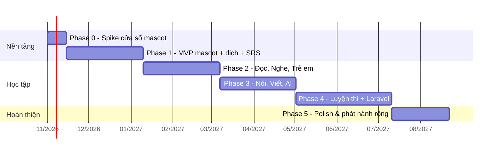

# 14 — Lộ trình phát triển

Thời gian ước tính cho **1 dev part-time (~15–20 giờ/tuần)**, mới làm desktop lần đầu. Có AI hỗ trợ code thì nhanh hơn. Mỗi phase kết thúc bằng một bản chạy được.

> Song song với code, **pipeline nội dung** ([09](09-content-pipeline.md)) phải chạy từ Phase 1 — nội dung là phần tốn thời gian nhất.

---

## Nhật ký tiến độ (cập nhật liên tục)

> Quy tắc: ghi `🚧 Đang làm` trước khi bắt đầu việc dài, xoá/đổi thành `[x]` ngay khi xong. Xem AGENTS.md.

- ✅ Xong (2026-10-20): **Làm lại sprite chi tiết gấp 4** (khung 96×96, 20 hoạt ảnh, phụ kiện lớp sau lưng, MascotBrain tự chơi) — lint/typecheck/310 test/build qua; **đã thử tay OK (2026-10-20) trong app** (xem mascot mới đi/nhảy/ngủ, đổi kích thước 1/2/3, đeo cánh/áo choàng, trang Thú cưng). Sheet ~16 MB cho cả bộ: cân nhắc nén/lược bớt khi đóng gói.
- ✅ Xong (2026-10-20): **Nhiều thú cưng (5 nhân vật) + trang Thú cưng/cây tiến hoá + màn hình tiến hoá + vật phẩm cửa hàng mới** — lint/typecheck/310 test/build qua; đã thử tay OK (2026-10-20) trong app (cần: mua & chọn nhân vật, xem mascot đổi hình, đeo cánh/áo choàng, màn tiến hoá khi lên level 2/10/25/50).
- ✅ Xong (2026-10-20): workflow phát hành `.github/workflows/release.yml` — chỉ chạy khi push nhánh `release`, chỉ phát hành khi version trong package.json chưa có tag (`scripts/release/check-version.mjs`), tự tạo release + tag (không push tag); **chưa chạy thử trên GitHub**. Cần làm một lần: tải content pack lên release `content-pack-1.2.0` (docs/15 §6) và tạo nhánh `release`.
- ✅ Xong (2026-10-21): phát hành `v1.0.0`, `v1.0.1` bằng workflow (release tự tạo tag); **đã thử cập nhật tự động v1.0.0 → v1.0.1 OK** và icon khay hệ thống đã hiện ở bản cài. Ký số: bỏ qua theo yêu cầu (bàn lại khi cần).
- ✅ Xong code (2026-10-21, **chưa thử tay**): **Chấm phát âm theo âm vị (wav2vec2, tải tuỳ chọn 355 MB)** — `duyentq/sonari-wav2vec2-phoneme-int8` rev f0652c4 (sha256 cd51f953…), worker `phonemeWorker` (onnxruntime-node + phonemizer/espeak), `PronunciationService.evaluate` + kênh `pron:evaluate`, so khớp âm vị `shared/phonemes.ts` (+ mẹo sửa tiếng Việt cho 26 âm), `SpeakPractice` chế độ âm vị; bảng chữ cái/âm (khối `sounds`) có nút 🎤 luyện từng ô, bài nói `speak` ưu tiên chấm âm vị khi đã tải model. Đã thử worker đã build với giọng Kokoro: sheep/right đúng, think → θ bị nghe thành /f/. Chưa: hoạt động chữ cái/âm của bé (kids) chưa dùng; ngưỡng điểm chưa hiệu chỉnh với giọng người Việt thật.
- ✅ Xong code (2026-10-21, **chưa thử tay**): **Phase 3 — bài nói**: ghi âm micro (`useRecorder`, quyền micro chỉ cho trang của app) → Whisper base.en offline (`SttService`/`WhisperEngine`, model ~80 MB tải khi đồng ý) → chấm theo từ + độ trôi chảy (`shared/speech.ts`) → dạng bài `speak` (speak_repeat/pronounce_word) + unit "Luyện nói" (5 bài); panel Cài đặt → Nhận dạng giọng nói. wav2vec2 chỉ là khung tải tuỳ chọn (`PronunciationService`, chưa có ONNX để tải, không có paywall). Cần thử tay: cấp quyền micro, tải model, nói thử, thấy điểm từng từ.
- ✅ Xong (2026-10-21): **việc nhỏ treo** — chỉ báo "đang tạo giọng đọc" ở mascot; câu thoại riêng 5 nhân vật + câu chung + nói bâng quơ (`mascot.chars.*`); gói âm thanh bài nghe tạo sẵn tải thêm (MP3 14,3 MB, release `listening-audio-1.0.0`, tải trong Cài đặt/trang Nghe, đã thử tải thật từ GitHub). Chưa thử tay trong app (nghe bài nghe với gói, mascot nói câu riêng).
- Trước đó: workflow phát hành xong, v1.0.1 đã phát hành & thử auto-update OK.

- ✅ Xong code (2026-10-21, **chưa thử tay**): **Sửa màn Ôn từ** — thứ tự ngẫu nhiên (mặc định mới `review.order = random`, xáo trong bể 150 thẻ đến hạn) + **ẩn từ vừa ôn** `review.hideMinutes` (mặc định 30 phút; ẩn theo từ, gồm mọi dạng thẻ và cả thẻ chấm "Quên"; chế độ trẻ em không ẩn) để thoát ra vào lại không phải làm lại từ đầu; thẻ điền từ có ô chữ (chữ đầu + số chữ), nghĩa của từ, nút "Gợi ý thêm 1 chữ" và "Nghe câu"; hình pixel minh hoạ khi từ có hình; bố cục căn giữa, chữ lớn hơn, nút "Không nhớ" rõ ràng. Cài đặt → Ôn từ có "Ngẫu nhiên" và "Ẩn từ vừa ôn".
- ✅ Xong code (2026-10-21, **chưa thử tay**): **Thẻ nhận diện tương tác** — trắc nghiệm nghĩa 4 lựa chọn (`review.choices`), nút 🎤 nói to, câu ngữ cảnh có từ tô đậm ở mặt trước (từ nhiều nghĩa), nghĩa mascot/màn ôn thống nhất (`formatMeanings`), dòng gợi ý phím tắt đổi theo trạng thái; thẻ điền từ chỉ hiện nghĩa khi từ có 1 nghĩa.

- ✅ Xong code (2026-10-21, **chưa thử tay**): **Biểu cảm/hành động riêng từng nhân vật** — 17 hoạt ảnh `quirk_*` (Bi 3, Webby 3, Draco 3, Robo 4, Kitsu 4) + chỉnh hoạt ảnh chung theo nhân vật (TWEAKS) + 5 kiểu mắt & 6 hiệu ứng mới; `sheet.json` riêng từng nhân vật; `MascotBrain` tự chọn quirk. **Vật phẩm cửa hàng**: +8 đồ ăn, +9 phụ kiện (tổng 20; xem docs/06). Chi tiết docs/05 §10.
- ✅ Xong code (2026-10-21, **chưa thử tay**): **Phản ứng tương tác riêng từng nhân vật** — 2 phản ứng bấm `click_*` mỗi nhân vật (10 hoạt ảnh) chọn ngẫu nhiên cùng happy/love; kéo/rơi/chạm đất/ăn chỉnh theo tính cách (`INTERACTION_TWEAKS`). Chi tiết docs/05 §10.

- ✅ Phát hành `v1.1.0` (2026-10-22): bài nói (Whisper + wav2vec2 tuỳ chọn), màn Ôn từ mới, 5 thú cưng có hành động/phản ứng riêng, thêm vật phẩm cửa hàng. Đã chạy lint/typecheck/test/build local trước khi đẩy; workflow GitHub tạo release + tag.

- ✅ Xong (2026-10-22): **mở rộng từ điển 24,6k → 43,6k từ** (nguồn wordfreq, docs/09 §10.3): đã duyệt hết nghĩa AI sinh (`validate --release` đạt), tải pack lên release `content-pack-1.3.0`, đổi `CONTENT_PACK_TAG`, phát hành app `v1.2.0`. **Còn dở:** sinh nghĩa Việt cho **26.862 từ** chưa có (`content:enrich vi`, theo đợt rồi duyệt).
- ✅ Xong code (2026-10-22, **chưa thử tay trong app**): **Tra từ gõ sai chính tả** — gợi ý "Có phải bạn muốn tìm…" (registation → registration) trong popup. (Mở rộng độ phủ từ điển đã làm ở pack 1.3.0 — dòng ngay trên.)
- ✅ Xong code (2026-10-22, **chưa thử tay trong app**): **Dịch câu/đoạn chuẩn hơn (offline)** — model tuỳ chọn mBART-50 chất lượng cao (~890 MB (848 MiB), Anh↔Việt một model), ưu tiên khi đã tải; nút tải trong popup + Cài đặt; dịch nhóm 2–3 câu, giới hạn 1200 ký tự; test dịch vụ (chọn engine, cache theo engine). Đã chạy worker đã build với model thật OK (2–8 s). Chi tiết docs/11 §2, decisions #27.
- 🚧 Đang làm (2026-10-23, **đã xong code các bước 1–4, chưa thử tay trong app thật; chưa commit**): **Dọn UI + lỗi vặt (tạm dừng thêm chức năng)** — thứ tự: (1) ✅ sửa thanh nhiệm vụ tụt sau khi đã xong (`MissionService.state`, có test); (2) căn thẻ Cửa hàng/Thú cưng (nút, mô tả, trạng thái "đã có"); (3) hệ design token hiện đại + `.btn/.card/.chip` dùng chung, thử trên Trang chủ/nav/Thú cưng/Cửa hàng rồi mới quét toàn app (docs/12 + decisions); (4) giao diện trẻ em; (5) ảnh thật thay pixel — **chưa làm — chỉ sau khi chọn nguồn + license và ghi vào docs/08, đưa danh sách ngắn cho chủ dự án duyệt**. Đã xong: bước 1 (nhiệm vụ), 2–3 (token + `ui.css` + Trang chủ/nav/Nhiệm vụ/Cửa hàng/Thú cưng/Thống kê, quét tự động các trang còn lại), 4 (kids: nút 3D mềm). Chi tiết docs/12 §1b, decisions #28. Đợt 2 (2026-10-23): bo góc đồng nhất toàn app, thay emoji bằng `UiIcon` (lucide), nút nghe/lưu thành `.btn--icon`, viết [docs/18-ui-rules.md](18-ui-rules.md) + `pnpm ui:audit` (0 lỗi). Kiểm tra: `pnpm lint && pnpm test` + chụp ảnh app trước/sau.
- ✅ Xong code (2026-10-23, **chưa thử tay trong app, chưa commit**): **ảnh thật cho 59/60 hình từ vựng của trẻ em** (Commons + Openverse, CC0/PD/CC BY, ưu tiên ảnh quen thuộc với trẻ Việt) — `scripts/images/kids-photos.mjs`, `KidPicture.vue`, ghi công ở Cài đặt (`PhotoCredits.vue`), docs/08 §8b. Shortlist ban đầu (lịch sử): Shortlist: (A) Wikimedia Commons ảnh chụp lọc CC0/PD (+CC-BY làm dự phòng), (B) Openverse (cùng loại license, phủ rộng hơn nhưng nhiễu), (C) minh hoạ phẳng Twemoji CC-BY 4.0 / OpenMoji CC-BY-SA 4.0 / Kenney CC0. Loại: Pixabay, Pexels, Unsplash (license riêng, không nêu rõ việc đóng gói vào app). Chờ chủ dự án chọn hướng rồi mới ghi vào docs/08 và làm pipeline.
- 🚧 Đang làm (2026-10-23): **Sprite thú cưng 288px làm gói tải thêm** (chủ dự án chọn 288px, bộ cài giữ 96px). **Xong code:** `SPRITE_SCALE`/`SPRITE_OUT` trong `scripts/sprites`, `SpritePackManager/Service` + kênh `sprites:*` + test, `PetSprite`/mascot dùng gói khi đã cài, panel Cài đặt "Thú cưng nét hơn", script `build-hires-pack.mjs`. **Đã sinh + đóng gói** (25 bộ, zip 57,2 MB, sha256 071e362d…; `packSpec.ts` đã điền; cài thử gói thật bằng `SpritePackManager` OK). **Còn:** đăng release `pet-sprites-hires-1.0.0` (chờ chủ dự án đồng ý) → thử tay trong app (tải gói, thấy mascot/trang Thú cưng nét hơn, gỡ gói quay lại 96px) → phát hành app. **Chưa làm:** huy hiệu (`badgeArt.ts`) và hình/vật phẩm pixel (`pictures.ts`) vẫn 32×32; chủ dự án cũng muốn nâng độ phân giải — làm sau khi duyệt mẫu. Chi tiết docs/05 §11, decisions #29.
- ✅ Phát hành `v1.2.2` (2026-10-22): pack **1.4.0** (thêm 1.877 nghĩa AI sinh đã duyệt; từ nay `draft` không vào pack), release `content-pack-1.4.0`, `CONTENT_PACK_TAG` đổi theo; `vi-review` duyệt theo `freqRank`. Số liệu ở docs/17.
- ✅ Sửa CI (2026-10-22): lần chạy release v1.2.2 đầu tiên lỗi test `chế độ trẻ em` (hook cài pack quá 30 s; cả bộ test chạy 485 s trên runner so với 66 s ở máy dev) → `vitest.config.ts` nới timeout lên 120 s khi `CI` được đặt; chạy lại workflow bằng push mới lên `release`.
- 🚧 Tạm dừng (2026-10-22, theo hạn mức phiên 5 giờ): **Sinh + duyệt nghĩa Việt cho từ ngoài top 10k bằng Claude CLI.** Trạng thái `vi-generated.json` (22.263 mục): 4.907 `approved` (3.030 cũ + 1.877 duyệt AI đợt này), 17.233 `draft`, 123 `rejected`; còn **7.629 từ chưa sinh**. **Tiếp tục:** (1) sinh nốt: `pnpm content:enrich vi --provider claude-cli --model sonnet --effort low --batch 40 --concurrency 3 [--limit N]` (idempotent; ~0,3% hạn mức Pro mỗi lô 40 từ); (2) duyệt (theo `freqRank` từ thấp lên cao, từ phổ biến trước — sửa 2026-10-22; 2.000 mục duyệt đợt đầu toàn là từ a/b vì lúc đó duyệt theo thứ tự chữ cái): `pnpm content:enrich vi-review --model sonnet --batch 25 --concurrency 3 [--limit N]` (~1,2% hạn mức / 100 từ với sonnet, ~2% với opus mặc định; sonnet sửa ~46% mục, opus ~16% — sonnet khắt khe hơn nhưng rẻ hơn chút, đã chọn sonnet theo yêu cầu); `by` = `claude-cli-review:<model>` (duyệt bằng AI, không phải người); (3) có thêm `approved` → `content:normalize merge level` → `content:validate --release` → tăng version pack trong `scripts/content/packs.ts` → `content:build` → tải lên release `content-pack-<ver>`, đổi `CONTENT_PACK_TAG`, tăng version app, phát hành → `content:stats` rồi cập nhật docs/17 §3 + docs/09 §10.3. (Pack 1.4.0 đã phát hành với phần `approved`; `draft` không vào pack nên `validate --release` đạt.) `missing-vi.json` nay gồm mọi từ (`level/apply.ts`). 
- ✅ Phát hành `v1.2.1` (2026-10-22): sửa popup dịch (câu dài không bị cắt ở 200 ký tự, có thông báo khi vượt 1.200 ký tự; trạng thái model dịch không còn báo sai), `pnpm stats` / `pnpm content:stats`, docs/17-metrics.md, công cụ `content:enrich vi-review`. **Không đổi content pack** (vẫn `content-pack-1.3.0`): 11.636 nghĩa AI sinh mới đang `draft`, chưa duyệt nên chưa đưa vào pack (quy tắc `validate --release`). Đã chạy lint/typecheck/358 test/build local trước khi đẩy.
- ✅ Xong (2026-10-22): **Rà lại docs + số liệu** — thêm [17-metrics.md](17-metrics.md) (bảng số liệu đo bằng lệnh) và lệnh `pnpm stats` / `pnpm content:stats`; sửa số cũ sai (bài học 34→43, mBART ~875→~890 MB, từ nhạy cảm, độ phủ 24,6k→43,6k, 26.862 từ chưa có nghĩa Việt, roadmap pack 1.3.0 đã phát hành); quy tắc "cập nhật số liệu" thêm vào AGENTS.md và docs/README. Lint/typecheck/358 test qua.
- ✅ Xong code (2026-10-22, chưa thử tay): **Sửa popup dịch** — (1) văn bản dài bị cắt ở 200 ký tự (`MAX_QUERY` trong `normalizeQuery`) → nâng lên 1200 (= `TRANSLATE_MAX_CHARS`), clipboard/selection chỉ chặn 20k ký tự; vượt 1200 thì cắt và popup hiện thông báo `translate.truncated` (`LookupResult.truncated`); (2) popup báo "chưa tải model" dù đã tải → làm mới `translate:status` trước mỗi lần dịch (`useTranslateModels.refresh`), tự dịch lại khi `canTranslate` chuyển true, khối tải chỉ hiện khi thật sự chưa dịch được; (3) sửa chuỗi `v-if/v-else-if` bị gợi ý nâng cấp chèn giữa. Kiểm tra: `pnpm lint && pnpm test`.

- ✅ Xong code (2026-10-22, **chưa thử tay**): **Bôi đen rồi Ctrl+Alt+T là dịch được** (không cần Ctrl+C): `system/selection.ts` gửi Ctrl+C giả lập, đọc chữ, khôi phục clipboard; bỏ qua terminal; có công tắc `translate.autoCopy`. Chi tiết docs/11 + docs/16.

## Phase 0 — Spike: cửa sổ mascot (≈ 2 tuần)

Mục tiêu: chứng minh các kỹ thuật khó nhất chạy được trên Windows.

- [x] Tạo project electron-vite + Vue + TS ([04](04-getting-started.md)), ghim Node/pnpm bằng Volta
- [x] Cửa sổ trong suốt, không khung, luôn trên cùng, không hiện taskbar, không cướp focus
- [x] Click xuyên qua vùng trong suốt, bắt được click trên nhân vật — đã thử tay OK (2026-10-18)
- [x] Kéo thả nhân vật; thả ra rơi xuống mép taskbar (có trọng lực); click → nhảy vui — đã thử tay OK (2026-10-18)
- [x] Animation sprite sheet (idle + walk + drag/fall/land/happy) bằng canvas, nhân vật tự đi qua lại — sprite tạm (`pnpm sprites:characters`)
- [x] Tray icon: Hiện/Ẩn, Đưa về góc, Thoát
- [x] Phím tắt toàn cục `Ctrl+Alt+T` bật/tắt popup trống cạnh con trỏ (Esc / click ra ngoài để đóng) — *đã code, cần thử tay*
- [x] Phát hiện app fullscreen → ẩn mascot (cùng màn hình với mascot; game DirectX độc quyền & chế độ trình chiếu ẩn ở mọi màn hình) — đã xác nhận thực tế với một game toàn màn hình
- [x] Build được installer `.exe` (`pnpm build:win`, ~112 MB) — [ ] cài thử trên máy khác
- [ ] Kiểm tra LibreSprite có xuất tag trong JSON không ([05](05-mascot-system.md#quy-trình-art))

**Đo CPU (bản dev, 2026-10-18):** đứng yên ~1–2% tổng các tiến trình Electron; đang đi bộ ~3–12%. Cần đo lại trên bản production và tối ưu thêm nếu vượt ngân sách ([03](03-architecture.md#8-hiệu-năng--ngân-sách-tài-nguyên)).

**DoD:** Cài trên một máy Windows sạch, mascot đi dạo trên taskbar, kéo thả được, không cản trở dùng máy, CPU idle < 2%.

## Phase 1 — MVP (≈ 8 tuần)

Mục tiêu: dùng được hằng ngày: thú cưng + dịch nhanh + từ vựng.

**Nền tảng**
- [x] Cấu trúc thư mục theo [03](03-architecture.md), `ipc-contract` (zod), container, event bus, Clock, AppError
- [x] SQLite `user.db` + Drizzle + migration tự chạy (cả bản đóng gói)
- [x] Vitest: 19 test cho logic thú cưng/XP, i18n, services (SQLite in-memory + FakeClock)
- [x] Profile: tự tạo profile mặc định + thú cưng + túi đồ khởi đầu; màn hình chào lần đầu (tên, mục tiêu/độ tuổi, tên thú cưng, trình độ); tạo/chuyển hồ sơ trong Cài đặt; hồ sơ trẻ em (track mầm non/tiểu học) bật `isChild` — chưa thử tay
- [x] Cài đặt (trang trong cửa sổ Học tập + menu chuột phải): ngôn ngữ, kích thước mascot, khởi động cùng Windows, trình độ, mục tiêu ôn/ngày, tần suất nhắc, chế độ yên lặng — **còn** đổi phím tắt
- [x] i18n vi/en dùng chung main + renderer, design tokens, `PxPanel`, `PxBar`
- [x] Cài content pack (`core-dictionary`) — `ContentPackService`: tự cài gói đi kèm lúc khởi động (giải nén theo luồng, kiểm tra sha256, nâng cấp khi có bản mới)

**Mascot**
- [x] State machine: idle, walk, drag, fall, land, happy, eat, **sleep** (người dùng vắng ≥ 10 phút hoặc năng lượng ≤ 20 → ngủ, hồi 12 năng lượng/giờ; thức dậy khi quay lại) — chưa thử tay
- [x] Bong bóng thoại + hàng đợi ưu tiên, lời chào theo giờ, thẻ chỉ số khi rê chuột, vuốt ve (click)
- [x] Menu chuột phải (Cho ăn, Ẩn 30 phút/1 giờ, Kích thước, Ngôn ngữ, Khởi động cùng Windows, Thoát)
- [x] Chỉ số nuôi + `PetDecayJob` + nhắc đói + cho ăn + túi đồ
- [x] XP, xu, level thú cưng: sổ cái `xp_events` + `XpService`; nguồn XP: lưu từ (+1), ôn thẻ (+2), nhiệm vụ ngày
- [x] Chế độ yên lặng: fullscreen, hẹn giờ ẩn, **app họp** (Zoom/Teams/Webex/Skype, tab Meet/Teams trên trình duyệt), **giờ không làm phiền** (khung giờ tuỳ chọn, vắt qua nửa đêm được)
- [x] Icon app dạng pixel: đầu mèo "AI" (`pnpm sprites:icon` → `build/icon.ico|png`, `resources/icon.png`)

**Dịch & từ điển**
- [x] Popup dịch: copy + `Ctrl+Alt+T` → tra từ điển offline (từ gốc, dạng đã chia, tra ngược tiếng Việt), ô tìm kiếm, ví dụ, nhãn level, nhãn "AI" cho nghĩa chưa duyệt — đã thử tay OK
- [x] TTS hệ thống (US/UK) qua `speechSynthesis`
- [x] Giọng đọc tự nhiên offline Kokoro-82M (tuỳ chọn trong Cài đặt): tải model ~92 MB xác minh sha256, 8 giọng Mỹ/Anh, bộ nhớ đệm + tạo trước cho bài học, tự rơi về giọng Windows khi lỗi — đã kiểm tra worker trong Electron (dev + đóng gói); có khối "Giấy phép & ghi công" trong Cài đặt; chưa thử tay giao diện. **Còn**: giải quyết rủi ro GPL của eSpeak-NG trước khi thương mại, sinh sẵn audio lúc build
- [x] Dịch câu: opus-mt en→vi chạy offline trong utilityProcess; popup hỏi rồi tải model (~107 MB, xác minh sha256) khi copy câu — đã kiểm tra worker trong Electron (dev + layout đóng gói) và thử tay popup OK (2026-10-19). **Đã thêm (2026-10-19):** dịch Việt→Anh (`Xenova/opus-mt-vi-en`, ~107 MB, tự nhận chiều theo dấu tiếng Việt, mỗi chiều một model riêng) và khối "Dịch câu offline" trong Cài đặt (tải/huỷ/xoá từng model); chưa thử tay giao diện. **Còn**: LLM API như phương án mở rộng
- [x] Lưu từ → sổ từ (`saved_words`) + tạo thẻ SRS FSRS (`srs_cards`) kèm câu ngữ cảnh, +1 XP cho từ mới

**Học**
- [x] Bài học nền tảng: 34 bài / 5 chương lúc đầu (chữ cái & phát âm, mẫu câu 1–2, các thì, giao tiếp hằng ngày); hiện **43 bài / 7 chương** (thêm hình minh hoạ, luyện nói — [17 §2](17-metrics.md)) tự soạn + trang "Bài học" (đọc bài, bài tập 5 dạng, thưởng XP lần đầu đạt, tiến độ) — chưa thử tay; **cần giáo viên người thật rà soát nội dung** ([07 §3b](07-learning-modules.md))
- [x] Thẻ ôn nhiều dạng (2026-10-19): thẻ gốc `en_vi` (lật thẻ) + 3 thẻ phụ tự tạo khi từ vào ôn dài hạn — `vi_en` (thấy nghĩa, gõ từ), `audio_en` (nghe, gõ), `cloze` (điền từ vào câu ngữ cảnh/ví dụ), đến hạn từ ngày hôm sau; gõ đáp án có chấm gần đúng và gợi ý mức chấm; tự đọc từ; hoàn tác lần chấm (Ctrl+Z/U); quản lý thẻ trong Sổ từ (lọc theo trạng thái/hay quên, sắp xếp, tạm dừng, đặt lại, xoá); lưu các từ khó của bài đọc và mẫu câu Phrasebook vào sổ thẻ; cài đặt hạn mức từ mới/ngày, thứ tự thẻ, bật/tắt từng hướng, tạo thẻ bù — chưa thử tay
- [x] SRS với ts-fsrs: `SrsService` (lịch FSRS, nhật ký `srs_reviews`, +2 XP/lần ôn) + phiên ôn đầy đủ trong cửa sổ Học tập (lật thẻ → chấm Quên/Khó/Được/Dễ, phím Space/1–4, hiện khoảng ôn lại dự kiến) — chưa thử tay
- [x] Micro-learning: quiz thẻ đến hạn (4 đáp án, chấm ở main: đúng nhanh → Được, đúng chậm → Khó, sai → Quên) + "Từ của khoảnh khắc" đúng trình độ khi không có thẻ đến hạn; tự nhắc mỗi 15/25/45 phút hoặc tắt, "🧠 Ôn từ ngay" trong menu chuột phải — đã thử tay OK (2026-10-19)
- [x] Trình độ: bài kiểm tra đầu vào từ vựng thích nghi (20 câu, `PlacementService`) + chọn tay (menu chuột phải, Cài đặt, màn hình chào) → `learning.level`
- [x] Cửa sổ Học tập: thanh bên (thú cưng, level, XP), trang chủ (thẻ đến hạn, streak, ôn hôm nay, tổng thẻ, **nhiệm vụ ngày**), phiên ôn, sổ từ, kiểm tra trình độ, cài đặt, màn hình chào; mở từ menu mascot/tray — **còn** lộ trình theo bài
- [x] Luyện tập: 5 dạng bài (điền từ, sắp xếp câu, nghe chọn nghĩa, nghe chép, ghép cặp) sinh từ câu Tatoeba + từ vựng đúng trình độ, phiên 10 bài, thưởng XP (tối đa 5 phiên/ngày) — đã thử tay OK (2026-10-19)
- [x] Placement nhiều kỹ năng: 20 câu xen kẽ từ vựng (10) / ngữ pháp (4) / đọc hiểu (3) / nghe (3), mỗi kỹ năng một "bậc thang" độ khó riêng, lưu trình độ theo kỹ năng (`learning.levelVocab/Grammar/Reading/Listening`) và trình độ chung; ngân hàng tự soạn ở `content/curated/placement` (33 câu ngữ pháp, 12 đọc hiểu, 15 nghe); Elo theo kỹ năng khởi tạo từ kết quả này — chưa thử tay

**Nội dung (song song)**
- [x] Pipeline: fetch + normalize Tatoeba, NGSL, CEFR-J, kaikki (Wiktionary), CMUdict
- [x] Build `core-dictionary` + `decks` theo level (v1.0.0 — [09 §10](09-content-pipeline.md#10-đã-làm-pipeline-core-dictionary-v1))
- [x] Công cụ sinh nghĩa tiếng Việt ngắn bằng LLM cho từ phổ biến còn thiếu (`pnpm content:enrich vi` → `curated/vocab/vi-generated.json`, [09 §10.5](09-content-pipeline.md#105-nghĩa-tiếng-việt-do-llm-sinh-contentenrich-vi)) — mẫu 50 từ
- [x] Sinh đủ từ còn lại: 2.693/2.762 từ (sinh trong phiên Claude, `claude-opus-5-5`, 2026-10-19, không cần API key) → gói `core-dictionary` 1.1.0
- [x] Duyệt nghĩa AI sinh tới `approved`: cả 2.442 từ `approved` (`review.by = Minh`; 303 từ cuối duyệt qua `vocab-303-review.csv`, 63 từ sửa nghĩa) → `content:validate --release` đạt
- [x] Đủ nghĩa tiếng Việt cho toàn bộ top 10k (2.442 từ nhờ nghĩa AI sinh; `fu` bị loại). ngoài top 10k vẫn chưa có nghĩa tiếng Việt (9.714 từ ở bản 1.2.0; **26.862 từ ở bản 1.3.0**)
- [x] 69 mục độ tin cậy thấp đã xử lý: 68 loại khỏi pack (`curated/vocab/excluded-words.json`), `jewelry` sửa ở `merge`
- [x] Pipeline `merge`: không lập mục riêng cho dạng biến tố chỉ mang nghĩa hiếm (came, ran, apples… — 1.885 mục) → gói `core-dictionary` 1.2.0 (24.616 từ)
- [x] Lọc từ nhạy cảm ở profile trẻ em: `curated/vocab/sensitive-words.json` (104 từ lúc đầu, nay 106; pack 1.3.0 gắn cờ tổng 569 từ gồm cả từ tự nhận diện) → cột `words.sensitive`; ẩn khi tra từ, hỏi ôn, từ của khoảnh khắc — **còn** màn hình tạo profile trẻ em để bật `isChild`, lọc câu ví dụ có từ nhạy cảm

**DoD:** Dùng liên tục 1 tuần không lỗi nghiêm trọng; dịch từ < 1s; học & ôn từ vựng hằng ngày được; thú cưng phản ứng với việc học.

## Phase 2 — Đọc, Nghe, Trẻ em (≈ 8 tuần)

- [x] Hệ thống dạng bài tập (registry): logic từng dạng (`mcq`, `gap`, `order`, `match`=tap_pairs, `listen`, `tf`, `picture`) nằm ở `exercises/lessonExercises.ts` (khởi tạo, đủ để chấm, chấm đúng/sai, lời giải — có test), phần hiển thị dùng thành phần chung `ChoiceList`/`WordOrderBoard`/`MatchBoard`/`AudioPrompt` cho cả bài học lẫn luyện tập; thêm dạng mới = một mục trong registry + schema. **Còn**: `speak_repeat` có chấm giọng (chờ Whisper, Phase 3)
- [x] Course → Unit → Lesson: 3 khoá (Nền tảng A1, Giao tiếp A2, Tiến tới B1) ghép bài học/ngữ pháp/đọc/nghe thành lộ trình có thứ tự (`CourseService`, trang "Lộ trình"), tiến độ dùng chung `lesson_progress`; rating Elo theo 4 kỹ năng (từ vựng, ngữ pháp, đọc, nghe) cập nhật sau mỗi bài/câu (`ProgressService`, `shared/progress.ts`) — đã thử tay OK (2026-10-20)
- [x] Trình đọc tương tác (bấm từ tra + lưu kèm câu ngữ cảnh, gạch chân từ trên level, TTS theo câu/cả bài, song ngữ từng đoạn) + bài đọc A1–B1 có câu hỏi đọc hiểu (12 bài lúc đầu, nay 50 bài) (`ReadingPassage.vue`, `content/curated/readings`) — đã thử tay OK (2026-10-20). **Còn**: nhiều bài đọc hơn (mục tiêu 50), từ mới của bài vào SRS tự động
- [x] Trình nghe: phát liên tục từng câu bằng TTS (người nói A/B giọng Mỹ/Anh khác nhau), tốc độ 0.6×/0.8×/1×, nghe lại câu, lặp A–B, ẩn/hiện lời thoại và bản dịch, tự chép lời có chấm; 30 bài nghe A1–B1 (`ListeningPlayer.vue`, `content/curated/listening`); phần nghe trong bài kiểm tra đầu vào — đã thử tay OK (2026-10-20). **Còn**: audio thật (sinh sẵn lúc build) thay cho TTS khi cần chất lượng cao
- [x] Ngữ pháp: trang "Ngữ pháp" với 14 điểm (động từ khuyết thiếu, V-ing/to V, used to, bị động, cụm động từ, điều kiện 0/1/2, mệnh đề quan hệ, tường thuật, câu hỏi đuôi, đếm được/không đếm được, trạng từ tần suất, sở hữu, too/enough) + bài tập — chưa thử tay. **Còn**: đủ 40 điểm
- [x] Phrasebook: 12 nhóm tình huống, ~100 mẫu câu có nghe (TTS), nghĩa Việt, tìm kiếm, bấm để sao chép — chưa thử tay. **Còn**: lưu mẫu câu vào SRS
- [x] Track trẻ em (2026-10-19/20, đã thử tay OK (2026-10-20)): giao diện riêng cho hồ sơ `isChild` (ô to có hình pixel + đọc to, không cần biết đọc), thẻ "nghe → chạm hình" (SRS hướng `audio_picture`, 60 hình pixel 64×64 tự vẽ), 25 hoạt động: chữ cái A–Z, âm (phonics), ghép âm CVC, từ nhìn là nhớ, sách tranh (4 truyện), tập viết chữ (tô theo chữ mẫu, chấm độ phủ), nói theo (tự xác nhận); album sticker, quà đồ ăn cho thú cưng, khu vực phụ huynh (PIN 4 số, quên PIN → giải phép nhân, giới hạn phút mỗi ngày, gia hạn, báo cáo 7 ngày). **Còn**: chấm giọng nói thật (chờ Whisper), âm đơn lẻ của TTS còn thô (cần audio thật), thêm sách tranh
- [x] Cửa hàng: mua đồ ăn + phụ kiện (nơ, kính, khăn, mũ chóp Lv5, vương miện Lv10) bằng xu, đeo/tháo, mascot vẽ lớp phụ kiện (`ShopService`, `acc-*.png` sinh từ `make-placeholder.mjs`) — chưa thử tay
- [x] Thành tựu, checkpoint lên cấp, tiến hoá thú cưng (đã thử tay OK (2026-10-20)): 32 huy hiệu pixel art có thưởng XP và mascot báo; bài kiểm tra lên cấp 10 câu (đạt ≥ 80% lên một bậc, lần đầu qua bậc có thưởng; Thống kê gợi ý khi Elo của kỹ năng vượt level hiện tại); thú cưng tiến hoá 5 giai đoạn egg → baby → teen → adult → legend (sheet + phụ kiện từng giai đoạn sinh bằng `pnpm sprites:placeholder`, mascot đổi sheet và ăn mừng khi lên mốc level 2/10/25/50)
- [x] Thống kê cơ bản: trang "Thống kê" (`StatsService`) — streak hiện tại/dài nhất, lịch hoạt động 16 tuần, lượt ôn 14 ngày, tỉ lệ nhớ, so tuần này với tuần trước, thẻ theo trạng thái FSRS, từ trong sổ theo level; tính từ `srs_reviews` + sổ XP, không có bảng riêng — chưa thử tay
- [x] Thống kê nâng cao: từ hay quên nhất, độ chính xác 30 ngày theo dạng bài và hướng thẻ (bảng `exercise_stats`), rating Elo theo kỹ năng, thời gian học theo ngày/tuần/tổng (bảng `usage_days`) — đã thử tay OK (2026-10-20)
- [x] Nội dung: đủ 30/30 bài nghe, 50/50 bài đọc, 40/40 điểm ngữ pháp, 3 khoá học (yêu cầu 2)
- [x] Auto-update: `electron-updater` qua GitHub Releases (`UpdateManager`): kiểm tra nền sau 45 giây và mỗi 6 giờ (tắt được), chỉ tải/cài khi người dùng đồng ý, UI trong Cài đặt; `user.db` được sao lưu tự động trước khi migrate (giữ 3 bản). **Còn**: phát hành bản đầu (`GH_TOKEN=... pnpm release:win`), ký số code signing, kiểm thử cập nhật thật giữa hai bản

**DoD:** Một người A1–B1 và một bé 6–8 tuổi đều có lộ trình học ≥ 4 tuần không hết bài.

## Phase 3 — Nói, Viết, AI (≈ 8 tuần)

- [x] Ghi âm + Whisper local (utilityProcess) + `ModelManager` (Whisper base.en q8, chưa thử tay)
- [x] `speak` (= speak_repeat/pronounce_word, chấm cấp 1–2: từ + độ trôi chảy) + 5 bài "Luyện nói" gồm shadowing (chưa thử tay). Còn: hoạt động nói theo của bé (kids) vẫn tự đánh giá; cấp 3 âm vị (wav2vec2) chờ có ONNX
- [ ] Cấu hình AI (provider, key mã hoá, giới hạn chi phí)
- [ ] LLM: giải thích ngữ pháp/câu, dịch nâng cao, `writing_feedback`, `speaking_feedback`, roleplay (người lớn)
- [ ] LanguageTool cho Writing
- [ ] Dạng bài `write_free`, `translate_sentence`, `transform`, `speak_answer`, `roleplay`
- [ ] Nhật ký tiếng Anh (💡) nếu kịp
- [ ] OCR vùng màn hình
- [ ] Theo dõi clipboard (opt-in)

**DoD:** Luyện nói/viết được hoàn toàn offline ở mức cơ bản; có AI thì nhận feedback chi tiết theo rubric.

## Phase 4 — Luyện thi + Backend Laravel (≈ 10 tuần)

- [ ] TOEIC: 7 Part, mini test, full test, ước lượng điểm
- [ ] IELTS: Reading/Listening dạng bài đầy đủ, Writing Task 1/2, Speaking Part 1–3 chấm AI
- [ ] Video library (YouTube embed + checkpoint)
- [ ] Track B2–C2 nội dung
- [ ] **Laravel**: API Sanctum, Content Studio (Filament) soạn/duyệt/sinh nội dung bằng AI, xuất pack, kho pack tải về
- [ ] Đồng bộ tiến độ (tuỳ chọn đăng nhập)

**DoD:** Người luyện TOEIC/IELTS có ≥ 5 đề mini + ngân hàng câu theo Part; pack mới phát hành qua backend mà không cần cập nhật app.

## Phase 5 — Polish & phát hành rộng (≈ 6 tuần)

- [ ] Nhiều nhân vật, mini-game
- [ ] Chấm phát âm cấp 3 (âm vị)
- [ ] Tối ưu hiệu năng, chế độ pin yếu
- [ ] Ký số code signing, trang giới thiệu, hướng dẫn sử dụng
- [ ] Thu thập phản hồi (form/issue, không tracking ẩn)
- [ ] Bản macOS (tuỳ nhu cầu)

---

## Rủi ro chính & cách giảm

| Rủi ro | Mức | Giảm thiểu |
|---|---|---|
| Thiếu nội dung chất lượng | Cao | Bắt đầu pipeline sớm; dùng AI sinh + duyệt; ưu tiên rule-based từ dữ liệu mở |
| Vấn đề license nội dung | Cao | Chính sách ở [08](08-content-sources.md); mọi bản ghi có `source.license`; tách pack share-alike |
| Cửa sổ trong suốt lỗi trên một số máy/GPU | Trung bình | Spike Phase 0 trên nhiều máy; tuỳ chọn tắt hardware acceleration |
| Model AI local nặng, chậm trên máy yếu | Trung bình | Model nhỏ lượng tử hoá; tải theo nhu cầu; fallback online |
| Mascot gây phiền → người dùng tắt | Cao | Chế độ yên lặng thông minh, tần suất mặc định thấp, dễ chỉnh |
| Phạm vi quá lớn cho 1 người | Cao | Bám MVP, cắt tính năng 💡, mỗi phase phải ra bản dùng được |
| Antivirus cảnh báo app chưa ký | Trung bình | Code signing (Phase 5); không dùng kỹ thuật hook bàn phím |
